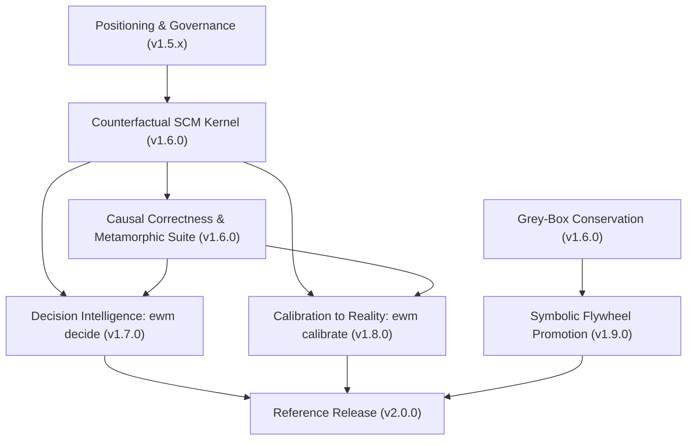

# EWM Engine — Transformative Architecture & Scientific Frontier Roadmap (v1.6 → v2.0)

> Architectural specification mapping transformative capabilities across causal structural models, decision intelligence, certified calibration, and neuro-symbolic grey-box dynamics onto the engine's declared milestone frontier.
> Anchored to the master release plan: `v1.5.0` (Shipped) · `v1.6.0` (Active: Learned Dynamics & Causal Epistemics) · `v1.7.0` (Decision Intelligence) · `v1.8.0` (Calibration to Reality) · `v1.9.0` (Neuro-Symbolic Maturation) · `v2.0.0` (Reference Architecture & Standard).

---

## 1. Maturity Framework

Capabilities in EWM Engine advance through strictly governed maturity tiers:
- **Stable**: Frozen public contract (`1.x`), protected by backward-compatibility guarantees, contract verification gates, and formal deprecation lifecycles.
- **Beta Adapter / Beta**: Production-ready, tested, time-bounded, and resource-bounded ecosystem components.
- **Experimental**: Frontier research modules under `ewm_engine.experimental.*`; subject to design evolution across minor versions.
- **Research**: Scientific measurement instruments, benchmark families, and theoretical formulations without production claims.

Every new capability enters at **Experimental** (isolated behind extras), advances to **Beta** upon completing comprehensive test suites, Architecture Decision Records (ADRs), and reproducible artifacts, and reaches **Stable** at `v2.0.0` only when proven bit-reproducible, honest-by-construction, and specification-stable.

---

## 2. Core Architectural Principles

1. **Explicit Separation of Known vs. Learned:** The engine preserves domain-specific physical invariants, capacity limits, and conservation laws by construction (via algebraic nullspace projection), while isolating learned probabilistic residuals.
2. **Native Structural Causal Modeling:** SCM representation with addressable exogenous noise trees enables true Pearlian counterfactual rollouts (Abduction-Action-Prediction with coupled noise) supported by the theoretical foundations of Richens & Everitt (ICLR 2024).
3. **Honest Epistemic Guardrails:** Capabilities land with built-in refusal and abstention paths (e.g., refusing unidentifiable causal claims under unobserved confounding, flagging under-coverage in calibration).
4. **Reproducible Empirical Evidence:** Every capability is verified via deterministic test harnesses and committed random seeds that regenerate headline results without drift.

---

## 3. Release Sequencing (Milestones at a Glance)

| Milestone | Subsystem Theme | Key Capabilities & Modules | Stability Tier |
| :--- | :--- | :--- | :--- |
| **v1.5.x** | Positioning & Narrative | Mechanism-first documentation, proof hero, executive use cases, governance compliance mapping | Docs / Stable |
| **v1.6.0** | Causal Epistemics & Learned Dynamics | Counterfactual SCM kernel, grey-box conservation layers, causal-correctness & metamorphic test suite | Beta |
| **v1.7.0** | Decision Intelligence | `ewm decide`: PRIM scenario discovery, minimax regret ranking, Expected Free Energy scoring | Beta |
| **v1.8.0** | Calibration to Reality | `ewm calibrate`: Simulation-based inference (SBI), TARP certified coverage, empirical validation packs | Beta |
| **v1.9.0** | Neuro-Symbolic Flywheel | Symbolic-regression term promotion (SINDy/PySR), end-to-end epistemic abstention, complete handbook | Beta |
| **v2.0.0** | Reference Architecture | Stable transformative kernel, CI-reproducible results gallery, arXiv companion paper, Relational GNNs & WSL | Stable + Beta |

---

## 4. Milestone Specifications

### v1.5.x — Positioning & Enterprise Governance
- **Positioning & Identity:** Mechanism-first documentation, clear disambiguation from video/pixel generation models, CI-generated proof hero, curated taxonomy, and competitive landscape analysis (`docs/positioning/landscape.md`).
- **Executive Governance:** Lineage documentation, decision-grade guarantees, C-suite use-case gallery, maturity model, and regulatory compliance mapping for NIST AI RMF and the EU AI Act (`docs/governance/compliance-mapping.md`).
- **Handbook Scaffold:** Question-organized practitioner guide (`docs/handbook/`) including the flagship "When to Refuse a Claim" guide.

### v1.6.0 — Causal Epistemics & Learned Dynamics
- **Counterfactual SCM Kernel:** Typed graph promoted to a native Structural Causal Model with addressable exogenous noise; `world.counterfactual()` implementing Pearl's Abduction-Action-Prediction with coupled noise; non-unique abduction distribution handling; backdoor/frontdoor identifiability gating (FEAT-008, ADR-040).
- **Grey-Box Dynamics & Conservation:** Residual-only learned dynamics interface (`DynamicsModel` with zero residual ≡ symbolic kernel, fingerprint-identical) paired with an architectural nullspace projection layer guaranteeing zero conservation violations by construction (FEAT-010, ADR-042).
- **Causal-Correctness & Metamorphic Suite:** Intervention-descendant selectivity gates, label-free metamorphic test cards (MR-cards), mutation adequacy testing, and first-class epistemic abstention (FEAT-012, ADR-044).
- **Verification Metrics:** Empirical verification metrics (rollout compounding error, CRPS, PIT/ECE calibration) and E-value sensitivity diagnostics.

### v1.7.0 — Decision Intelligence (`ewm decide`)
- **Scenario Discovery & Vulnerability Identification:** Patient Rule Induction Method (PRIM) bump-hunting and Classification and Regression Trees (CART) for vulnerability subspace discovery over Monte Carlo ensembles (FEAT-009, ADR-041).
- **Multi-Metric Decision Evaluation:** Comparative ranking across Minimax Regret, CVaR regret, and Satisficing criteria, with explicit refusal to declare a false winner when metrics conflict.
- **Active Inference Action Scoring:** Expected Free Energy (EFE) balancing epistemic information-seeking value with pragmatic goal-seeking value.

### v1.8.0 — Calibration to Reality (`ewm calibrate`)
- **Simulation-Based Inference (SBI):** Parameter inference engine wrapping the simulator as an explicit forward likelihood-free generative model (FEAT-011, ADR-043).
- **Certified Coverage Verification:** Mandatory Tests of Accuracy of Recovery of Posterior (TARP) and Simulation-Based Calibration (SBC) coverage checks with automated refusal upon under-coverage.
- **Real-Data Validation Packs:** Reference validation packs (SEIR epidemic dynamics, Beer Distribution Game bullwhip amplification, WORLD3 carrying capacity) serving as empirical calibration baselines.

### v1.9.0 — Neuro-Symbolic Maturation & Flywheel
- **Symbolic Term Promotion Flywheel:** Automated equation discovery and residual extraction via sparse regression (SINDy/PySR) with human-in-the-loop promotion into explicit declarative rules (FEAT-010).
- **End-to-End Epistemic Abstention:** Integration of out-of-competence signaling across decision-making and parameter calibration pipelines.
- **Comprehensive Documentation:** Full Diátaxis coverage across all capabilities, browser-based explorable explanations, and interactive tutorials.

### v2.0.0 — Reference Architecture & Standard
- **Core Stability Graduation:** Graduation of the counterfactual SCM kernel and grey-box conservation layers to **Stable** under SemVer compatibility guarantees.
- **Scientific Results Gallery & Paper:** CI-reproducible results gallery with cryptographic SHA-256 state fingerprints, companion methods/benchmark arXiv paper audited against the NeurIPS Datasets & Benchmarks checklist, and public benchmark harnesses.
- **Relational GNNs & World Specification Language:** Heterogeneous relational graph states, Graph Neural Network dynamics adapters, declarative World Specification Language (WSL), and World Model Interchange Format (WMIF).

---

## 5. Architectural Dependency Graph

---

## 6. Architectural Risk Management & Mitigation

| Potential Risk | Technical Mitigation Strategy |
| :--- | :--- |
| **Scope Expansion & Runtime Footprint** | All learned dynamics and calibration routines reside in optional extras; core remains dependency-light (`pydantic`, `numpy`, `pyyaml`). |
| **Unwarranted Epistemic Certainty** | Every capability is paired with explicit refusal paths (e.g., unidentifiable causal claims, under-covered calibration posteriors). |
| **Numerical & PRNG Drift** | Hierarchical `SeedSequence` trees isolate branch entropy; bit-for-bit equivalence is verified against pure-Python baselines in CI. |
| **Third-Party Dependency Drift** | Heavy numerical libraries are isolated behind strict protocol interfaces with fallback stubs. |

---

## 7. Master Roadmap Synchronization

This roadmap refines the repository's declared **v1.6.0 "Learned Dynamics & Causal Epistemics"** and subsequent milestones:
> The engine provides a bit-reproducible counterfactual SCM kernel (grounded in Richens & Everitt's theorem that robust agents must learn causal world models), a grey-box architecture that enforces enterprise conservation laws by construction and whitens itself over time, and a causal-correctness + metamorphic test suite that scores the engine on interventional correctness and epistemic abstention. It advances through decision intelligence (`v1.7`, `ewm decide`: scenario discovery and robust regret ranking) and empirical calibration (`v1.8`, `ewm calibrate`: simulation-based inference with certified coverage), consolidates the neuro-symbolic flywheel (`v1.9`), and culminates in a **v2.0 reference release** with a reproducible results gallery and companion arXiv methods paper.
