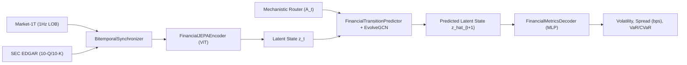
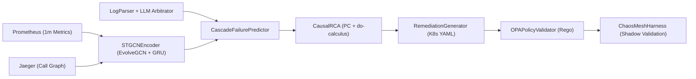

# Enterprise World Model Engine — Technical Architecture

**Author:** Vinícius Caridá  
**License:** Apache-2.0

---

## 1. Architectural Thesis: State-Transition Simulation over Autoregressive Prediction

Enterprise decision systems operate in non-stationary, interconnected environments where actions trigger multi-hop cascades across supply chains, financial balance sheets, and distributed microservice topologies. Rather than relying solely on observational next-token or single-step correlation $P(Y \mid X)$, `ewm-engine` formulates enterprise dynamics as an action-conditioned state-transition system:

$$S_{t+1} = F\bigl(S_t, A_t, \mathcal{G}_t\bigr), \quad \text{subject to} \quad \mathcal{V}_{\text{pre}}(S_t, A_t) = \text{True}, \quad \mathcal{V}_{\text{post}}(S_{t+1}) = \text{True}$$

where:
- $S_t$ is the bitemporally synchronized state representation at event time $t_e$ and knowledge time $t_k$ ($t_e \le t_k$),
- $A_t$ is a structured `CausalInterventionVector` or operational control action,
- $\mathcal{G}_t = (\mathcal{V}_t, \mathcal{E}_t, W_t)$ is the time-varying dependency graph maintained in the `ContinuousGraphRegistry`.

---

## 2. Shared Foundational Layers

### 2.1 Mechanistic Router (`src/ewm_engine/routing/`)

Enterprise state transitions fuse high-frequency quantitative telemetry (1Hz limit order books, pod CPU/memory metrics) with unstructured qualitative events (SEC 8-K filings, fatal stack traces). The **Mechanistic Router** orchestrates compute across three tiers under a `<100ms` p95 gateway latency budget:

1. **Tier 1 — Deterministic Rule Engine (`DeterministicRuleEngine`):** Evaluates quantitative surprises ($|\text{value} - \text{consensus}| / |\text{consensus}| < 0.005$) and minor deployment checks in `<1ms` without invoking neural inference.
2. **Tier 2 — Semantic Vector Router (`SemanticVectorRouter`):** Encodes qualitative text into dense vector embeddings (`BAAI/bge-large-en-v1.5`), classifies routine operational/market patterns via cosine similarity in `<15ms`, and monitors representation health via **RankMe** ($\exp(-\sum_k p_k \log p_k)$).
3. **Tier 3 — Frontier LLM Arbitrator (`FrontierLLMArbitrator`):** Invoked exclusively for novel, ambiguous, or multi-hop qualitative shocks. Extracts a schema-validated `CausalInterventionVector` (`primary_target_entities`, `directional_sentiment`, `magnitude`, `contagion_pathways`, `confidence`).

### 2.2 Continuous-Time Temporal Graph Neural Networks (`src/ewm_engine/graph/`)

Static graph databases incur $O(N^2)$ adjacency rebuild overhead on high-frequency edge updates. The `graph` subsystem provides:

- **`ContinuousGraphRegistry`:** In-memory topology registry supporting $O(1)$ node/edge additions and removals (`>10,000` edge updates/sec) and bounded snapshot materialization.
- **`EvolveGCN` (`EvolveGCNLayer`, `GCNConv`):** Evolves Graph Convolutional Network weight matrices $W_t^{(l)}$ across time via recurrent `GRUCell` or `LSTMCell` units:
  $$W_t^{(l)} = \text{RNN}\bigl(W_{t-1}^{(l)}, H_t^{(l)}\bigr), \qquad H_t^{(l+1)} = \sigma\bigl(\hat{A}_t H_t^{(l)} W_t^{(l)}\bigr)$$
  handling node additions, node removals, and shifting edge weights without parameter re-initialization.

---

## 3. Financial World Model Vertical (`src/ewm_engine/financial/`)

1. **Bitemporal Data Pipelines (`financial/data/`):**
   - `Market1TLoader`: Ingests partitioned 1Hz limit order book Parquet files, computes bid-ask spread in basis points (`spread_bps`), and aligns asynchronous ticks to a uniform 1Hz grid.
   - `EDGARLoader` & `BitemporalSynchronizer`: Extracts 6 quarterly accounting fundamentals (`revenue`, `net_income`, `total_assets`, `total_liabilities`, `free_cash_flow`, `debt_to_equity`) and performs point-in-time backward as-of joins on `knowledge_time`, guaranteeing zero look-ahead leakage.
2. **JEPA Representation & VICReg/SIGReg Regularization (`financial/models/`):**
   - `FinancialJEPAEncoder` & `FinancialJEPAPair`: Encodes multi-asset microstructure + fundamental tensors into latent states $z_t$ with an online context encoder and exponential moving average (EMA) target encoder.
   - `VICRegLoss` & `sigreg_loss`: Enforces invariance, per-dimension variance ($\ge \gamma$), and off-diagonal covariance decorrelation to prevent dimensional collapse.
3. **Counterfactual Contagion & Decoding (`financial/models/`, `financial/evaluation/`):**
   - `FinancialTransitionPredictor`: Conditions on $z_t$, `CausalInterventionVector` $A_t$, and supply-chain/sector topology in `ContinuousGraphRegistry` to propagate systemic shocks via `EvolveGCN`.
   - `FinancialMetricsDecoder`: Projects $\hat{z}_{t+1}$ and node embeddings into asset volatility $\hat{\sigma}_{t+1}$, spread widening $\Delta\text{spread}_{\text{bps}}$, calibrated uncertainty intervals, and portfolio $\text{VaR}_{95}$ / $\text{CVaR}_{95}$.

---

## 4. AIOps World Model Vertical (`src/ewm_engine/aiops/`)

1. **Multimodal Telemetry Ingestion (`aiops/data/`):**
   - `PrometheusCollector`: Queries 1-minute CPU, memory, HTTP 5xx error rate, and p95 latency metrics with bitemporal timestamps and builds `(T, N, 5)` telemetry tensors.
   - `JaegerCollector`: Extracts directed microservice call-graph dependencies and edge latencies into `ContinuousGraphRegistry`.
   - `LogParser`: Pre-filters unstructured logs via regex and routes `FATAL`, `OutOfMemoryError`, and `TimeoutException` lines to `FrontierLLMArbitrator`.
2. **Spatial-Temporal Cascade Forecasting (`aiops/models/`):**
   - `STGCNEncoder` & `CascadeFailurePredictor`: Combines `EvolveGCN` spatial message passing with temporal GRUs and bidirectional call-graph backpressure propagation to forecast cascading microservice failures **30–60 minutes before user-facing SLO breach**.
3. **Causal Root Cause Analysis (`aiops/rca/`):**
   - `CausalRCA`: Applies constraint-based PC conditional independence pruning (Fisher's z-transform partial correlation tests) and Pearl's `do(fix(service))` interventional backdoor/frontdoor scoring to isolate upstream root causes from downstream symptoms.
4. **Closed-Loop Remediation, OPA Gatekeeper & Chaos Mesh (`aiops/remediation/`, `aiops/chaos/`):**
   - `RemediationGenerator`: Synthesizes declarative Kubernetes `apps/v1` `Deployment` manifests (`rollback`, `scale_up`, `adjust_resources`).
   - `OPAPolicyValidator` (`opa_policies/remediation_policy.rego`): Validates `PodDisruptionBudget` (`replicas >= minAvailable`), blast-radius caps, and container image tag hygiene.
   - `ChaosMeshHarness`: Injects `StressChaos`, `NetworkChaos`, and `PodChaos` CRDs into isolated `shadow`/`canary` namespaces, applies the candidate remediation, and verifies Time to Recovery (`ttr_seconds < 300s`) and SLO restoration prior to production promotion.
