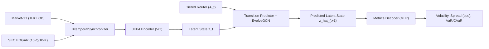
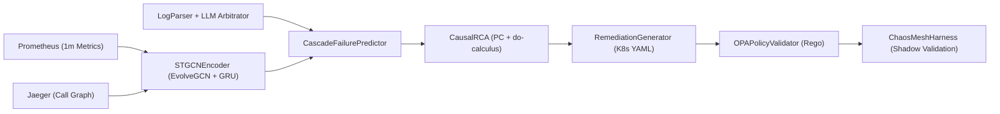

# Enterprise World Model Engine — Technical Architecture

**Author:** Vinicius Caridá  
**Version:** v1.5.0  
**License:** Apache-2.0  
**Reconciliation Audit:** See [`docs/architecture/reconciliation_report.md`](docs/architecture/reconciliation_report.md)

---

## 1. Architectural Thesis: State-Transition Simulation over Autoregressive Prediction [IMPLEMENTED]

Enterprise decision systems operate in non-stationary, interconnected environments where actions trigger multi-hop cascades across supply chains, accounting balance sheets, and distributed service topologies. Rather than relying solely on observational next-token or single-step correlation $P(Y \mid X)$, `ewm-engine` formulates enterprise dynamics as an action-conditioned state-transition system:

$$S_{t+1} = F\bigl(S_t, A_t, K_t\bigr), \quad \text{subject to} \quad \mathcal{V}_{\text{pre}}(S_t, A_t) = \text{True}, \quad \mathcal{V}_{\text{post}}(S_{t+1}) = \text{True}$$

where:
- $S_t$ is the immutable, SHA-256 fingerprinted `WorldState` at event time $t_e$ and knowledge time $t_k$ ($t_e \le t_k$),
- $A_t$ is a typed operational `Action` or structural intervention $\text{do}(X = x)$,
- $K_t$ is the runtime `ContextSnapshot` governing regime parameters and epistemic guardrails (`ADR-053`).

---

## Part I — Implemented v1.5.0 Core, Beta & Experimental Architecture

### 2. Core Simulation Engine & Immutable State [IMPLEMENTED] (v1.5.0 STABLE)

**Status:** `[IMPLEMENTED]` — Fully implemented and stable in `v1.5.0` (`ewm_engine.core`, `ewm_engine.simulation`).

- **Immutable State & Branching (`src/ewm_engine/core/`):** `WorldState` snapshots with canonical JSON serialization, SHA-256 state fingerprints, $O(1)$ isolated `world.branch()` counterfactual trees (`AC-005`), and point-in-time `BitemporalLedger.as_of(t)` queries.
- **Deterministic Simulation Kernel (`src/ewm_engine/simulation/`):** Hierarchical `SeedSequence` Monte Carlo rollouts (`SimulationEngine`), vectorized `SoAStateTensor` batching, and three-tier reproducibility certification (`BITWISE_REPRODUCIBLE`, `NUMERICALLY_EQUIVALENT_WITH_TOLERANCE`, `NON_CERTIFIED_BACKEND`).

### 3. Phase-Aware Constraint Engine & Projected Residual Dynamics [IMPLEMENTED] (v1.5.0 STABLE)

**Status:** `[IMPLEMENTED]` — Fully implemented and stable in `v1.5.0` (`ewm_engine.constraints`, `ewm_engine.dynamics`).

- **Normative Constraint Gates (`src/ewm_engine/constraints/`):** `PRE_ACTION` gates reject invalid interventions before execution; `POST_TRANSITION` gates mark conservation-violating trajectories `INVALID` without silent state clamping (`AC-006`–`AC-008`).
- **Grey-Box Residual Projection (`src/ewm_engine/dynamics/`, `src/ewm_engine/experimental/conservation.py`):** Combines known structural rules $f_{\text{known}}$ with empirical residuals $\mathcal{P}_{\mathcal{C}}(g_\theta)$ via KKT nullspace projection (`ConservationProjectionLayer`) preserving conservation laws within $\le 10^{-12}$.

### 4. Scenario Evaluation, Uncertainty & Provenance Suite [IMPLEMENTED] (v1.5.0 STABLE)

**Status:** `[IMPLEMENTED]` — Fully implemented and stable in `v1.5.0` (`ewm_engine.evaluation`, `ewm_engine.provenance`, `ewm_engine.cards`).

- **Counterfactual Comparison (`compare_scenarios`):** Paired and independent non-parametric bootstrap confidence intervals, split-conformal marginal intervals (`ConformalIntervalPredictor`), and safe-testing e-processes under $P_{\text{model}}$.
- **Auditable Provenance (`SystemicTrace`):** Directed dependency DAGs tagged with 8-tier `EvidenceLevel` metadata and SHA-256 signed `ModelCard`, `DatasetCard`, and `ScenarioCard` artifacts.

### 5. Counterfactual SCM, Decision Discovery, Calibration, Induction & MCP [IMPLEMENTED] (v1.5.0 BETA)

**Status:** `[IMPLEMENTED]` — Implemented in-tree beta in `v1.5.0` (`ewm_engine.simulation.counterfactual`, `ewm_engine.decision`, `ewm_engine.calibration`, `ewm_engine.induction`, `ewm_engine.mcp`).

- **Twin-Rollout Counterfactual SCM:** Pearlian three-step abduction-action-prediction with coupled exogenous noise and backdoor/frontdoor identifiability gates (`UnqualifiedCausalClaimError`).
- **Decision Intelligence (`ewm decide`) & Calibration (`ewm calibrate`):** PRIM scenario vulnerability box discovery, minimax/CVaR regret robustness, amortized SBI posterior calibration, and TARP coverage diagnostics.
- **Induction Honesty Gate (`ewm induce`) & Boundary MCP (`ewm mcp`):** Candidate causal/invariant mining with mandatory refusal of unidentifiable edges (`REFUSED_UNIDENTIFIABLE_AS_DESIGNED`) and stdio Model Context Protocol tool server for boundary LLM agents.

### 6. Flagship Fraud Cascade, 5-Rung Comparative Ladder & Enterprise Suite (A–L) [IMPLEMENTED] (v1.5.0 BETA)

**Status:** `[IMPLEMENTED]` — Implemented and benchmarked in `v1.5.0` (`ewm_engine.flagship`, `benchmarks/`).

- **Flagship Cascade & Pre-Registered Ladder (`EWME-PREREG-20261023-LADDER`):** Evaluates `Rung 1` (`AR(1)`) through `Rung 5` (`Full EWM`), 6 single-component ablations, 4 negative results (`N1`–`N4`), and `ValidityLimitAbstentionGate` (`"DO_NOT_USE_ME_HERE"`).
- **Enterprise Benchmark Suite (`benchmarks/enterprise_suite.py`):** 12 runtime-executed enterprise failure-mode families (`A_DirectDynamics` through `L_DecisionQuality`) across 13 orthogonal metrics.

### 7. Experimental Neural Residuals, Relational GNNs & SWE Ecosystem [IMPLEMENTED] (v1.5.0 EXPERIMENTAL)

**Status:** `[IMPLEMENTED]` — Implemented in `src/ewm_engine/experimental/` (`v1.5.0` Experimental tier; isolated behind optional extras).

- **Experimental Modules:** `TorchNeuralResidualDynamics` (`dynamics_torch.py`), heterogeneous `GraphNeuralDynamics` (`graph_dynamics.py`), multi-domain composition (`domain_composition.py`), and software-engineering deployment dynamics (`swe_ecosystem.py`, `UNVERIFIED_RESEARCH`).

---

## Part II — Planned v2.0+ Vertical Extensions & Research Prototypes

> **Scope Note (`v1.5.0` vs. `v2.0+`):** The sections below describe **PLANNED `v2.0+` vertical extensions** that are **not part of the `v1.5.0` stable public API (`ewm_engine.__all__`) or `v1.5.0` release certification**. Experimental research prototypes exist in-tree for active development but are scheduled for production graduation in `v2.0+`.

### 8. Mechanistic Router [PLANNED] (v2.0+ Future Release)

**Status:** `[PLANNED]` — Conceptual design and experimental prototype (`src/ewm_engine/routing/`) scheduled for `v2.0+` release; not part of the `v1.5.0` core public API.

The **Mechanistic Router [PLANNED]** orchestrates compute across a three-tier processing hierarchy under a `<100ms` p95 gateway latency budget:

1. **Tier 1 — Deterministic Rule Engine (`DeterministicRuleEngine`) [PLANNED]:** Evaluates quantitative threshold surprises ($|\text{value} - \text{consensus}| / |\text{consensus}| < 0.005$) and minor deployment checks in `<1ms` without invoking neural inference.
2. **Tier 2 — Semantic Vector Router (`SemanticVectorRouter`) [PLANNED]:** Encodes qualitative text into dense vector embeddings (`BAAI/bge-large-en-v1.5`), classifies routine patterns via cosine similarity in `<15ms`, and monitors representation health via **RankMe** ($\exp(-\sum_k p_k \log p_k)$).
3. **Tier 3 — Frontier LLM Arbitrator (`FrontierLLMArbitrator`) [PLANNED]:** Invoked exclusively for novel, ambiguous, or multi-hop shocks to extract a schema-validated `CausalInterventionVector` (`primary_target_entities`, `directional_sentiment`, `magnitude`, `contagion_pathways`, `confidence`).

---

### 9. Continuous-Time Temporal Graph Neural Networks (CT-TGNN) [PLANNED] (v2.0+ Future Release)

**Status:** `[PLANNED]` — Planned for `v2.0+` vertical graduation (`src/ewm_engine/graph/`); not exported in the `v1.5.0` core public API.

- **`ContinuousGraphRegistry` [PLANNED]:** In-memory topology registry supporting $O(1)$ node/edge additions and removals (`>10,000` edge updates/sec) and bounded snapshot materialization.
- **`EvolveGCN` (`EvolveGCNLayer`, `GCNConv`) [PLANNED]:** Evolves Graph Convolutional Network weight matrices $W_t^{(l)}$ across time via recurrent `GRUCell` or `LSTMCell` units:
  $$W_t^{(l)} = \text{RNN}\bigl(W_{t-1}^{(l)}, H_t^{(l)}\bigr), \qquad H_t^{(l+1)} = \sigma\bigl(\hat{A}_t H_t^{(l)} W_t^{(l)}\bigr)$$

---

### 10. Financial World Model Vertical [PLANNED] (v2.0+ Future Release)

**Status:** `[PLANNED]` — Planned for future release (`v2.0+`). Not part of the `v1.5.0` certified core; research prototype modules reside in `src/ewm_engine/financial/` [PLANNED].

1. **Bitemporal Market Data Pipelines [PLANNED]:**
   - `Market1TLoader` [PLANNED]: Ingests partitioned 1Hz limit order book Parquet files, computes bid-ask spread in basis points (`spread_bps`), and aligns asynchronous ticks to a uniform 1Hz grid.
   - `EDGARLoader` & `BitemporalSynchronizer` [PLANNED]: Extracts 6 quarterly accounting fundamentals (`revenue`, `net_income`, `total_assets`, `total_liabilities`, `free_cash_flow`, `debt_to_equity`) and performs point-in-time backward as-of joins on `knowledge_time`.
2. **JEPA Representation & VICReg/SIGReg Regularization [PLANNED]:**
   - `FinancialJEPAEncoder` & `FinancialJEPAPair` [PLANNED]: Encodes multi-asset microstructure + fundamental tensors into latent states $z_t$ with an online context encoder and exponential moving average (EMA) target encoder.
   - `VICRegLoss` & `sigreg_loss` [PLANNED]: Enforces invariance, per-dimension variance ($\ge \gamma$), and off-diagonal covariance decorrelation to prevent dimensional collapse.
3. **Counterfactual Contagion & Decoding [PLANNED]:**
   - `FinancialTransitionPredictor` [PLANNED]: Conditions on $z_t$, `CausalInterventionVector` $A_t$, and supply-chain/sector topology in `ContinuousGraphRegistry` to propagate systemic shocks via `EvolveGCN`.
   - `FinancialMetricsDecoder` [PLANNED]: Projects $\hat{z}_{t+1}$ and node embeddings into asset volatility $\hat{\sigma}_{t+1}$, spread widening $\Delta\text{spread}_{\text{bps}}$, calibrated uncertainty intervals, and portfolio $\text{VaR}_{95}$ / $\text{CVaR}_{95}$.

---

### 11. AIOps World Model Vertical [PLANNED] (v2.0+ Future Release)

**Status:** `[PLANNED]` — Planned for future release (`v2.0+`). Not part of the `v1.5.0` certified core; research prototype modules reside in `src/ewm_engine/aiops/` [PLANNED].

1. **Multimodal Telemetry Ingestion [PLANNED]:**
   - `PrometheusCollector` [PLANNED]: Queries 1-minute CPU, memory, HTTP 5xx error rate, and p95 latency metrics with bitemporal timestamps and builds `(T, N, 5)` telemetry tensors.
   - `JaegerCollector` [PLANNED]: Extracts directed microservice call-graph dependencies and edge latencies into `ContinuousGraphRegistry`.
   - `LogParser` [PLANNED]: Pre-filters unstructured logs via regex and routes `FATAL`, `OutOfMemoryError`, and `TimeoutException` lines to `FrontierLLMArbitrator`.
2. **Spatial-Temporal Cascade Forecasting [PLANNED]:**
   - `STGCNEncoder` & `CascadeFailurePredictor` [PLANNED]: Combines `EvolveGCN` spatial message passing with temporal GRUs and bidirectional call-graph backpressure propagation to forecast cascading microservice failures 30–60 minutes before user-facing SLO breach.
3. **Causal Root Cause Analysis [PLANNED]:**
   - `CausalRCA` [PLANNED]: Applies constraint-based PC conditional independence pruning and Pearl's `do(fix(service))` interventional scoring to isolate upstream root causes from downstream symptoms.
4. **Closed-Loop Remediation, OPA Gatekeeper & Chaos Mesh [PLANNED]:**
   - `RemediationGenerator` & `OPAPolicyValidator` [PLANNED]: Synthesizes declarative Kubernetes `apps/v1` `Deployment` manifests and validates `PodDisruptionBudget` (`replicas >= minAvailable`) and blast-radius policies.
   - `ChaosMeshHarness` [PLANNED]: Injects `StressChaos`, `NetworkChaos`, and `PodChaos` CRDs into isolated `shadow`/`canary` namespaces to verify Time to Recovery (`ttr_seconds < 300s`) before production promotion.
