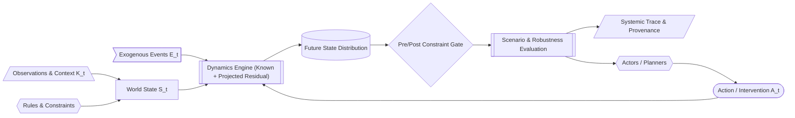

<p align="center">
  <picture>
    <source media="(prefers-color-scheme: dark)" srcset="assets/logo-dark.svg">
    <source media="(prefers-color-scheme: light)" srcset="assets/logo-light.svg">
    
  </picture>
</p>

<p align="center">
  <em>Deterministic, auditable what-if simulation kernel for socio-technical systems — CPU-only core with optional, complementary LLM/GPU boundary adapters.</em><br>
  <strong>An open-source research program and structural world-model engine investigating when explicit dynamics improve decisions over outcome prediction.</strong>
</p>

<p align="center">
  <a href="https://github.com/vfcarida/Enterprise-World-Model-Engine/actions/workflows/ci.yml"></a>
  <a href="https://vfcarida.github.io/Enterprise-World-Model-Engine/"></a>
  <a href="pyproject.toml"></a>
  <a href="scripts/check_coverage.py"></a>
  <a href="pyproject.toml"></a>
  <a href="LICENSE"></a>
</p>

<p align="center">
  <a href="https://vfcarida.github.io/Enterprise-World-Model-Engine/"><b>Docs</b></a> ·
  <a href="#60-second-quickstart"><b>Quickstart</b></a> ·
  <a href="#verified-results--evidence"><b>Evidence</b></a> ·
  <a href="#project-roadmap--maturity"><b>Maturity</b></a> ·
  <a href="#limitations--non-goals"><b>Limitations</b></a> ·
  <a href="#reproduce-in-one-command"><b>Reproduce</b></a> ·
  <a href="docs/explanation/what-is-an-ewm.md"><b>What Is an EWM?</b></a> ·
  <a href="docs/explanation/research-agenda.md"><b>Research Agenda</b></a> ·
  <a href="docs/scientific/claim-evidence-matrix.md"><b>Claim Registry</b></a> ·
  <a href="docs/research/enterprise-benchmark-suite.md"><b>Benchmarks (A–L)</b></a> ·
  <a href="docs/positioning/landscape.md"><b>Landscape</b></a> ·
  <a href="#citation"><b>Cite</b></a>
</p>

---

## 1. What EWM Engine Is

**Enterprise World Model Engine (`ewm-engine`)** is an open-source **research program** and action-conditioned Python simulation kernel that investigates, comparatively and reproducibly, **one central, conditional, and falsifiable hypothesis**:

> *In certain corporate systems with relevant interdependencies, temporal effects, and recurrent decisions, explicit representations of the environment's dynamics can improve the quality of predictions, simulations, or decisions compared with approaches that do not model those dynamics in an integrated way.*

Rather than assuming that a world model is universally superior or cost-justified, `ewm-engine` treats that proposition as an empirical question to be tested—and potentially refuted—against simpler statistical, machine-learning, discrete-event, and optimization baselines.

> [!NOTE]
> - **Structural Core + Plural Components, Judged on Decisions:** Rather than framing modeling as "structural vs. neural" or assuming a universal hierarchy of determinism, `ewm-engine` pairs a typed structural core with plural pluggable mechanisms—accounting identities, business rules, statistical estimators, learned/neural residuals, foundation-model policies, discrete-event queues, and mathematical optimizers—evaluated on downstream decision quality.
> - **CPU Core + Optional, Complementary LLM/GPU Boundary:** The deterministic core runs fully on CPU with **no required** GPU or LLM dependency. GPUs and LLMs are **optional and complementary**: LLM agents operate at the boundary (natural-language goal interpretation and trace-audited explanation via `ewm mcp` and `agents`, following the *Business World Model* and *World of Workflows* boundary pattern), and optional GPU/array backends (`[ml]`, `[jax]`, `[cuda]`) accelerate residual learning and batched rollouts, while the dynamics core stays deterministic and auditable.
> - **Not Every Application Needs an EWM:** In stationary, single-layer, or purely observational forecasting tasks, standard ML or SQL rules suffice at a fraction of the cost. An EWM is **one optional, modular capability inside a larger AI systems architecture** (cf. Sculley et al., *NeurIPS 2015*, "Hidden Technical Debt in ML Systems"). See [What Is an Enterprise World Model? (Scientific Demarcation)](docs/explanation/what-is-an-ewm.md) and the [Research Agenda](docs/explanation/research-agenda.md).

---

## 2. Measured Headline Result: The Prediction-vs-Decision Gap

Enterprise analytics and supervised machine learning excel at estimating observational associations $P(Y \mid X)$ (*"What is likely to happen if current correlations continue?"*). Operational decision-makers face a conditionally different question:

$$\text{"Under which conditions does explicitly modeling system dynamics and constraints let us decide better than simply predicting outcomes?"}$$

On the controlled synthetic **Fraud $\to$ Declines $\to$ Call-Center Cascade** flagship scenario (`CONTROLLED_SYNTHETIC_KNOWN_MECHANISMS_NOT_REAL_WORLD_EFFICACY`, [`docs/results/decision-first-comparative-evaluation.md`](docs/results/decision-first-comparative-evaluation.md), pre-registered under [`EWME-PREREG-20261023-LADDER`](docs/scientific/pre_registration_comparative_ladder.md)), evaluating a 5-rung comparative ladder across $M=10$ bitemporal splits (`BitemporalLedger.as_of(t)`) demonstrates both **where explicit dynamics improve decisions** and **where simpler baselines win**:

- **Better 1-Step Prediction $\not\Rightarrow$ Better Decision:** Climbing from **Rung 1 (`Simple Statistical AR(1)`)** to **Rung 3 (`ML + Engineered Lag Features`)** reduces 1-step call-arrival forecast MAE by **91.49%** (`25.60` $\to$ `2.18`), yet produces **\$0.00 improvement in decision regret** (regret remains **\$124,283.57** per episode vs. **Rung 5 Full EWM**'s **\$0.00**), because observational feature engineering cannot identify the 4-layer operational cascade triggered by an aggressive fraud-rule intervention $\text{do}(\tau = 0.40)$.
- **First-Class Negative Findings (`N1`–`N4`):** For pure 1-step observational prediction, **Rung 3** beats **Rung 5 (`Full EWM`)** (`Call MAE = 2.18` vs. `3.32`) at $3.7\times$ lower specification burden (`N1`); for passive state evolution without interventions, a conventional predict-only queueing simulator (**Rung 4**) achieves **100.0% internal coherence** (`N2`); and in a stationary single-layer regime without cascades (`N4`), **Rung 1** achieves **\$0.00 decision regret** with `1` specification component vs. **Rung 5**'s `11` components.

Reproduce this comparative evaluation directly from the repository:

```bash
python scripts/run_comparative_evaluation.py --seed 42 --smoke
```

See the [Blunt Guide: When You Do NOT Need an EWM](docs/explanation/what-is-an-ewm.md#6-blunt-guide-when-you-do-not-need-an-ewm) and the full [Research Agenda](docs/explanation/research-agenda.md).

---

## 3. Maturity & Status

- **Current Release:** `v1.5.0` (`Development Status :: 4 - Beta`, Apache-2.0 License)
- **Supported Runtime:** Python `>=3.11` (`3.11`, `3.12`, `3.13`) and NumPy `>=1.26.0` under [Scientific Python SPEC 0](docs/spec0-policy.md)
- **Core Dependencies:** `pydantic>=2.6.0`, `numpy>=1.26.0`, `pyyaml>=6.0` (the deterministic core runs on CPU with no required ML, LLM, GPU, solver, or cloud dependencies; optional extras provide `[mcp]`, `[agents]`, `[ml]`, `[jax]`, `[cuda]`, `[ortools]`, `[calibrate]`, and `[causal]`)
- **Verification Gates & Honest Evidence Tiers:** Strict `mypy` typing, `ruff` lint/format, `>=85%` branch coverage gate (`>=90%` on core modules), Hypothesis property/metamorphic tests, selective mutation ratchet ([`scripts/run_mutation_gate.py`](scripts/run_mutation_gate.py)), untrusted-input fuzz smoke ([`scripts/run_fuzz_smoke.py`](scripts/run_fuzz_smoke.py)), and a 28-claim [Claim-to-Evidence Registry](docs/scientific/claim-evidence-matrix.md) (`EXTERNALLY_REPRODUCED = 0` until independent third-party replication).

---

## 4. Distinguishing Architecture

`ewm-engine` separates state evolution into three explicitly governed layers (detailed in [State Management & Formalism](docs/architecture/state-management.md) and [ADR-053](docs/adr/ADR-053-formal-enterprise-world-model-semantics-and-context.md)):

1. **Known Structural Rules & Phase-Aware Constraints ($f_{\text{known}}, \mathcal{V}_{\text{pre}}, \mathcal{V}_{\text{post}}$):** Typed entities, directed relationships, and bounded resources ($R_t \in [R_{\min}, R_{\max}]$). Pre-action constraints reject invalid actions prior to transition; post-transition hard constraints mark violating trajectories `INVALID` without silently fabricating or clamping state.
2. **Feasible-Set Projected Residual Dynamics ($\mathcal{P}_{\mathcal{C}}(g_\theta)$):** Optional empirical or neural residual models capture unmodeled friction and stochastic demand while KKT nullspace projections (`ConservationProjectionLayer`) and explicit `InfeasibleResidualPolicy` rules (`PROJECT`, `REJECT`, `ABSTAIN`, `INVALIDATE`) preserve linear conservation laws within IEEE-754 double-precision tolerance ($\le 10^{-12}$).
3. **Runtime Context ($K_t$) & Epistemic Guardrails:** Separates ontic state ($S_t$), partial observations ($O_t$), belief state ($B_t$), and runtime deployment context ($K_t$). Causal effect queries check backdoor/frontdoor identifiability on the declared `CausalGraph` and fail closed (`UnqualifiedCausalClaimError`) when unobserved confounding leaves backdoor paths open.

---

<a id="60-second-quickstart"></a>

## 5. Minimal Seeded Quickstart

Install the core package from source:

```bash
git clone https://github.com/vfcarida/Enterprise-World-Model-Engine.git
cd Enterprise-World-Model-Engine
pip install -e .
```

Simulate a deterministic baseline against a counterfactual resource transfer intervention in 12 lines of seeded Python:

```python
import ewm_engine as ewm
from ewm_engine.dynamics.deterministic import DeterministicTransferDynamics

# 1. Define enterprise state with bounded resources
world = ewm.World(
    state=ewm.WorldState(
        resources=[
            ewm.Resource(id="stock_a", current=100.0, max_value=200.0),
            ewm.Resource(id="stock_b", current=20.0, max_value=200.0),
        ]
    ),
    dynamics=DeterministicTransferDynamics(),
)
# 2. Simulate baseline vs. isolated counterfactual branch with fixed seed
baseline = world.simulate(horizon=5, seed=42)
counterfactual = world.branch().simulate(
    actions=[
        ewm.Action(
            type="transfer_resource",
            parameters={
                "quantity": 30.0,
                "source_resource": "stock_a",
                "target_resource": "stock_b",
            },
        )
    ],
    horizon=5,
    seed=42,
)
# 3. Compare scenarios and inspect the summary table
diff = ewm.compare_scenarios(
    baseline, [counterfactual], metrics=["resource_stock_a", "resource_stock_b"]
)
print(diff.summary_table())
```

```text
=== Scenario Comparison (Baseline: Baseline) ===
Estimand: E_{P_model}[Y_candidate] - E_{P_model}[Y_baseline] (in-simulator P_model; not P_real unless externally validated)
---------------------------------------------------------------------------------------------------------------------------
Metric                    | Scenario             | Mean (Std)         | p50 [p05, p95]       | Delta vs Base [CI] (*sig)   
---------------------------------------------------------------------------------------------------------------------------
resource_stock_a          | Baseline             | 100.00 (+/-0.00)   | 100.00 [100.00, 100.00] | -                           
                          | Counterfactual       | 70.00 (+/-0.00)    | 70.00 [70.00, 70.00] | -30.00 (-30.0%) [-30.00, -30.00] (det)
---------------------------------------------------------------------------------------------------------------------------
resource_stock_b          | Baseline             | 20.00 (+/-0.00)    | 20.00 [20.00, 20.00] | -                           
                          | Counterfactual       | 50.00 (+/-0.00)    | 50.00 [50.00, 50.00] | +30.00 (+150.0%) [+30.00, +30.00] (det)
---------------------------------------------------------------------------------------------------------------------------
```

> [!NOTE]
> Zero-variance deterministic comparisons are explicitly labeled `(det)` (`status_label="deterministic_difference"`, `is_significant=False`) rather than claiming statistical significance (`*`). Stochastic Monte Carlo comparisons (`samples >= 2`) report non-parametric bootstrap confidence intervals under $P_{\text{model}}$.

---

<a id="verified-results--evidence"></a>

## 6. Verified Results & Evidence

<p align="center">
  <picture>
    <source media="(prefers-color-scheme: dark)" srcset="assets/hero-proof-dark.svg">
    <source media="(prefers-color-scheme: light)" srcset="assets/hero-proof-light.svg">
    
  </picture>
</p>
<p align="center">
  <em>SEIR validation card: Analytical ground-truth curve overlaid on EWM forward simulation. Closed-system conservation (S + E + I + R = N) holds within IEEE-754 double-precision tolerance (&lt;= 1e-12; observed max residual 4.55e-13 across 80 steps). Shaded band indicates 90% split-conformal marginal coverage. Regenerate via <code>python scripts/generate_hero_proof.py</code>.</em>
</p>

All empirical claims are verified by committed, machine-readable benchmark artifacts ([`reproduction_manifest.json`](reproduction_manifest.json), [`docs/results/artifacts/comparative_evaluation_ladder.json`](docs/results/artifacts/comparative_evaluation_ladder.json), [`docs/results/artifacts/fraud_cascade_flagship.json`](docs/results/artifacts/fraud_cascade_flagship.json), and [`docs/results/artifacts/enterprise_benchmark_suite.json`](docs/results/artifacts/enterprise_benchmark_suite.json)):

| Evaluation Suite / Card | Scope & Invariant Tested | Verified Empirical Result | Evidence Tier & Command |
| :--- | :--- | :--- | :--- |
| **Decision-First Comparative Ladder (`EWME-PREREG-20261023-LADDER`)** | 5-rung baseline ladder (`Rung 1` AR(1) $\to$ `Rung 5` full EWM), 6 single-component ablations, 4 negative results (`N1`–`N4`), and 4 construct-validity objective specifications on the Fraud $\to$ Declines $\to$ Call-Center cascade | `Rung 3` (GBT) beats `Rung 5` on 1-step observational prediction (`MAE = 2.18` vs. `3.32`, `N1`), while `Rung 5` reduces pre-deployment policy regret from `Rung 3`'s `$113,864.26` (`15.63%` SLA violation) to `$0.00` (`0.00%` SLA violation); misspecified Fraud-Team proxy inside `Rung 5` still incurs `$123,689.15` regret | `BENCHMARKED` — `python scripts/run_comparative_evaluation.py --seed 42 --smoke` |
| **Enterprise Benchmark Suite (Families A–L)** | 12 runtime-executed synthetic enterprise failure-mode families comparing `rules-only`, `learned-only`, `static hybrid`, and `hybrid + runtime context discovery` across 13 orthogonal metrics | `CONSTRAINT_PRESERVATION = 1.0000` (vs. `0.7823` for `learned-only`); post-shift recovery in `2` steps on Family D (`MAE = 0.158` vs. `>34.6` unrecovered for static baselines); `DECISION_REGRET = 0.1557` (vs. `46.25` for `learned-only`); negative controls on `A`, `I`, `H`, `K` | `BENCHMARKED` — `python -m benchmarks.enterprise_suite --seed 42` |
| **Validity Limits, Performativity & Abstention Gate** | Model-induced `DriftOrigin` (`POLICY_INDUCED_SHIFT`, `ENDOGENOUS_FEEDBACK_SHIFT`, `ADVERSARIAL_ADAPTATION_SHIFT`), $5 \times 4$ `EVIDENCE_QUERY_MATRIX_CONTRACT`, verifiable mechanistic trace explainability, and `"DO_NOT_USE_ME_HERE"` abstention | Unmodeled performativity incurs `$70,350.00` gap; stylized adversary increases loss by `+$53,166.96`; `ValidityLimitAbstentionGate` emits `"DO_NOT_USE_ME_HERE"` across all 4 validity limits | `BENCHMARKED` — `pytest tests/unit/test_validity_limits.py -q` |
| **SEIR Epidemic Outbreak** | Closed-population conservation ($S+E+I+R=1000$) over 80 steps | Observed max residual $4.55 \times 10^{-13} \le 10^{-12}$; 90% split-conformal coverage $= 1.00$ | `BENCHMARKED` — `python scripts/reproduce.py` |
| **Beer Game & WORLD3 Packs** | Multi-echelon supply bullwhip (Sterman, 1989) & non-linear resource depletion (Meadows et al., 1972) | Bullwhip amplification ratio $= 3.80$; WORLD3 industrial peak at step $t=99$ | `BENCHMARKED` — `python scripts/reproduce.py` |
| **Amortized SBI & TARP** | Empirical posterior coverage across 200 synthetic holdout simulations | Mean TARP calibration error $= 0.0283 \le 0.05$ threshold | `CALIBRATED` — `python scripts/reproduce.py` |
| **Counterfactual SCM & Induction Gate** | Abducted-noise twin rollout & fail-closed refusal under unobserved confounding | Coupled net treatment effect $= +35.0$ units; `0` unidentifiable causal strings emitted | `BENCHMARKED` — `python scripts/reproduce.py` |

See the full **[Claim-to-Evidence Registry](docs/scientific/claim-evidence-matrix.md)**, **[Decision-First Comparative Evaluation](docs/results/decision-first-comparative-evaluation.md)**, and **[Enterprise Benchmark Suite (A–L) Report](docs/research/enterprise-benchmark-suite.md)**.

---

## 7. Architecture Overview



- **State & Context (`ewm_engine.core`):** Immutable `WorldState` snapshots with canonical SHA-256 fingerprints, `ContextSnapshot` ($K_t$), `ObservationFilter`, and $O(1)$ isolated `world.branch()` snapshots (`AC-005`).
- **Constraints (`ewm_engine.constraints`):** `PRE_ACTION` and `POST_TRANSITION` validation gates with `HARD` and `SOFT` severities (`AC-006`–`AC-008`).
- **Dynamics (`ewm_engine.dynamics`):** Pluggable `DynamicsModel` protocol supporting deterministic rules, stochastic processes, and `LearnedDynamics` residuals with `InfeasibleResidualPolicy` enforcement.
- **Simulation & Counterfactuals (`ewm_engine.simulation`):** Hierarchical `SeedSequence` Monte Carlo rollouts, Pearlian three-step `StructuralCausalModel` twin rollouts, receding-horizon control (`RecedingHorizonSimulator`), and three-tier array backends.
- **Evaluation & Decision (`ewm_engine.evaluation`, `ewm_engine.decision`):** Paired/independent bootstrap confidence intervals, split-conformal intervals, safe-testing e-processes, PRIM scenario vulnerability discovery, and multi-metric robustness analysis.
- **Provenance & Cards (`ewm_engine.provenance`, `ewm_engine.cards`):** Inspectable `SystemicTrace` DAGs tagged with `EvidenceLevel` tiers and Mitchell/Gebru/Croissant-compliant `ModelCard`, `DatasetCard`, and `ScenarioCard` artifacts.

---

<a id="project-roadmap--maturity"></a>

## 8. Capabilities by Maturity Tier

Capabilities are governed across three explicit stability tiers ([Stability Policy](docs/stability-policy.md)):

| Tier | Guarantee & Namespace | Representative Subsystems |
| :--- | :--- | :--- |
| **Stable (`1.x`)** | Backward-compatible root public API (`ewm_engine.__all__`), deterministic CPU core with no required GPU or LLM dependency | Core simulation kernel, `World` & immutable `WorldState`, phase-aware `ConstraintRegistry`, `DeterministicTransferDynamics`, `compare_scenarios` (5 bootstrap methods + 6-part uncertainty taxonomy), `ConformalIntervalPredictor`, `SystemicTrace`, JSON Schema Draft 2020-12 & safe YAML loader, event-sourced `TraceLog`/`ResultStore`, `ModelCard`/`DatasetCard`/`ScenarioCard`, OR-Tools/SciPy/Z3/Gymnasium adapters, FMI/SimPy/Mesa/PySD co-simulation, reporting & FastAPI service |
| **In-Tree Beta (`1.5.0`)** | Verified by unit, contract, and benchmark suites; domain-specific optional extras (`[calibrate]`, `[causal]`, `[induction]`, `[dsl]`, `[mcp]`) | Flagship Fraud $\to$ Declines $\to$ Call-Center Cascade & 5-Rung Comparative Evaluation (`ewm_engine.flagship`), Twin-Rollout Counterfactual SCM (`ewm_engine.simulation.counterfactual`), Grey-Box `ConservationProjectionLayer` & SINDy flywheel, PRIM scenario discovery & multi-metric robustness (`ewm decide`), Amortized SBI calibration & TARP diagnostics (`ewm calibrate`), OCEL 2.0 / causal / invariant induction with refusal gate (`ewm induce`), World Specification Language (`.wsl`) & WMIF v1.0 conformance, MCP stdio server for boundary LLM agents (`ewm mcp`), 12-family Enterprise Benchmark Suite (A–L) |
| **Experimental (`ewm_engine.experimental.*`)** | Research prototypes isolated behind optional extras (`[ml]`, `[jax]`, `[cuda]`); interfaces may evolve across minor releases | `TorchNeuralResidualDynamics` (PyTorch MLP residual with symlog scaling), `GraphNeuralDynamics` (heterogeneous relational GNN), `JaxBackend` (`NUMERICALLY_EQUIVALENT_WITH_TOLERANCE`), `CuPyBackend` (`NON_CERTIFIED_BACKEND`) |

See [ROADMAP.md](ROADMAP.md) and [Platform Capability Tracks](docs/architecture/platform-tracks.md) for the complete subsystem table.

---

<a id="limitations--non-goals"></a>

## 9. Limitations & Non-Goals

### Operational & Scientific Limitations

1. **Simulation Validity Depends on Model Assumptions:** All rollout distributions, bootstrap intervals, and counterfactual deltas are computed *under the declared simulation model* ($P_{\text{model}}$). If a domain model omits a critical real-world feedback loop, in-model metrics cannot automatically measure `model_discrepancy_vs_reality` without external holdout telemetry.
2. **Performativity, Endogeneity & Unmodeled Regime Shifts:** A deployed decision system alters the environment it modeled (`POLICY_INDUCED_SHIFT`, `ENDOGENOUS_FEEDBACK_SHIFT`, `ADVERSARIAL_ADAPTATION_SHIFT`; Perdomo et al., 2020; Lucas, 1976). While runtime context discovery ($K_t$) recovers from parameter shifts represented in `ContextSnapshot` after audit telemetry delay $\Delta t_{\text{audit}}$ (Benchmark Family D), unmodeled structural phase changes outside the context schema (Benchmark Family K) cause raw state-prediction breakdown and require `ValidityLimitAbstentionGate` (`"DO_NOT_USE_ME_HERE"`) abstention.
3. **Causal Conclusions Require Identification:** `world.counterfactual()` and `check_backdoor_identifiability()` evaluate causal validity relative to the declared `CausalGraph` and `DependencyEvidenceNature`. If latent confounders exist in reality but are omitted from the graph specification, graph-based checks cannot detect them. Observational sensitivity analyses (`compute_sensitivity_e_value`) bound, but do not eliminate, unmeasured confounding.
4. **Calibration & Conformal Assumptions:** Split-conformal prediction intervals guarantee finite-sample **marginal** coverage ($\mathbb{P}(Y_{\text{test}} \in \hat{C}(X_{\text{test}})) \ge 1-\alpha$) under **exchangeability**, not distribution-free conditional coverage ($\mathbb{P}(Y \in \hat{C}(X) \mid X=x)$). Under covariate or regime shift, coverage degrades until recalibrated. TARP (`compute_tarp_coverage`) is an empirical finite-sample diagnostic, not a formal proof of real-world posterior truth.
5. **Three-Tier Numerical Reproducibility Envelope:**
   - `BITWISE_REPRODUCIBLE` (`NumPyBackend` / pure-Python): Bit-identical SHA-256 state fingerprints require an identical pinned runtime (same Python, NumPy, IEEE-754 `float64` dtype, single-threaded BLAS `OMP_NUM_THREADS=1`, and `SeedSequence` tree). Universal bit-identity across arbitrary CPU ISAs, compilers, or multi-threaded BLAS reductions is not claimed.
   - `NUMERICALLY_EQUIVALENT_WITH_TOLERANCE` (`JaxBackend` in `float64`): Certified within `rtol=1e-6, atol=1e-7` due to XLA fusion and FMA instruction selection.
   - `NON_CERTIFIED_BACKEND` (`CuPyBackend`): Non-associative GPU floating-point atomic reductions are non-deterministic; refused when `certify_equivalence=True`.
6. **One Modular Capability in a Larger AI-Systems Stack:** Following Sculley et al. (2015, *"Hidden Technical Debt in Machine Learning Systems"*), an Enterprise World Model is one optional, bounded component inside a broader enterprise data, ML, and governance architecture—not a standalone end-to-end replacement for data engineering, perception, or operational monitoring.

### Scope & Architectural Composition (What EWM Engine Is NOT)

- **Not an LLM Agent Orchestrator / Prompt-Workflow Runner — A Deterministic Engine That LLM Agents Call:** The deterministic core runs fully on CPU with no required GPU or LLM dependency. GPUs and LLMs are optional and complementary: LLM agents operate at the boundary (natural-language goal interpretation, tool invocation, and result explanation via `ewm mcp` and `ewm_engine.integrations.concordia`), while the dynamics core stays deterministic and auditable (following the hybrid agentic-symbolic boundary pattern of *Business World Model*, 2026, and *World of Workflows*, 2026).
- **Scoped to Typed Socio-Technical State (Distinct Problem Domain from Pixel or 3D Physics Simulation):** Models typed enterprise entities, financial ledgers, operational queues, and accounting conservation laws rather than camera frames, point clouds, or 3D robotics physics meshes.
- **Not an Assumption-Free Causal Discovery Oracle:** `ewm induce causal` outputs Markov Equivalence Classes (CPDAG/PAG) and refuses to assert unique causal directions from observational data alone without interventional or refutation backing.

---

## 10. Documentation Map (Diátaxis)

Full documentation is published at **[https://vfcarida.github.io/Enterprise-World-Model-Engine/](https://vfcarida.github.io/Enterprise-World-Model-Engine/)**:

| Diátaxis Mode | Purpose | Key Entry Points |
| :--- | :--- | :--- |
| **Tutorials** *(Learning-oriented)* | Guided, end-to-end lessons for new users | [Getting Started](docs/getting-started.md) · [Flagship Cascade Tutorial](docs/tutorials/fraud-call-center-cascade.md) · [The Whole Game in 10 Minutes](docs/tutorials/whole-game-in-ten-minutes.md) · [Building Your First World](docs/tutorials/first-world.md) · [Simulating Interventions](docs/tutorials/counterfactual-interventions.md) · [CivicFlow Walkthrough](docs/examples/civicflow.md) |
| **How-To Guides** *(Goal-oriented)* | Step-by-step operational recipes | [Counterfactual Twin-Rollouts](docs/guides/counterfactual-twin-rollouts.md) · [Scenario Discovery with PRIM](docs/guides/scenario-discovery-prim.md) · [Enforcing Conservation Layers](docs/guides/conservation-layers.md) · [Amortized Calibration](docs/guides/calibration.md) · [Cookbook Index](docs/cookbook/index.md) |
| **Reference** *(Information-oriented)* | Exact APIs, schemas, CLI, cards, and evidence | [API Reference](docs/reference/api/index.md) · [Flagship Scenario Reference](docs/reference/fraud-cascade-scenario.md) · [CLI Reference](docs/reference/cli.md) · [JSON Schemas](docs/reference/schemas.md) · [Claim-to-Evidence Registry](docs/scientific/claim-evidence-matrix.md) · [Verified Bibliography](docs/REFERENCES.md) · [Model & Scenario Cards](docs/cards/TEMPLATE.md) |
| **Explanation** *(Understanding-oriented)* | Mathematical foundations, trade-offs, and benchmarks | [What Is an EWM?](docs/explanation/what-is-an-ewm.md) · [Research Agenda](docs/explanation/research-agenda.md) · [Decision-First Comparative Evaluation](docs/results/decision-first-comparative-evaluation.md) · [Enterprise Benchmark Suite (A–L)](docs/research/enterprise-benchmark-suite.md) · [Causal Epistemology](docs/concepts/causality.md) · [Uncertainty & Rollouts](docs/concepts/uncertainty.md) · [Competitive Landscape](docs/positioning/landscape.md) · [Handbook](docs/handbook/index.md) |

---

<a id="reproduce-in-one-command"></a>

## 11. Reproducibility

Under a pinned Python/NumPy environment (`uv sync --extra dev`), all benchmark cards, WMIF reference worlds, and the 12-family Enterprise Benchmark Suite can be reproduced with single commands:

```bash
# 1. Verify the 7 scientific validation cards, 3 WMIF oracle worlds, and SoA fingerprints
python scripts/reproduce.py

# 2. Run the 5-rung Decision-First Comparative Evaluation & Ablations
python scripts/run_comparative_evaluation.py --seed 42 --smoke

# 3. Run the 12-family Enterprise Benchmark Suite (A-L) across all 4 baselines
python -m benchmarks.enterprise_suite --seed 42

# 4. Verify release version coherence, schema freshness, and security controls
python scripts/check_release_truth.py
```

| Environment | Launch / Command | Scope |
| :--- | :--- | :--- |
| **Local CLI (`uv`)** | `uv run python scripts/reproduce.py` | Verifies [`reproduction_manifest.json`](reproduction_manifest.json) (`CERTIFIED_RELEASE` on clean git worktrees; `REPRODUCIBLE_DIRTY_WORKTREE` when uncommitted edits exist) |
| **Pinned Docker** | `docker build -t ewm-engine:pinned -f Dockerfile . && docker run --rm ewm-engine:pinned` | Isolated Linux `float64` container ([`Dockerfile`](Dockerfile)) with `OMP_NUM_THREADS=1` |

See the [Reproducibility & Citation Guide](docs/reproducibility.md) and [Performance & Reproducibility Contract](docs/performance.md).

---

## 12. Security, Governance & Contributing

- **Runtime & Deserialization Safety ([SECURITY.md](SECURITY.md), [ADR-034](docs/adr/ADR-034-supply-chain-security-provenance-and-vulnerability-management.md)):** Safe YAML deserialization via [`StrictSafeLoader`](src/ewm_engine/serialization/yaml.py) (rejecting custom tags and arbitrary object instantiation) and closed [`WorldFactory`](src/ewm_engine/core/spec.py) component registries (`AC-003`, verified by [`tests/contract/test_serialization_roundtrip.py`](tests/contract/test_serialization_roundtrip.py)).
- **CI & Supply-Chain Workflows:** 40-character commit-SHA pinned GitHub Actions enforced by [`scripts/check_action_pins.py`](scripts/check_action_pins.py), least-privilege `permissions: contents: read` across workflows, static workflow auditing (`zizmor`) and dependency auditing (`pip-audit`) in [`.github/workflows/ci.yml`](.github/workflows/ci.yml), CodeQL analysis in [`.github/workflows/codeql.yml`](.github/workflows/codeql.yml), scheduled OSSF Scorecard checks in [`.github/workflows/scorecard.yml`](.github/workflows/scorecard.yml), OSV-Scanner/Grype scans in [`.github/workflows/vulnerability-scan.yml`](.github/workflows/vulnerability-scan.yml), and release workflow definitions for CycloneDX/Syft SBOM generation, SLSA build provenance attestation, and OIDC publishing in [`.github/workflows/release.yml`](.github/workflows/release.yml).
- **Contributing & Governance:** Review [CONTRIBUTING.md](CONTRIBUTING.md), [GOVERNANCE.md](GOVERNANCE.md), [CODE_OF_CONDUCT.md](CODE_OF_CONDUCT.md), [SPEC 0 Support Policy](docs/spec0-policy.md), and [Deprecation Policy](docs/deprecation-policy.md).
- **Maintainer:** [Vinicius Caridá](https://github.com/vfcarida)

---

<a id="citation"></a>

## 13. Citation

If you use `ewm-engine` in research or technical evaluations, please cite the software repository via [`CITATION.cff`](CITATION.cff) or the BibTeX entry below:

```bibtex
@software{carida2026ewmengine,
  author    = {Carid{\'a}, Vinicius},
  title     = {Enterprise World Model Engine: An Open Framework for Modeling, Simulating, and Evaluating Organizational Dynamics},
  year      = {2026},
  url       = {https://github.com/vfcarida/Enterprise-World-Model-Engine},
  version   = {1.5.0},
  license   = {Apache-2.0}
}
```

