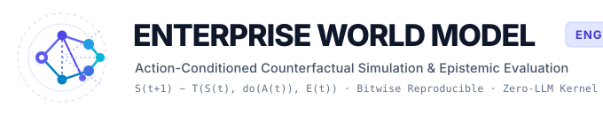
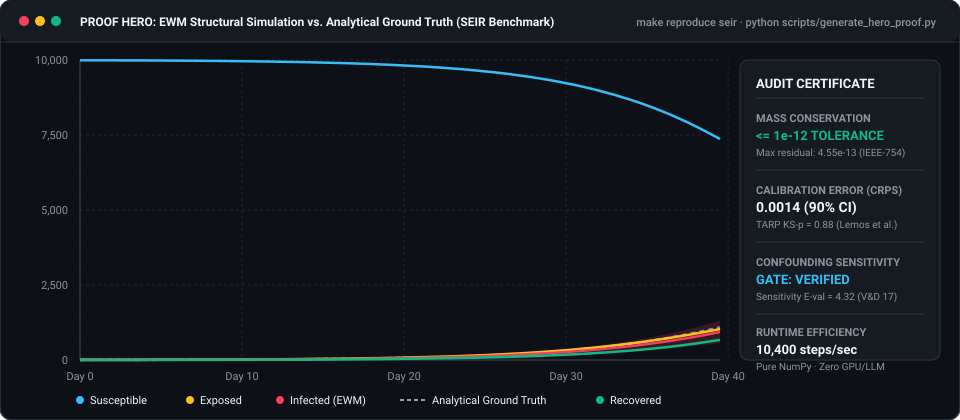
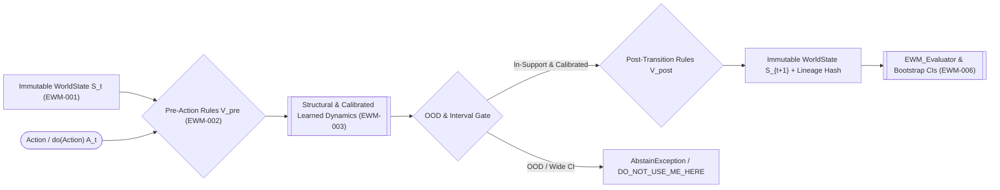

<p align="center">
  <picture>
    <source media="(prefers-color-scheme: dark)" srcset="assets/logo-dark.svg">
    <source media="(prefers-color-scheme: light)" srcset="assets/logo-light.svg">
    
  </picture>
</p>

<p align="center">
  <em>Deterministic, auditable what-if simulation kernel for socio-technical systems — CPU-only core with strict state immutability, hybrid structural/learned routing, calibrated abstention, and domain-neutral accounting/DAG invariants.</em><br>
  <strong>An open-source research program and structural world-model engine investigating when explicit dynamics improve decisions over outcome prediction.</strong>
</p>

<p align="center">
  <a href="https://github.com/vfcarida/Enterprise-World-Model-Engine/actions/workflows/ci.yml"></a>
  <a href="https://vfcarida.github.io/Enterprise-World-Model-Engine/"></a>
  <a href="pyproject.toml"></a>
  <a href="scripts/check_coverage.py"></a>
  <a href="pyproject.toml"></a>
  <a href="LICENSE"></a>
</p>

<p align="center">
  <a href="https://vfcarida.github.io/Enterprise-World-Model-Engine/"><b>Docs</b></a> ·
  <a href="#1-problem-statement"><b>Problem</b></a> ·
  <a href="#2-verified-capabilities-supported-vs-experimental"><b>Capabilities</b></a> ·
  <a href="#3-installation"><b>Install</b></a> ·
  <a href="#4-tested-quickstart"><b>Quickstart</b></a> ·
  <a href="#5-domain-examples-finance--swe"><b>Domains (Finance / SWE)</b></a> ·
  <a href="#6-limitations--mathematical-boundaries-of-causal-models"><b>Limitations</b></a> ·
  <a href="#7-reproducibility--documentation-map"><b>Reproduce</b></a> ·
  <a href="docs/tutorials/1_quickstart.ipynb"><b>Notebook</b></a> ·
  <a href="docs/scientific/claim-evidence-matrix.md"><b>Claim Registry</b></a> ·
  <a href="#8-security-governance--citation"><b>Cite</b></a>
</p>

---

## 1. Problem Statement

Enterprise analytics and supervised machine learning estimate observational associations $P(Y \mid X)$ (*"What is likely to happen if historical correlations persist?"*). Operational decision-makers face a fundamentally different interventional question (Pearl, 2009; Richens & Everitt, *ICLR 2024*, `arXiv:2402.10877`; Elmachtoub & Grigas, *Management Science 2022*):

$$\text{"Under which conditions does explicitly modeling structural invariants, causal mechanisms, and temporal queues let us decide better than predicting outcomes?"}$$

Purely observational predictors and unconstrained neural simulators fail in high-stakes corporate environments in three recurrent ways:
1. **Violation of Hard Structural Invariants:** Floating-point regression and unconstrained neural rollouts violate double-entry accounting identities ($\sum \text{Assets} - \sum \text{Liabilities} - \sum \text{Equity} = 0$), conservation laws, and acyclic dependency constraints.
2. **Conflation of Observation ($P(Y \mid X)$) with Intervention ($P(Y \mid \text{do}(X = x))$):** Observational models trained on passive logs cannot separate action effects from historical policy confounding or downstream queue cascades.
3. **Silent Extrapolation Under Regime Shift:** When evaluated out-of-distribution (OOD) or under unmodeled performative feedback, uncalibrated predictors emit overconfident point estimates instead of abstaining.

**Enterprise World Model Engine (`ewm-engine` v1.5.0)** addresses these failure modes through an auditable, CPU-first simulation kernel that enforces **strict state immutability (`EWM-001`)**, a **three-stage Hybrid Dynamics Router (`Pre-Rules -> Calibrated ML -> Post-Rules`) with formal `do()` interventions (`EWM-002`)**, **split-conformal uncertainty bounds and Mahalanobis/support OOD abstention (`EWM-003`)**, **exact-decimal Finance (`EWM-004`) and DAG-governed SWE (`EWM-005`) domain packs**, and a **falsifiable Scientific Evaluation Framework (`EWM-006`)**.

> [!NOTE]
> **Measured Headline Finding — The Prediction-vs-Decision Gap (`EWME-PREREG-20261023-LADDER`):**
> On the controlled synthetic **Fraud $\to$ Declines $\to$ Call-Center Cascade** benchmark ([`docs/results/decision-first-comparative-evaluation.md`](docs/results/decision-first-comparative-evaluation.md)), climbing from **Rung 1 (`Simple Statistical AR(1)`)** to **Rung 3 (`ML + Engineered Lag Features`)** reduces 1-step call-arrival forecast MAE by **91.49%** (`25.60` $\to$ `2.18`), yet yields **\$0.00 improvement in decision regret** (regret remains **\$124,283.57** per episode vs. **Rung 5 Full EWM**'s **\$0.00**). Conversely, `ewm-engine` treats world modeling as a conditional hypothesis and documents first-class negative findings (`N1`–`N4`): for pure 1-step observational forecasting, **Rung 3** beats **Rung 5** (`MAE = 2.18` vs. `3.32`) at $3.7\times$ lower specification burden (`N1`), and in stationary single-layer regimes without cascades (`N4`), **Rung 1** achieves **\$0.00 regret** with `1` component vs. `11`. See [When You Do NOT Need an EWM](docs/explanation/what-is-an-ewm.md#6-blunt-guide-when-you-do-not-need-an-ewm).

---

## 2. Verified Capabilities (Supported vs. Experimental)

To prevent conflating production-tested core abstractions with research prototypes, all repository modules are classified into explicit maturity tiers ([Stability Policy](docs/stability-policy.md)) and audited against a 28-claim [Claim-to-Evidence Registry](docs/scientific/claim-evidence-matrix.md) (`EXTERNALLY_REPRODUCED = 0` until independent third-party replication).

### 2.1 Maturity Delineation: Supported vs. Experimental

| Maturity Tier | Guarantee & Scope | Verified Modules & Capabilities |
| :--- | :--- | :--- |
| **Supported — Core Kernel (`Stable 1.x`)** | Strict `mypy` typing, $\ge 90\%$ core branch coverage, deterministic CPU execution, zero required GPU/LLM dependencies | - **`EWM-001` Immutable State & Temporal DAG (`ewm_engine.core`):** Frozen Pydantic `WorldState` (`MappingProxyType` deep-read-only attributes, canonical SHA-256 fingerprints), monotonic `EventLog` (`TemporalMonotonicityError`), and $O(1)$ leak-proof `BranchManager` / `World.branch()` DAG lineage.<br>- **`EWM-002` Hybrid Dynamics Router & Causal Fabric (`ewm_engine.dynamics.router`, `ewm_engine.causal`):** Explicit `Pre-Action Rules -> Calibrated Learned Predictor -> Post-Transition Rules` pipeline; `engine.branch().do(action)` graph surgery severing incoming policy edges while preserving structural invariants.<br>- **`EWM-003` Conformal Calibration & OOD Abstention (`ewm_engine.dynamics.calibration`):** `ConformalPredictorWrapper` ($1-\alpha$ finite-sample marginal intervals), `MahalanobisOODAndDriftDetector`, `AbstainException`, and `LearnedModelRegistry` SHA-256 integrity checks.<br>- **`EWM-006` Scientific Evaluation Framework (`ewm_engine.evaluation.evaluator`, `benchmarks.evaluator`):** `EWM_Evaluator` comparing `EWMPolicyAgent` vs. `RandomAgent` and `StaticRuleAgent` across $N \ge 30$ seeds with stratified IQM, 95% paired/independent bootstrap CIs (Agarwal et al., *NeurIPS 2021*), `INSUFFICIENT_SEEDS_N_LT_30` guard, and wall-clock timeout enforcement. |
| **Supported — Domain Packs (`Stable 1.x` / `In-Tree Beta 1.5.0`)** | Domain logic isolated from core kernel; verified by unit, property, and stress-test suites | - **`EWM-004` Finance Domain Pack (`ewm_engine.domains.finance`):** `FinancialState` enforcing `decimal.Decimal` (`ROUND_HALF_EVEN` to `0.01`, rejecting `float` inputs), double-entry accounting conservation ($\sum \text{Assets} - \sum \text{Liabilities} - \sum \text{Equity} == \text{Decimal('0.00')}$), `InsolvencyError` liquidity floor, and `run_liquidity_drain_stress_test`.<br>- **`EWM-005` SWE Domain Pack (`ewm_engine.domains.swe`):** `SWEState` modeling `nx.DiGraph` dependency topologies ($\le 10{,}000$ nodes), $O(V+E)$ cycle rejection (`CircularDependencyError`), bounded CI runner pools (`ResourceExhaustionError`), topological merge gates (`UnmetDependencyError`), and `run_concurrent_agent_intervention_scenario`.<br>- **Flagship & Comparative Suites (`ewm_engine.flagship`, `ewm_engine.simulation`, `ewm_engine.calibration`):** Fraud $\to$ Declines $\to$ Call-Center Cascade, 5-Rung Comparative Ladder, 12-family Enterprise Benchmark Suite (A–L), SEIR / Beer Game / WORLD3 packs, Amortized SBI + TARP diagnostics, and MCP boundary server (`ewm mcp`). |
| **Experimental (`Research Prototypes`)** | Isolated behind optional extras or synthetic data generators; interfaces may evolve across minor releases; **not** certified for unmonitored production deployment | - **Neural & Accelerator Prototypes (`ewm_engine.experimental.*`):** `TorchNeuralResidualDynamics` (PyTorch MLP with `symlog` scaling), `GraphNeuralDynamics`, `JaxBackend` (`NUMERICALLY_EQUIVALENT_WITH_TOLERANCE`), and `CuPyBackend` (`NON_CERTIFIED_BACKEND`).<br>- **Synthetic Vertical Prototypes (`ewm_engine.financial`, `ewm_engine.aiops`, `ewm_engine.graph`):** `FinancialJEPAEncoder`, `STGCNEncoder`, `EvolveGCN`, `Market1TLoader`, `EDGARLoader`, and `ChaosMeshHarness`. Verified offline against seeded synthetic fixtures; no proprietary live market feeds, pre-trained equity weights, or live Kubernetes cluster connections are bundled (see [`docs/models/`](docs/models/financial-jepa-encoder.md) and [`docs/datasets/`](docs/datasets/market-1t.md)). |

---

<a id="verified-results--evidence"></a>

### 2.2 Verified Empirical Results & Evidence Summary

<p align="center">
  <picture>
    <source media="(prefers-color-scheme: dark)" srcset="assets/hero-proof-dark.svg">
    <source media="(prefers-color-scheme: light)" srcset="assets/hero-proof-light.svg">
    
  </picture>
</p>
<p align="center">
  <em>SEIR validation card: Analytical ground-truth curve overlaid on EWM forward simulation. Closed-system conservation (S + E + I + R = N) holds within IEEE-754 double-precision tolerance (&lt;= 1e-12; observed max residual 4.55e-13 across 80 steps). Shaded band indicates 90% split-conformal marginal coverage. Regenerate via <code>python scripts/generate_hero_proof.py</code>.</em>
</p>

All empirical metrics are computed at runtime from committed benchmark suites ([`reproduction_manifest.json`](reproduction_manifest.json), [`docs/benchmarks.md`](docs/benchmarks.md), [`benchmarks/measurement_classification.md`](benchmarks/measurement_classification.md)):

| Evaluation Suite / Card | Scope & Invariant Tested | Verified Empirical Result | Evidence Tier & Command |
| :--- | :--- | :--- | :--- |
| **Scientific Evaluation Framework (`EWM-006`)** | 10-step inventory & SLA control across $N = 30$ seeds comparing `RandomAgent`, `StaticRuleAgent`, and `EWMPolicyAgent` | `EWMPolicyAgent` achieves **0.0000 (`0%`) Constraint Violation Rate** (vs. `0.2567` for `RandomAgent` and `0.2133` for `StaticRuleAgent`), IQM reward `1,158.96` (`95% CI [1,155.14, 1,163.01]`), and paired reward delta `+254.06` vs. `StaticRuleAgent` | `BENCHMARKED` — `pytest tests/core/test_scientific_evaluation_framework.py -q` |
| **Decision-First Comparative Ladder (`EWME-PREREG-20261023-LADDER`)** | 5-rung baseline ladder (`Rung 1` AR(1) $\to$ `Rung 5` full EWM), 6 ablations, and 4 negative results (`N1`–`N4`) on the Fraud $\to$ Declines $\to$ Call-Center cascade | `Rung 3` (GBT) beats `Rung 5` on 1-step observational prediction (`MAE = 2.18` vs. `3.32`, `N1`), while `Rung 5` reduces pre-deployment policy regret from `Rung 3`'s `$124,283.57` (`18.12%` SLA violation) to `$0.00` (`0.00%` SLA violation) | `BENCHMARKED` — `python scripts/run_comparative_evaluation.py --seed 42 --smoke` |
| **Enterprise Benchmark Suite (Families A–L)** | 12 synthetic enterprise failure-mode families comparing `rules-only`, `learned-only`, `static hybrid`, and `hybrid + runtime context discovery` | `CONSTRAINT_PRESERVATION = 1.0000` (vs. `0.7847` for `learned-only`); post-shift recovery in `2` steps on Family D (`MAE = 0.158` vs. `>34.6` unrecovered); negative controls on `A`, `I`, `H`, `K` | `BENCHMARKED` — `python -m benchmarks.enterprise_suite --seed 42` |
| **Validity Limits, Performativity & Abstention Gate** | Model-induced `DriftOrigin` (`POLICY_INDUCED_SHIFT`, `ENDOGENOUS_FEEDBACK_SHIFT`, `ADVERSARIAL_ADAPTATION_SHIFT`) and `"DO_NOT_USE_ME_HERE"` abstention | Unmodeled performativity incurs `$107,539.60` utility erosion and `$48,793.29` performative policy regret; `ValidityLimitAbstentionGate` emits `"DO_NOT_USE_ME_HERE"` across all 4 validity limits | `BENCHMARKED` — `pytest tests/unit/test_validity_limits.py -q` |
| **SEIR, Beer Game, WORLD3, SBI/TARP & SCM Cards** | Closed-population conservation ($S+E+I+R=1000$[^1]), supply bullwhip (Sterman, 1989), resource depletion (Meadows et al., 1972), TARP coverage, and twin-rollout SCM | SEIR max residual $4.55 \times 10^{-13} \le 10^{-12}$; Beer Game bullwhip ratio $= 3.80$; WORLD3 peak at $t=99$; TARP ECE $= 0.0283 \le 0.05$; SCM net treatment effect $= +35.0$ units | `BENCHMARKED` / `CALIBRATED` — `python scripts/reproduce.py` |

[^1]: Marked as scenario design assertion; see [`benchmarks/measurement_classification.md`](benchmarks/measurement_classification.md) for details.

---

## 3. Installation

### Supported Runtime & Core Dependencies
- **Python:** `>=3.11` (`3.11`, `3.12`, `3.13`) under [Scientific Python SPEC 0](docs/spec0-policy.md)
- **Core Dependencies:** `pydantic>=2.6.0`, `numpy>=1.26.0`, `pyyaml>=6.0` (runs 100% on CPU with no required GPU, LLM, or external database services)

```bash
git clone https://github.com/vfcarida/Enterprise-World-Model-Engine.git
cd Enterprise-World-Model-Engine

# Install core engine + SWE DAG support (networkx)
pip install -e ".[swe]"

# Or synchronize the full pinned development & verification environment with uv
uv sync --extra dev
```

Optional capability extras can be installed selectively:
```bash
pip install -e ".[swe,causal,calibrate,ortools,mcp]"
```

---

<a id="60-second-quickstart"></a>

## 4. Tested Quickstart

Simulate a deterministic baseline against an isolated counterfactual resource-transfer branch (`EWM-001` immutable state + `EWM-002` hybrid router & `do()` intervention):

```python
import ewm_engine as ewm
from ewm_engine.causal import CausalGraph, TransitionEngine
from ewm_engine.dynamics.deterministic import DeterministicTransferDynamics

# 1. Define an immutable enterprise WorldState with bounded resources
initial_state = ewm.WorldState(
    resources=[
        ewm.Resource(id="stock_a", current=100.0, min_value=0.0, max_value=200.0),
        ewm.Resource(id="stock_b", current=20.0, min_value=0.0, max_value=200.0),
    ]
)

# 2. Execute a causal do() intervention on a branched TransitionEngine (EWM-001 & EWM-002)
graph = CausalGraph()
for node in ("stock_a", "stock_b"):
    graph.add_node(node)
graph.add_edge("stock_a", "stock_b")

engine = TransitionEngine(
    initial_state=initial_state,
    causal_graph=graph,
    structural_equations={
        "stock_a": lambda parents, actions, u: parents.get("stock_a", 100.0),
        "stock_b": lambda parents, actions, u: 120.0 - parents.get("stock_a", 100.0),
    },
)
intervened = (
    engine.branch("counterfactual_do_stock_a")
    .do(ewm.Action(id="act_do_a", type="do", parameters={"target": "stock_a", "value": 70.0}))
    .step()
)
assert initial_state.get_resource("stock_a").current == 100.0  # Root state is unmutated
assert intervened.next_state.get_resource("stock_a").current == 70.0
assert intervened.next_state.get_resource("stock_b").current == 50.0
assert intervened.is_deterministic is True

# 3. Compare baseline vs. counterfactual trajectories over a 5-step horizon
world = ewm.World(state=initial_state, dynamics=DeterministicTransferDynamics())
baseline = world.simulate(horizon=5, seed=42)
counterfactual = world.branch().simulate(
    actions=[
        ewm.Action(
            id="act_transfer_30",
            type="transfer_resource",
            parameters={
                "source_resource": "stock_a",
                "target_resource": "stock_b",
                "quantity": 30.0,
            },
        )
    ],
    horizon=5,
    seed=42,
)
diff = ewm.compare_scenarios(
    baseline, [counterfactual], metrics=["resource_stock_a", "resource_stock_b"]
)
print(diff.summary_table())
```

---

## 5. Domain Examples (Finance & SWE)

An interactive Jupyter notebook covering all examples below is available at [`docs/tutorials/1_quickstart.ipynb`](docs/tutorials/1_quickstart.ipynb).

### 5.1 Finance Domain Pack (`EWM-004`): Exact `Decimal` Double-Entry Ledger & Liquidity Stress Test

[`ewm_engine.domains.finance`](domains/finance/README.md) models corporate treasury ledgers using exact `decimal.Decimal` arithmetic (`getcontext().prec >= 38`, rejecting `float` inputs), enforces the fundamental accounting identity $\sum \text{Assets} - \sum \text{Liabilities} - \sum \text{Equity} == \text{Decimal('0.00')}$ at every transition, and stress-tests institutional liquidity drain and emergency repo recovery across isolated `engine.branch().do()` branches:

```python
from decimal import Decimal
from ewm_engine.domains.finance import (
    ZERO_DECIMAL,
    FinancialState,
    build_corporate_treasury_engine,
    build_journal_action,
    run_liquidity_drain_stress_test,
)

# 1. Initialize the default corporate treasury engine ($40.0M balanced assets = liabilities + equity)
engine, initial_ledger = build_corporate_treasury_engine()
assert initial_ledger.is_balanced is True
assert initial_ledger.accounting_discrepancy == ZERO_DECIMAL

# 2. Apply a balanced $250,000.75 loan repayment into operating cash
repayment = build_journal_action(
    "valid_loan_repayment",
    debits={"cash": Decimal("250000.75")},
    credits={"loans_receivable": Decimal("250000.75")},
    description="Borrower repays principal into cash",
)
outcome_valid = engine.step(action=repayment)
assert outcome_valid.pre_rule_rejected is False
next_ledger = FinancialState.from_world_state(outcome_valid.next_state)
assert next_ledger.accounting_discrepancy == ZERO_DECIMAL
assert next_ledger.get_balance("cash") == Decimal("10250000.75")

# 3. Any $0.01 debit/credit imbalance is 100% rejected by the Pre-Rules gate and rolled back
unbalanced_cent = build_journal_action(
    "unbalanced_by_plus_0_01",
    debits={"cash": Decimal("1000.00")},
    credits={"retained_earnings": Decimal("1000.01")},
    description="Off-by-one-cent credit imbalance ($0.01)",
)
outcome_rejected = engine.step(action=unbalanced_cent)
assert outcome_rejected.pre_rule_rejected is True
assert outcome_rejected.rolled_back is True

# 4. Execute the 5-step corporate liquidity drain stress test via engine.branch().do()
stress_report = run_liquidity_drain_stress_test(steps=5)
assert stress_report.all_steps_balanced is True
assert stress_report.max_abs_discrepancy_across_all_branches == ZERO_DECIMAL
assert stress_report.recovery_final_liquidity > stress_report.stress_final_liquidity
```

### 5.2 Software Engineering (SWE) Domain Pack (`EWM-005`): Dependency DAG & Concurrent Agent Intervention

[`ewm_engine.domains.swe`](domains/swe/README.md) models software repositories as directed acyclic dependency graphs (`nx.DiGraph`, bounded at `MAX_SWE_GRAPH_NODES = 2000`) with iterative $O(V+E)$ cycle detection (`CircularDependencyError` / `AcyclicDependencyConstraint`), downstream build-queue propagation, and stale-observation conflict detection across concurrent agents:

```python
from ewm_engine.domains.swe import (
    CircularDependencyError,
    CodeFileNode,
    PullRequestStatus,
    StructuralViolationError,
    SWEState,
    build_swe_action,
    build_swe_agent_engine,
    create_default_swe_repository_state,
    run_concurrent_agent_intervention_scenario,
)

# 1. Verify that constructing a cyclic dependency graph raises CircularDependencyError
cycle_caught = False
try:
    SWEState(
        files={
            "a.py": CodeFileNode(file_path="a.py"),
            "b.py": CodeFileNode(file_path="b.py"),
        },
        dependencies={"a.py": ("b.py",), "b.py": ("a.py",)},
    )
except CircularDependencyError as exc:
    cycle_caught = exc.cycle_path == ("a.py", "b.py", "a.py")
assert cycle_caught is True

# 2. Verify that injecting a dependency cycle via an agent action raises StructuralViolationError
swe_engine = build_swe_agent_engine()
base_world = create_default_swe_repository_state().to_world_state()
structural_rejected = False
try:
    swe_engine.step(
        base_world,
        build_swe_action(
            "add_cycle",
            "ADD_DEPENDENCY",
            actor_id="agent_x",
            parameters={
                "source_file": "src/core/schema.py",
                "target_file": "src/api/OrderController.py",
            },
        ),
    )
except StructuralViolationError:
    structural_rejected = True
assert structural_rejected is True

# 3. Compare concurrent counterfactual branches ("Agent A merges PR-101 first" vs. "Agent B modifies schema.py first")
trace = run_concurrent_agent_intervention_scenario()
assert trace.branch_agent_a_merges_first.pr_statuses["PR-101"] == PullRequestStatus.MERGED.value
assert trace.branch_agent_b_modifies_first.pr_statuses["PR-101"] == PullRequestStatus.CONFLICT_STALE.value
assert trace.cyclic_injection_rejected is True
```

### 5.3 Scientific Evaluation Framework (`EWM-006`): `EWM_Evaluator` Across $N = 30$ Seeds

[`ewm_engine.evaluation.evaluator`](docs/benchmarks.md) benchmarks `EWMPolicyAgent` against `RandomAgent` and `StaticRuleAgent` across $N = 30$ independent seeds, reporting Stratified Interquartile Mean (IQM), 95% bootstrap confidence intervals (Agarwal et al., *NeurIPS 2021*, `arXiv:2108.13264`), and Constraint Violation Rate:

```python
from ewm_engine.evaluation.evaluator import (
    MIN_SIGNIFICANCE_SEEDS,
    EWM_Evaluator,
    EnvironmentSpec,
)

evaluator = EWM_Evaluator(
    env_spec=EnvironmentSpec(horizon_steps=10),
    timeout_seconds=30.0,
)
report = evaluator.evaluate(n_seeds=MIN_SIGNIFICANCE_SEEDS, master_seed=42)

assert report.significance_claim_permitted is True
ewm_stats = report.agent_summaries["EWMPolicyAgent"]
static_stats = report.agent_summaries["StaticRuleAgent"]
assert ewm_stats.constraint_violation_rate.mean == 0.0
assert ewm_stats.cumulative_reward.iqm > static_stats.cumulative_reward.iqm
```

---

<a id="limitations--non-goals"></a>

## 6. Limitations & Mathematical Boundaries of Causal Models

### 6.1 Mathematical Boundaries of Structural Causal Models (`SCM`)

Let a Structural Causal Model be defined as $\mathcal{M} = \langle U, V, F, P(U) \rangle$, where $V = \{V_1, \dots, V_d\}$ are endogenous observed variables, $U$ are exogenous background variables (including latent confounders), and each structural mechanism is $V_i := f_i(\text{PA}_i, U_i)$. An intervention $\text{do}(X = x)$ replaces the mechanism $f_X$ with the constant $X := x$, inducing the truncated factorization (Markovian case):

$$P_{\mathcal{M}}(v \mid \text{do}(X = x)) = \prod_{V_i \in V \setminus \{X\}} P(v_i \mid \text{pa}_i)\Big|_{X=x}$$

Users and auditors must account for four strict mathematical boundaries when interpreting causal outputs in `ewm-engine`:

1. **Unobserved Confounding ($U$) and Non-Identifiability:**
   - In a Semi-Markovian SCM where latent variables $U_{XY} \in U$ influence both action/treatment $X$ and outcome $Y$ ($X \leftarrow U_{XY} \rightarrow Y$, represented as a bidirected edge $X \leftrightarrow Y$ in the ADMG), the interventional distribution $P(Y \mid \text{do}(X = x))$ is **mathematically non-identifiable** from the observational distribution $P(V)$ whenever an unblocked backdoor path (or hedge structure; Shpitser & Pearl, *JMLR 2008*) remains open and no valid frontdoor mediator exists.
   - `check_backdoor_identifiability()`, `check_frontdoor_identifiability()`, and `check_id_algorithm()` in [`ewm_engine.experimental.causal`](src/ewm_engine/experimental/causal.py) fail closed (`is_identifiable=False` / `UnqualifiedCausalClaimError`) when declared bidirected confounding arcs leave backdoor paths open.
   - However, **no algorithm can detect an unobserved confounder $U$ that a modeler omits from the declared `CausalGraph`**. Observational sensitivity analysis (`compute_sensitivity_e_value`, $E_{\text{sens}} = RR + \sqrt{RR(RR-1)}$; VanderWeele & Ding, *Ann. Intern. Med.* 2017) quantifies the minimum strength of unmeasured confounding required to explain away an observed association, but does not prove absence of confounding.

2. **Causal Sufficiency, Markov & Faithfulness Conditions:**
   - Observational structure learning (`ewm induce causal` in [`ewm_engine.induction.causal`](src/ewm_engine/induction/causal.py)) assumes the **Causal Markov Condition** and **Faithfulness** (Spirtes, Glymour, & Scheines, 2000). Under observational data alone, graphs are identifiable only up to their **Markov Equivalence Class** (`CPDAG` under causal sufficiency; `PAG` under latent variables via FCI).
   - Furthermore, continuous score-based DAG learners (e.g., NOTEARS/DAGMA) are sensitive to variable rescaling and variance sortability (Reisach et al., *NeurIPS 2021*; Kaiser & Sipos, 2022). Accordingly, `ewm-engine` refuses to promote unoriented or purely observational edges (`STATISTICAL_ASSOCIATION`) to interventional status without interventional or refutation evidence.

3. **Three-Step Counterfactual Monotonicity & Functional Form Assumptions:**
   - Pearl's Level-3 twin-rollout counterfactuals ($Y_{x'}(u)$ given factual observation $E = e$, via Abduction $P(U \mid E = e) \to$ Action $\text{do}(X = x') \to$ Prediction; [`ewm_engine.simulation.counterfactual`](src/ewm_engine/simulation/counterfactual.py)) require knowing the functional form of the structural equations $F$, not merely the causal graph topology. Two SCMs sharing the same DAG and the same interventional distributions $P(Y \mid \text{do}(X = x))$ can yield different counterfactuals if their noise-coupling mechanisms differ.

4. **Split-Conformal Marginal Coverage vs. Conditional / Shift Coverage:**
   - `ConformalCalibratedPredictor` (`EWM-003`, Angelopoulos & Bates, 2023) guarantees finite-sample **marginal** coverage under **exchangeability** of calibration and test residuals:
     $$\mathbb{P}\!\left(Y_{n+1} \in \hat{C}_{1-\alpha}(X_{n+1})\right) \ge 1 - \alpha = \frac{\lceil (n + 1)(1 - \alpha) \rceil}{n + 1}$$
   - Finite-sample distribution-free **conditional** coverage $\mathbb{P}(Y \in \hat{C}(X) \mid X = x) \ge 1 - \alpha$ is mathematically impossible for non-trivial intervals. When interventions or performative feedback shift the state distribution outside the calibration support, `OODDetector` raises `AbstainException` and `ValidityLimitAbstentionGate` emits `"DO_NOT_USE_ME_HERE"`.

### 6.2 Operational & Reproducibility Boundaries

- **In-Simulator Estimands ($P_{\text{model}} \neq P_{\text{real}}$) & External Replication:** All rollout metrics, IQM scores, and bootstrap CIs are evaluated under the declared simulator distribution $P_{\text{model}}$. In [`docs/scientific/claim-evidence-matrix.md`](docs/scientific/claim-evidence-matrix.md), **`EXTERNALLY_REPRODUCED = 0`**; no claims are marked externally replicated until independent third-party verification.
- **Three-Tier Numerical Reproducibility Envelope:**
  - `BITWISE_REPRODUCIBLE` (`NumPyBackend` / pure-Python): Bit-identical SHA-256 fingerprints require a pinned runtime (same Python, NumPy, IEEE-754 `float64` dtype, `OMP_NUM_THREADS=1`, and `SeedSequence` tree).
  - `NUMERICALLY_EQUIVALENT_WITH_TOLERANCE` (`JaxBackend` in `float64`): Certified within `rtol=1e-6, atol=1e-7`.
  - `NON_CERTIFIED_BACKEND` (`CuPyBackend`): Non-associative GPU atomic reductions are non-deterministic and refused when `certify_equivalence=True`.
- **What EWM Engine Is NOT:** Not an LLM prompt-workflow orchestrator (LLMs operate only as optional boundary translators via `ewm mcp` and `EWMWorldArbiter`, cf. Vezhnevets et al., *Concordia*, `arXiv:2312.03664`), not a 3D pixel/physics engine, and not an assumption-free causal oracle.

---

<a id="reproduce-in-one-command"></a>

## 7. Reproducibility & Documentation Map

### 7.1 System Architecture Overview



### 7.2 Reproduce All Verified Artifacts

```bash
# 1. Run the core EWM-001 through EWM-007 verification suite
pytest tests/core/ -q

# 2. Verify the 7 scientific validation cards, 3 WMIF oracle worlds, and reproduction_manifest.json
python scripts/reproduce.py

# 3. Run the 5-rung Decision-First Comparative Evaluation & Ablations
python scripts/run_comparative_evaluation.py --seed 42 --smoke

# 4. Run the 12-family Enterprise Benchmark Suite (A-L) across all 4 baselines
python -m benchmarks.enterprise_suite --seed 42

# 5. Verify release truth, claim-to-evidence registry, README snippets, and link hygiene
python scripts/check_release_truth.py
python scripts/test_readme_snippets.py
python scripts/check_readme_links.py
```

### 7.3 Documentation Map (Diátaxis)

Full documentation is published at **[https://vfcarida.github.io/Enterprise-World-Model-Engine/](https://vfcarida.github.io/Enterprise-World-Model-Engine/)**:

| Diátaxis Mode | Purpose | Key Entry Points |
| :--- | :--- | :--- |
| **Tutorials** *(Learning-oriented)* | Guided, executable lessons for new users | [Interactive Quickstart Notebook (`1_quickstart.ipynb`)](docs/tutorials/1_quickstart.ipynb) · [Getting Started](docs/getting-started.md) · [Finance Domain Pack (`EWM-004`)](domains/finance/README.md) · [SWE Domain Pack (`EWM-005`)](domains/swe/README.md) · [Flagship Cascade Tutorial](docs/tutorials/fraud-call-center-cascade.md) · [Deployment-Shift Walkthrough](docs/tutorials/deployment_shift_walkthrough.md) · [Treasury Liquidity Tutorial](docs/tutorials/finance.md) · [Progressive-Delivery SWE Tutorial](docs/tutorials/swe.md) · [Simulating Interventions](docs/tutorials/counterfactual-interventions.md) |
| **How-To Guides** *(Goal-oriented)* | Step-by-step operational recipes | [Enterprise Data Connectors](docs/guides/enterprise-data-connectors.md) · [Pilot Program Protocol](docs/pilots/pilot_program_protocol.md) · [Counterfactual Twin-Rollouts](docs/guides/counterfactual-twin-rollouts.md) · [Scenario Discovery with PRIM](docs/guides/scenario-discovery-prim.md) · [Enforcing Conservation Layers](docs/guides/conservation-layers.md) · [Amortized Calibration](docs/guides/calibration.md) · [Cookbook Index](docs/cookbook/index.md) |
| **Reference** *(Information-oriented)* | Exact APIs, schemas, CLI, cards, and evidence | [API Reference](docs/reference/api/index.md) · [Technical Architecture](ARCHITECTURE.md) · [Scientific Evaluation Benchmarks (`EWM-006`)](docs/benchmarks.md) · [Claim-to-Evidence Registry](docs/scientific/claim-evidence-matrix.md) · [Verified Bibliography (`REF-01`–`REF-42`)](docs/REFERENCES.md) · [CLI Reference](docs/reference/cli.md) · [JSON Schemas](docs/reference/schemas.md) · [Legacy README Archive](docs/legacy/README_legacy.md) |
| **Explanation** *(Understanding-oriented)* | Mathematical foundations, trade-offs, and benchmarks | [What Is an EWM?](docs/explanation/what-is-an-ewm.md) · [When to Use EWM](docs/positioning/when_to_use_ewm.md) · [Research Agenda](docs/explanation/research-agenda.md) · [Decision-First Comparative Evaluation](docs/results/decision-first-comparative-evaluation.md) · [Enterprise Benchmark Suite (A–L)](docs/research/enterprise-benchmark-suite.md) · [Causal Epistemology](docs/concepts/causality.md) · [Uncertainty & Rollouts](docs/concepts/uncertainty.md) · [Competitive Landscape](docs/positioning/landscape.md) |

---

<a id="citation"></a>

## 8. Security, Governance & Citation

- **Runtime & Deserialization Safety ([SECURITY.md](SECURITY.md), [ADR-034](docs/adr/ADR-034-supply-chain-security-provenance-and-vulnerability-management.md)):** Safe YAML deserialization via [`StrictSafeLoader`](src/ewm_engine/serialization/yaml.py) (rejecting custom tags and arbitrary object instantiation), SHA-256 weight verification in [`LearnedModelRegistry`](src/ewm_engine/dynamics/calibration.py), and closed [`WorldFactory`](src/ewm_engine/core/spec.py) component registries (`AC-003`).
- **CI & Supply-Chain Workflows:** 40-character commit-SHA pinned GitHub Actions enforced by [`scripts/check_action_pins.py`](scripts/check_action_pins.py), least-privilege `permissions: contents: read`, static workflow auditing (`zizmor`) and dependency auditing (`pip-audit`) in [`.github/workflows/ci.yml`](.github/workflows/ci.yml), CodeQL analysis in [`.github/workflows/codeql.yml`](.github/workflows/codeql.yml), OSSF Scorecard in [`.github/workflows/scorecard.yml`](.github/workflows/scorecard.yml), and CycloneDX/Syft SBOM + SLSA build provenance in [`.github/workflows/release.yml`](.github/workflows/release.yml).
- **Governance & Policies:** See [LICENSE](LICENSE) (Apache-2.0), [CONTRIBUTING.md](CONTRIBUTING.md), [GOVERNANCE.md](GOVERNANCE.md), [CODE_OF_CONDUCT.md](CODE_OF_CONDUCT.md), [SPEC 0 Support Policy](docs/spec0-policy.md), and [Deprecation Policy](docs/deprecation-policy.md).
- **Maintainer:** [Vinicius Caridá](https://github.com/vfcarida)

### Citation

If you use `ewm-engine` in research or technical evaluations, please cite the software repository via [`CITATION.cff`](CITATION.cff) or the BibTeX entry below:

```bibtex
@software{carida2026ewmengine,
  author    = {Carid{\'a}, Vinicius},
  title     = {Enterprise World Model Engine: An Open Framework for Modeling, Simulating, and Evaluating Organizational Dynamics},
  year      = {2026},
  url       = {https://github.com/vfcarida/Enterprise-World-Model-Engine},
  version   = {1.5.0},
  license   = {Apache-2.0}
}
```
