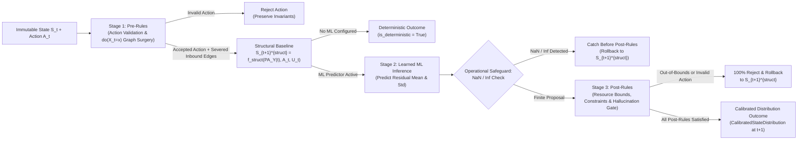
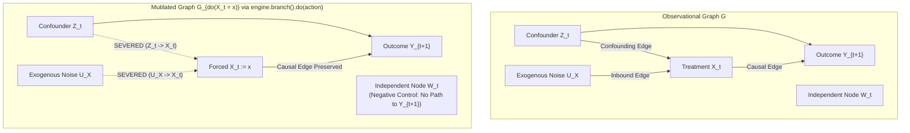

# Realigned Core & Domain Architecture: OCEL 2.0, CDA Dynamics, and DoWhy-GCM Causality

The **Enterprise World Model Engine (EWM Engine)** strictly separates its domain-neutral **Core Engine** (`ewm_engine.core`) from domain-specific **Application Packs** (`ewm_engine.domains.finance` and `ewm_engine.domains.software_engineering`). Historical documentation prior to the E1–E10 realignment is archived under [`docs/legacy/`](legacy/architecture_legacy.md).

---

## 1. Core Engine vs. Domain Packs Delineation

| Architectural Layer | Module Path | Responsibility & Mathematical Contract |
| :--- | :--- | :--- |
| **Core State (OCEL 2.0)** | `ewm_engine.core.ocel` | Relational SQLite Object-Centric Event Log (`StateEncoder`, $N:M$ `event_object` E2O and `object_object` O2O mappings) with PM4Py JSON/XML/CSV/XES interoperability. |
| **Core Dynamics (CDA)** | `ewm_engine.core.dynamics` | Continual Discovery Agent (`RetrieveAndReasonEngine`) modeling $s_{t+1} \sim P(s_{t+1} \mid s_t, a_t, c)$ with explicit `RuleAttribution` to retrieved `BusinessRule` configs $c$. |
| **Core Causality (DoWhy-GCM)** | `ewm_engine.core.causal` | Graphical Structural Causal Models (`EngineCausalInterface`) enforcing strict DAG acyclicity and modular graph surgery $do(V_s = v_s)$. |
| **Finance Domain Pack (E6)** | `ewm_engine.domains.finance` | Arbitrary-precision `Decimal` double-entry ledgers (`ImmutableLedger`, `ImmutableTransaction`, `Entry`) enforcing $dr - cr = 0$ and $h_a = h_o$. |
| **Software Engineering Pack (E7)** | `ewm_engine.domains.software_engineering` | Sparse eIRWR + DynaCausal microservice incident cascade simulator (`DynamicRCASimulator`) with anomaly-conditioned resilience $R_i = R_{\text{base}} \exp(-\beta \hat{s}_i)$ and backward retry edges ($\rho$). |

---

## 2. Hybrid Transition Router Pipeline (`Pre-rules -> ML -> Post-rules`)

---

## 2. Pearlian `do(X_t = x)` Causal Surgery & Confounding Removal

For a structural causal system $Y_{t+1} = f(X_t, Z_t, U_t)$ where an observational confounder $Z_t$ drives both treatment $X_t$ and outcome $Y_{t+1}$:

### Key Guarantees (`EWM-002`)
1. **Deterministic vs. Calibrated Outcome (`TransitionEngine.step(state, action)`)**:
   - Returns a deterministic `TransitionStepOutcome` (`is_deterministic=True`, `distribution=None`) when only structural rules apply.
   - Returns a calibrated distribution (`is_deterministic=False`, `distribution=CalibratedStateDistribution`) when an ML module is active.
2. **Pre-Rule Structural Gate**: Rejects invalid enterprise actions before any state transition or learned inference executes.
3. **Operational `NaN`/`Inf` Safeguard**: Intercepts numerical `NaN` or `Inf` emitted by learned modules *before* structural `Post-rules` evaluation (`NumericalInstabilityError`).
4. **Post-Rule 100% Rollback**: Rejects 100% of out-of-bounds ML predictions and hallucinated invalid actions, rolling back to the valid deterministic structural state $S_{t+1}^{\text{struct}}$.
5. **Context-Managed `Intervention` & `engine.branch().do(action)`**: Forces specific state nodes, overrides standard and learned dynamics, and severs all inbound edges $(u \to X_t)$ in the causal graph (Peters et al., 2017; Pearl, 2009).
