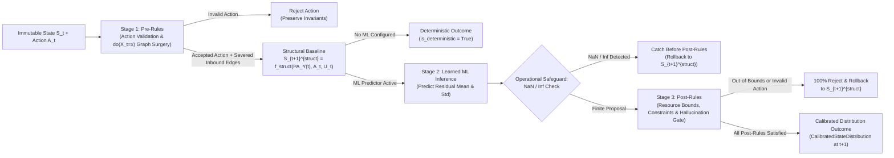
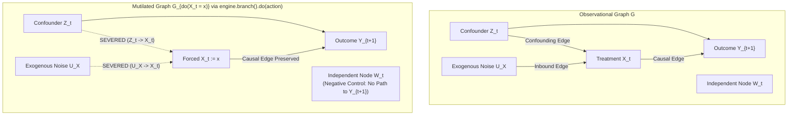

# Hybrid Dynamics Router & Causal Fabric Architecture (`EWM-002`)

The Enterprise World Model Engine separates hard structural compliance rules from uncertain machine-learning predictions through the **`HybridTransitionRouter`** (`Pre-rules -> ML -> Post-rules`) and enforces Pearl's $\text{do}(X_t = x)$ causal graph surgery via **`TransitionEngine.branch().do(action)`** and **`Intervention`** context managers.

---

## 1. Hybrid Transition Router Pipeline (`Pre-rules -> ML -> Post-rules`)

---

## 2. Pearlian `do(X_t = x)` Causal Surgery & Confounding Removal

For a structural causal system $Y_{t+1} = f(X_t, Z_t, U_t)$ where an observational confounder $Z_t$ drives both treatment $X_t$ and outcome $Y_{t+1}$:

### Key Guarantees (`EWM-002`)
1. **Deterministic vs. Calibrated Outcome (`TransitionEngine.step(state, action)`)**:
   - Returns a deterministic `TransitionStepOutcome` (`is_deterministic=True`, `distribution=None`) when only structural rules apply.
   - Returns a calibrated distribution (`is_deterministic=False`, `distribution=CalibratedStateDistribution`) when an ML module is active.
2. **Pre-Rule Structural Gate**: Rejects invalid enterprise actions before any state transition or learned inference executes.
3. **Operational `NaN`/`Inf` Safeguard**: Intercepts numerical `NaN` or `Inf` emitted by learned modules *before* structural `Post-rules` evaluation (`NumericalInstabilityError`).
4. **Post-Rule 100% Rollback**: Rejects 100% of out-of-bounds ML predictions and hallucinated invalid actions, rolling back to the valid deterministic structural state $S_{t+1}^{\text{struct}}$.
5. **Context-Managed `Intervention` & `engine.branch().do(action)`**: Forces specific state nodes, overrides standard and learned dynamics, and severs all inbound edges $(u \to X_t)$ in the causal graph (Peters et al., 2017; Pearl, 2009).
