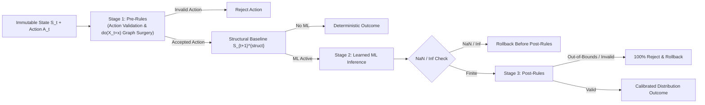

# Architecture Overview

The Enterprise World Model Engine is designed around strict separation of concerns, high modularity, and deterministic execution.

---

## High-Level Component Topology

```
ewm_engine/
  ├── core/            # Domain primitives: World, WorldState, Entity, Relationship, Resource, Action, Event
  ├── dynamics/        # Pluggable transition models: Deterministic, Stochastic, Composite, Learned
  ├── constraints/     # First-class verification: Registry, Hard/Soft enforcement, Provenance
  ├── actors/          # Decision-making agents: Rule-based, Threshold, Stochastic, External adapters
  ├── simulation/      # Execution engine: Seeded Monte Carlo rollouts, Branching, Trajectory tracking
  ├── provenance/      # Epistemic clarity: EvidenceLevel, SimulationMetadata, SystemicTrace DAG
  ├── evaluation/      # Statistical analysis: Uncertainty quantiles, Metrics, ScenarioComparison
  └── cli/             # Developer CLI: ewm example, ewm run
```

---

## Subsystem Interactions

1. **State Snapshotting**: A `World` instance holds an initial immutable `WorldState` snapshot $S_0$.
2. **Pluggable Dynamics Engine**: Transitions are governed by instances conforming to the `DynamicsModel` protocol:
   $$\mathcal{T}(S_t, A_{\text{accepted}}, E_t, \text{rng}) \longrightarrow (S_{t+1}, \text{applied\_changes}, \text{evidence\_level})$$
3. **Double Constraint Validation**:
   - **Pre-transition**: Checks proposed actions before dynamics execute (rejects invalid operations).
   - **Post-transition**: Verifies that the resulting state conforms to operational invariants (detects capacity breaches and penalties).
4. **Counterfactual Branching**: Calling `world.branch()` clones the model state and registries without mutating the parent world, enabling side-by-side rollout comparisons.
5. **Hybrid Transition Router (`Pre-rules -> ML -> Post-rules`)**: Separates structural compliance rules from uncertain learned predictions, intercepts numerical `NaN`/`Inf` before structural evaluation, rejects 100% of out-of-bounds ML hallucinations, and supports `engine.branch().do(action)` causal graph surgery (see [`docs/architecture.md`](../architecture.md)).


