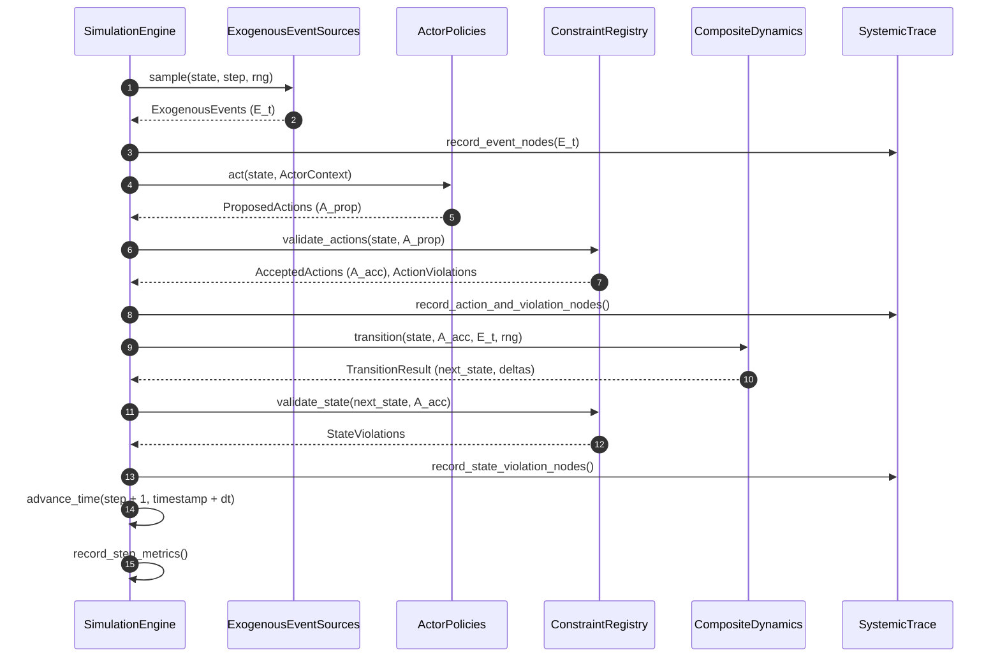

# Simulation Execution Lifecycle

The simulation engine coordinates state evolution through an explicit, reproducible step execution loop.

---

## Detailed Step Lifecycle



---

## Reproducible Seed Sequence Architecture

To guarantee exact bit-for-bit determinism across Monte Carlo rollouts:
1. The user supplies a master seed $s$ (e.g. `seed=42`).
2. The engine constructs a NumPy `SeedSequence(s)`.
3. Independent child seeds are spawned for each sample:
   ```python
   child_seeds = SeedSequence(scenario.seed).spawn(scenario.samples)
   ```
4. Each rollout trajectory receives its own dedicated pseudo-random generator `default_rng(child_seeds[k])`.
5. Rollouts are completely independent and immune to order-of-execution variations.

---

## Context-Conditioned Transitions, Partial Observability & Hybrid Feasibility ([ADR-053](../adr/ADR-053-formal-enterprise-world-model-semantics-and-context.md))

1. **Observation Filtering ($O_t$)**: Before invoking `actor.act(observed_state, context)`, the engine applies `world.observation_filter.observe(state, actor_id=actor.actor_id)` when `world.observation_spec` is configured, ensuring actors cannot access hidden entities, resources, relationships, memory, or rules.
2. **Context Conditioning ($K_t$)**: When `world.runtime_context` (`ContextSnapshot`) is present, context-aware mechanisms receive the projected slice `K_t.project(required_context_keys)` and record `context_metadata` (`context_id`, `version`, `fingerprint`, `domain_fingerprint`) alongside `mechanism_provenance` (`MechanismProvenance` with `MechanismKind`: `KNOWN_DETERMINISTIC`, `KNOWN_STOCHASTIC`, `LEARNED`, `DISCOVERED_AT_RUNTIME`, or `HYBRID`) in `TransitionResult.diagnostics` and `SystemicTrace`.
3. **Constraint-Preserving Hybrid Residuals (`InfeasibleResidualPolicy`)**: When a learned residual in `GreyBoxDynamics` / `HybridDynamics` or `LinearResidualDynamics` proposes an infeasible delta, silent repair is forbidden. The transition executes the configured policy (`PROJECT`, `REJECT`, `ABSTAIN`, or `INVALIDATE`) and logs a `ResidualFeasibilityRecord`. Under `INVALIDATE`, the step emits a hard `POST_TRANSITION` constraint violation (`hybrid_residual_feasibility`) and terminates the trajectory with `TrajectoryStatus.INVALID`.
