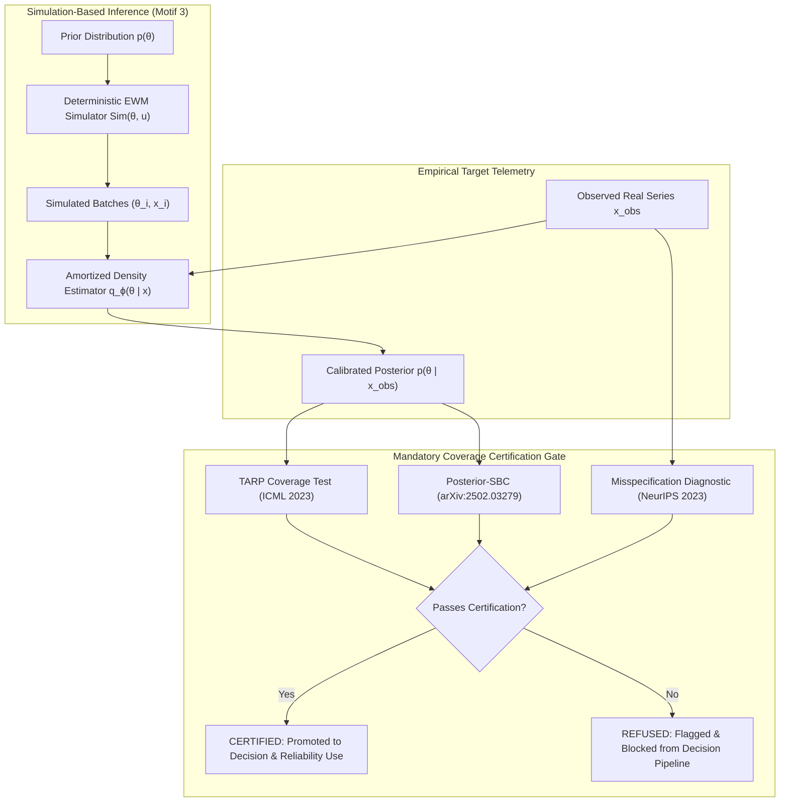

# Amortized Simulation-Based Calibration with Certified Coverage

> *"Hand-tuning simulation parameters is neither reproducible nor honest. Simulation-Based Inference learns an amortized posterior over calibration parameters—and, done EWM's way, refuses to report a calibration it cannot certify."*

---

## 1. The Real-World Calibration Gap

Enterprise world models simulate complex organizational, supply chain, epidemiological, and operational dynamics from initial states, known conservation laws, and behavioral policies. However, simulators possess tunable continuous parameters—such as depletion rates, market demand elasticity, lead times, or infection coefficients.

Historically, organizations tuned these parameters through manual spreadsheet tweaking, unconstrained least-squares curve fitting, or point estimation. This introduces three severe epistemic failures:
1. **Spurious Point Certainty:** Real enterprise dynamics are subject to epistemic uncertainty; reporting a single scalar parameter $\hat{\theta}$ conceals parameter confounding and posterior variance.
2. **Computational Inefficiency:** Classical Markov Chain Monte Carlo (MCMC) requires rerunning expensive simulation rollouts for thousands of iterations *every time* a new telemetry point arrives.
3. **Miscalibration & Misspecification:** Simulators are inevitably simplified models of reality. Standard Bayesian updates often become wildly overconfident or completely invalid under model misspecification, leading downstream decision-makers to make catastrophically fragile commitments.

The **Enterprise World Model Engine** resolves this via **Simulation-Based Inference (SBI)** coupled with a **mandatory coverage certification gate**.

---

## 2. Scientific Foundations & Anchors



### 2.1 Simulation Intelligence Motif 3
In *"Simulation Intelligence: Towards a New Generation of Scientific Methods"* (Lavin et al., arXiv:2112.03235), simulation-based inference forms the critical bridge connecting mechanistic forward simulators with machine learning. Rather than replacing the simulator with a black box, SBI treats the existing forward engine as the simulator and learns inverse mappings $p(\theta \mid x)$.

### 2.2 Amortized Neural Posterior Estimation (NPE) & Simformer
In traditional Bayesian calibration (Kennedy & O'Hagan, JRSS-B 2001), inference must be rerun from scratch for every new observation $x_{obs}$. Amortized SBI (Boelts et al., *"sbi reloaded"*, arXiv:2411.17337; Gloeckler et al., *"Simformer"*, ICML 2024) simulates a batch of $(\theta_i \to x_i)$ pairs once offline and trains a conditional estimator $q_\phi(\theta \mid x)$. At test time, conditioning on empirical target telemetry $x_{obs}$ takes milliseconds and produces an amortized posterior distribution.

EWM Engine provides a pure NumPy kernel-conditioned locally linear Bayesian amortizer out of the box, with zero heavy dependencies, and seamlessly delegates to PyTorch NPE / Simformer via the optional `[sbi]` extra.

### 2.3 Mandatory Coverage Certification: TARP & Posterior-SBC
Bayesian posteriors in high dimensions can collapse, become overconfident, or underestimate tails. EWM Engine introduces the **Mandatory Coverage Certification Gate**:
- **TARP (Tests of Accuracy and Relative Precision; Lemos et al., ICML 2023, arXiv:2302.03026):** Evaluates joint coverage across nominal credibility levels $\alpha \in [0.1, 0.9]$. For a set of holdout test pairs $(\theta_j^*, x_j^*)$, TARP computes credibility fractions $f_j = \mathbb{P}_{\tilde{\theta} \sim q(\cdot \mid x_j^*)}(\|\tilde{\theta} - r\| < \|\theta_j^* - r\|)$ against reference point $r$. If the estimator is well-calibrated, $f_j \sim \text{Uniform}([0, 1])$. EWM Engine tests this via Kolmogorov-Smirnov statistics and bounds maximum discrepancy.
- **Posterior-SBC (arXiv:2502.03279):** Standard Simulation-Based Calibration (SBC) checks prior data distributions. Posterior-SBC validates calibration *conditional on the actual observed dataset* $x_{obs}$, re-inferring parameter ranks under forward re-simulations from posterior draws.

### 2.4 Misspecification Detection (Huang et al., NeurIPS 2023)
Every enterprise simulator is an approximation of the real world. When real-world data $x_{obs}$ falls outside the generative manifold of the simulator (model misspecification), standard Bayesian updates produce deceptively sharp posteriors centered on nonsensical parameters. EWM Engine implements the robust distance metric of Huang et al. (arXiv:2305.15871):
$$\text{Score}(x_{obs}) = \frac{1}{P} \sum_{p=1}^P \frac{|x_{obs, p} - \mu_{sim, p}|}{\sigma_{sim, p}}$$
If this score exceeds 3.5 standard deviations, the model is flagged as `UNCERTIFIED_MISSPECIFIED`.

---

## 3. The Refuse-If-Uncertified Doctrine

Mirroring EWM Engine's causal discipline (*"refuse to claim causal effects when backdoor identification fails"*), the calibration engine **refuses to report an uncertified posterior for downstream decision making**.

```
+------------------------------------------------------------------------+
| Calibration Report: calib_SupplyChain_20261015                         |
+========================================================================+
| Coverage Status:       [REFUSED] UNCERTIFIED_MISSPECIFIED              |
| Decision Usable:       NO (Refused for decision use)                   |
| TARP Max Discrepancy:  0.4210                                          |
| Misspecification:      18.42 std (DETECTED)                            |
|                                                                        |
| Refusal Rationale:                                                     |
|   Model Misspecification: Observed target data lies 18.42 standard     |
|   deviations outside the simulator generative support (Huang et al.).  |
|   The simulator cannot reproduce real observations under any prior.    |
+------------------------------------------------------------------------+
```

When uncertified:
1. `certificate.decision_usable` is set to `False`.
2. Downstream decision tools (`ewm decide`) reject the model spec for policy optimization.
3. The CLI exits with error code 1 unless `--allow-uncertified` is explicitly passed for diagnostic inspection.

---

## 4. Epistemic Integrity: Calibrated $\neq$ Causally Identified

A certified calibration proves that the simulator's parameter distribution reproduces historical observational time series. **It does not prove that those parameters are structural or causally identified.**

In EWM Engine's epistemic tier hierarchy:
- Certified calibration promotes a model from speculative simulation to **`EvidenceLevel.PREDICTIVE`**.
- It is **never** auto-promoted to `EvidenceLevel.STRUCTURAL` or `EvidenceLevel.CAUSAL`.
- Counterfactual rollouts on calibrated models require structural backdoor or instrumental identification (Structural Causal Model).

---

## 5. CLI Usage: `ewm calibrate`

Calibrate any WorldSpec with target data and priors:
```bash
ewm calibrate spec.yaml \
  --data empirical_series.yaml \
  --priors priors.yaml \
  --samples 100 \
  --posterior-samples 500 \
  --seed 42 \
  --out calib_artifact.json \
  --markdown-out calib_artifact.md
```

Options:
- `--data <file>`: Target time series observations in YAML, JSON, or CSV.
- `--priors <file>`: Optional YAML declaring prior distributions (`uniform`, `gaussian`, `log_uniform`). If omitted, sensible uniform priors are derived automatically from resource declarations.
- `--summary-mode trajectory|moments`: Match full trajectory series or summary statistical moments (mean, std, min, max, final).
- `--allow-uncertified`: Diagnostic flag allowing execution to return 0 even when certification fails.
