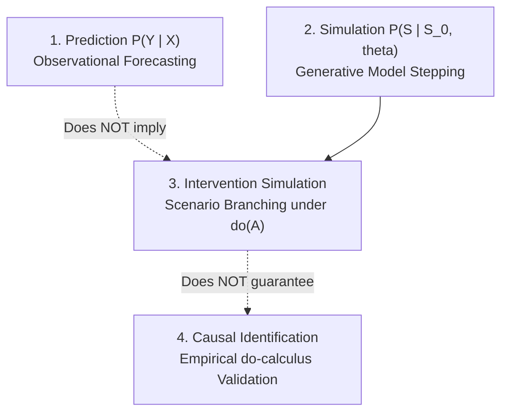
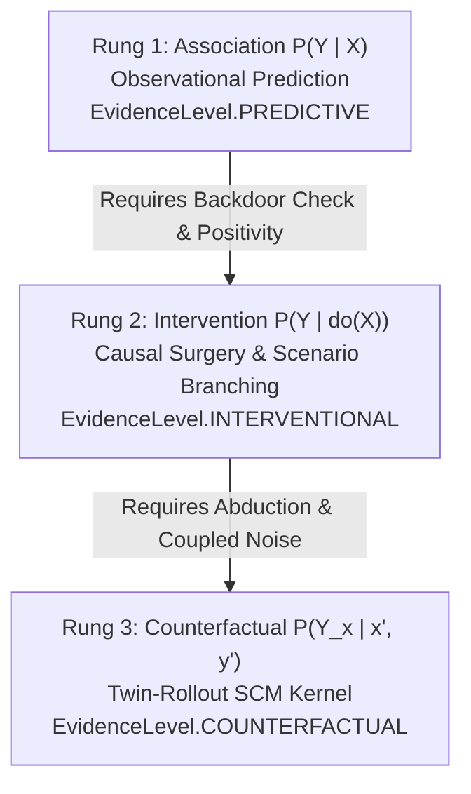

# Causal Epistemology and Scientific Integrity

One of the defining commitments of the **Enterprise World Model Engine (EWM Engine)** is **epistemic honesty**: the absolute refusal to label predictive, observational associations or simulation branchings as proven real-world causal relationships.

---

## 1. Prediction vs. Simulation vs. Intervention vs. Causal Identification

In enterprise decision science and machine learning, four distinct analytical capabilities are frequently conflated:

1. **Prediction ($P(Y \mid X)$)**: Observational forecasting of future metrics given historical data. Answers: *"What has typically occurred when $X$ was observed?"*
2. **Simulation ($P(S_{1:T} \mid S_0, \theta)$)**: Stepping a generative model forward in time given an initial state $S_0$ and transition parameters $\theta$. Answers: *"How does our mathematical model evolve over time?"*
3. **Intervention Simulation ($P(S_{1:T} \mid S_0, \text{do}(A))$)**: Altering actions or structural rules within the model to observe simulated downstream state changes. Answers: *"What happens inside this model if we inject action $A$?"*
4. **Causal Identification ($P(Y \mid \text{do}(X))$ in the Real World)**: Mathematically and empirically proving that a simulated interventional distribution corresponds to the actual real-world response under deliberate manipulation. Answers: *"Will real-world reality change in the predicted manner if we alter policy $X$?"*



---

## 2. Theoretical Foundations: Why $P(Y \mid X) \neq P(Y \mid \text{do}(X))$

A foundational error in applied enterprise analytics is equating conditional observational forecasting with interventional outcomes:

$$P(Y \mid X) \;\neq\; P(Y \mid \text{do}(X))$$

### 2.1 The Observational Confounding Trap
Observing that a retailer experiences stockouts whenever price promotions are active ($P(\text{Stockout} \mid \text{Promotion})$) does **not** prove that launching a price promotion will causally induce stockouts. Unobserved confounders—such as major holiday seasons, competitor supply disruptions, or regional demand spikes—drive both customer foot traffic and promotional timing simultaneously.

Conditioning on $X$ filters historical data where $X$ naturally occurred. Intervening with $\text{do}(X)$ severs the incoming causal parents of $X$, altering the structural data-generating mechanism.

### 2.2 Theoretical Foundations: Richens & Everitt (ICLR 2024)
The theoretical justification for EWM Engine's architecture is provided by **Richens & Everitt ("Robust agents learn causal world models", ICLR 2024 oral, arXiv:2402.10877)**.

Their central theorem establishes that:
> **Any agent or decision system that successfully generalizes across distribution shifts must have implicitly learned an approximate causal model of the environment.**

Specifically, an agent optimizing purely observational associations $P(Y \mid X)$ will catastrophically fail under out-of-distribution interventions. Robust decision-making requires separating:
1. **Explicit, known causal mechanisms** (conservation laws, physical constraints, operational handoffs).
2. **Exogenous noise variations** ($U_i$) driven by environmental shocks or actor choices.
3. **Learned stochastic dynamics** ($f_i(\text{PA}_i, U_i)$) bounded by invariant boundaries.

This theorem provides the rigorous license for EWM Engine: agents and policies orbit the engine; the engine itself is the **explicit Structural Causal Model (SCM)** that simulates the environment under Pearl's do-calculus.

---

## 3. Pearl's Typed Ladder of Causation

The engine natively formalizes Judea Pearl's three-tiered hierarchy of causal reasoning:



### 3.1 Rung 1: Observational Association
Observational expectations $\mathbb{E}[Y \mid X=x]$ are evaluated via `query_observational()`. They are strictly tagged with `EvidenceLevel.PREDICTIVE`. They reflect correlation and carry an explicit disclaimer that observational associations do not imply causal effects.

### 3.2 Rung 2: Interventional Identification & Backdoor Checking
Interventional queries $\mathbb{E}[Y \mid \text{do}(X=x)]$ perform causal surgery on the data-generating mechanism.

Before asserting `EvidenceLevel.INTERVENTIONAL`, the engine validates **Judea Pearl's Backdoor Criterion** on the declared [`CausalGraph`](file:///c:/Users/vinicius/Documents/GeminiCodes/Enterprise-World-Model-Engine/src/ewm_engine/core/scm.py):
1. **Descendant Check**: No variable in the conditioning set $Z$ may be a descendant of treatment $X$.
2. **Backdoor Blocking Check**: Conditioning set $Z$ must block all active backdoor paths from $X$ to outcome $Y$.

If backdoor paths remain open or unobserved confounders exist, the engine refuses to return a scalar effect estimate, returning a [`NotIdentifiableResult`](file:///c:/Users/vinicius/Documents/GeminiCodes/Enterprise-World-Model-Engine/src/ewm_engine/experimental/causal.py) tagged with `EvidenceLevel.PREDICTIVE`.

### 3.3 Rung 3: Native Counterfactual SCM Kernel (`world.counterfactual()`)
Rung 3 answers entity-level retrospective queries: *"Given that this specific warehouse stocked out at step 2 under observed demand, what would have happened had we rerouted supply at step 0?"*

Under Pearl (2009), counterfactuals require three algorithmic steps:
1. **Abduction**: Infer the posterior over exogenous background noise $U$ given the factual trajectory $\tau = (S_0, A_{0:T}, S_{1:T})$.
   - Invertible / deterministic mechanisms yield unique, exact algebraic recovery: $U_i := f_i^{-1}(V_i, \text{PA}_i)$.
   - All exogenous draws are addressably recorded in [`SystemicTrace.exogenous_noise`](file:///c:/Users/vinicius/Documents/GeminiCodes/Enterprise-World-Model-Engine/src/ewm_engine/provenance/trace.py).
   - If a mechanism is non-invertible, the engine refuses to emit a false point counterfactual, returning a posterior distribution with `is_unique=False` and a structured [`NonUniqueAbductionWarning`](file:///c:/Users/vinicius/Documents/GeminiCodes/Enterprise-World-Model-Engine/src/ewm_engine/core/scm.py).
2. **Action (Graph Surgery)**: Apply $\text{do}(X = x)$ by mutilating the structural assignment:
   $$X := x, \quad \text{severing } \text{PA}(X) \to X$$
3. **Prediction (Twin-Rollout Noise Coupling)**: Re-run the simulation holding all exogenous noise variables $U$ coupled bit-for-bit to the factual branch.

```python
# Native counterfactual execution
cf_result = world.counterfactual(
    observed=factual_trajectory,
    intervention={"warehouse_stock": 350.0},
    horizon=4,
)

# Inspect divergence metrics and trace diff
print(cf_result.target_divergences)
print(cf_result.locality_preserved)
print(cf_result.trace_diff.to_mermaid())
```

---

## 4. Empirical Diagnostics for Observational Data

Even if a causal graph is identified in theory, empirical estimation from finite observational datasets requires two non-trivial conditions: **Positivity** and **Unconfoundedness**.

### 4.1 Overlap & Positivity Diagnostics (`check_positivity_overlap`)
Positivity (or common support) requires that every unit has a non-zero probability of receiving any treatment:

$$0 < P(X = 1 \mid Z = z) < 1 \quad \forall z$$

`check_positivity_overlap` fits propensity scores and computes:
- **Overlap Index**: Bhattacharyya coefficient of propensity distributions between treated and control units.
- **Extreme Propensity Identification**: Identifies near-deterministic treatment assignments ($P \approx 0$ or $P \approx 1$) that lead to extreme variance and ungrounded extrapolation.
- **High-Dimensional Warnings**: Incorporates D'Amour et al. (arXiv:1711.02582) overlap collapse warnings as covariate dimensionality increases.

### 4.2 Confounding Sensitivity Diagnostics (`report_confounding_sensitivity` & E-values)
No observational study can empirically prove the absence of unobserved confounding. The engine provides two rigorous sensitivity diagnostics:
1. **Rosenbaum Bounds ($\Gamma$)**: Measures how strong an unobserved confounder would have to alter treatment odds to nullify the effect estimate.
2. **E-values (VanderWeele & Ding, 2017)**: Computes the minimum risk ratio that an unmeasured confounder must have with both treatment and outcome to explain away the observed effect.

---

## 5. Twin-Rollout Coupled Noise & Bit-Reproducibility

In standard Monte Carlo simulators, branching a scenario with an uncorrelated seed induces random divergence having nothing to do with the intervention:

```
Uncoupled Branching:
Factual:         S_0 ---> S_1(w_1) ---> S_2(w_2)
Counterfactual:  S_0 ---> S_1(w'_1) ---> S_2(w'_2)   (Noise uncoupled: confounded by stochasticity)
```

EWM Engine implements **Twin-Rollout Noise Coupling**:

```
Twin-Rollout Noise Coupling:
Factual:         S_0 ---> S_1(U_1) ---> S_2(U_2)
                          |              |  (Same coupled exogenous noise U_t)
                          v              v
Counterfactual:  S_0'---> S'_1(U_1)---> S'_2(U_2)  (Difference is SOLELY the causal intervention)
```

### 5.1 Bit-Reproducibility Contract (S00 Invariant 5)
1. **Exact Seed Sequence Coupling**: Sub-stream random generators are derived deterministically via `np.random.SeedSequence`.
2. **Bit-Identical Invariance**: If an intervention has no causal path to variable $Y$, the counterfactual trajectory of $Y$ is bit-identical to its factual trajectory.
3. **Trace Diff (`TraceDiff`)**: Categorizes nodes into `invariant_nodes` vs. `divergent_nodes`, proving structural locality.

---

## 6. What EWM Engine Strictly Does NOT Claim

To preserve scientific humility and prevent executive overclaim:

1. **No Automated Causal Discovery**: The engine does not claim to discover causal graphs from observational data. Causal graphs must be explicitly declared and defended.
2. **Model-Counterfactual Scoping**: Rung-3 counterfactuals carry `EvidenceLevel.COUNTERFACTUAL` with an explicit disclaimer that they are counterfactuals *of the simulation model*, not validated real-world counterfactuals (unless the SCM is empirically calibrated).
3. **No Automatic Level Elevation**: Predictive associations and observational fits are **never** auto-upgraded to `INTERVENTIONAL` or `COUNTERFACTUAL`.
4. **No `"causes"` Edges**: Provenance traces model simulated mechanistic dependencies (`influences`, `drives`, `perturbs`, `conditions`), strictly forbidding `"causes"` relations.
