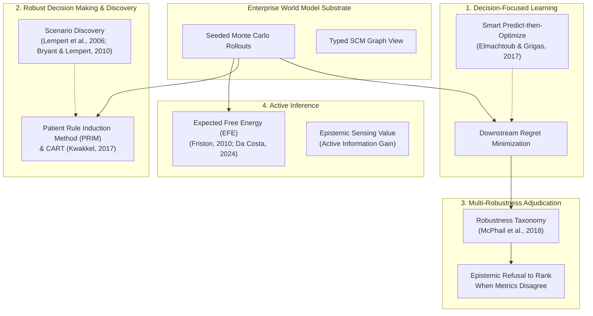

# Decision-Focused Scenario Discovery & Multi-Robustness Adjudication

> **Headline Reframing:** Transforming the world model from a *predictive simulator* ("what could happen?") into a *decision instrument* ("what should we do, and under which futures does it break?").

---

## 1. Motivation: Why Point Accuracy Fails Decisions

Enterprise world models simulate complex, interconnected socio-technical systems characterized by **deep uncertainty**—conditions where the system dynamics, probability distributions over external drivers, and stakeholder utility functions are unknown, non-stationary, or contested (Knight 1921; Lempert et al. 2003).

In these operating regimes, ranking policies or world models by **rollout accuracy (mean squared error)** is fundamentally flawed:
1. **Prediction Error ≠ Decision Quality:** A world model with minimal rollout error can still recommend catastrophic decisions if its errors concentrate around critical decision boundaries or constraint thresholds.
2. **The Curse of Optimization:** Optimizing a policy against a single calibrated point forecast overfits to nominal conditions and leaves the enterprise vulnerable to tail shocks.
3. **The Illusions of Confident Ranking:** Collapsing multi-dimensional deep uncertainty into a single expected value or confidence interval obscures the fact that different robustness criteria favor completely different actions.

---

## 2. Scientific & Intellectual Lineage

EWM Engine's decision layer (`ewm_engine.decision`, CLI `ewm decide`) grounds its methodology in four converging disciplines:



### 2.1 Decision-Focused Learning (DFL)
Anchored in the work of **Elmachtoub & Grigas ("Smart 'Predict-then-Optimize'", Management Science 2022, arXiv:1710.08005)** and Mandi et al. (2023), DFL establishes that model parameters and policy candidates must be trained and evaluated against the **downstream decision loss (regret)** rather than statistical goodness-of-fit. EWM Engine evaluates policies directly by how much regret they incur across evaluated futures relative to the hindsight-optimal choice.

### 2.2 Robust Decision Making (RDM) & Scenario Discovery
Pioneered at the RAND Corporation by **Lempert, Popper & Bankes (2003, 2006)** and **Bryant & Lempert (2010)**, RDM inverts traditional "predict-then-act" analysis. Instead of predicting the most likely future and optimizing for it, RDM stress-tests candidate strategies across thousands of plausible futures to discover **vulnerability scenarios**—concise, interpretable subspaces of the uncertainty space where a policy fails.

EWM Engine implements:
- **Patient Rule Induction Method (PRIM; Friedman & Fisher, 1999):** An iterative peeling algorithm that discovers orthogonal bounding boxes with high failure density and coverage, surfaced with quasi-p-values.
- **Classification and Regression Trees (CART; Breiman et al., 1984):** Fast binary recursive partitioning extracting interpretable rule sets.
- **Optional EMA Workbench Adapter (Kwakkel, 2017):** Seamless integration with `ema_workbench` behind the `[decision]` extra.

### 2.3 Multi-Robustness Adjudication & The Refusal to Rank
In a landmark empirical study across water resources and infrastructure planning, **McPhail et al. ("Robustness metrics: How choice of metric changes which policy wins", 2018)** proved that under deep uncertainty, the choice of mathematical robustness metric drastically changes which policy is identified as optimal:
- **Min-Max Regret (Savage, 1951):** Minimizes worst-case regret across all conceivable futures (extreme risk aversion).
- **Percentile / CVaR Regret (Rockafellar & Uryasev, 2000):** Minimizes the expected regret in the worst 10% tail, ignoring isolated extreme outliers.
- **Starr's Domain Criterion / Satisficing (Starr, 1962; Simon, 1955):** Maximizes the proportion of futures in which performance meets an acceptable operational threshold.

#### The Core Ethos: Epistemic Refusal to Rank
Just as EWM Engine refuses to auto-promote observational associations to causal claims without mathematical identifiability (ADR-039), **the engine refuses to declare a single winning decision when robustness metrics disagree**:
> When Min-Max Regret favors Policy A while Satisficing favors Policy B, declaring a single winner would impose an arbitrary, ungrounded risk posture upon the enterprise. EWM Engine surfaces the disagreement, explains the underlying trade-offs, and prompts human executives to choose according to organizational risk tolerance.

### 2.4 Active Inference & Expected Free Energy (EFE)
Grounded in active inference (**Friston 2010; Parr, Pezzulo & Friston 2022; Da Costa et al. 2024; pymdp**), EWM Engine offers an optional Expected Free Energy (EFE) action scorer. EFE evaluates candidate decisions as:
$$\text{Score}(\pi) = (1 - \beta) \cdot \text{PragmaticValue}(\pi) + \beta \cdot \text{EpistemicValue}(\pi)$$
- **Pragmatic Value (Extrinsic):** Expected progress toward operational targets / minimal loss.
- **Epistemic Value (Information Gain):** The mutual information between rollout outcomes and latent parameter uncertainty—rewarding actions that probe the environment and actively reduce the world model's own uncertainty.

---

## 3. Workflow: Using `ewm decide`

The decision analysis engine is available via Python API and CLI:

```bash
# Run decision analysis across parameter uncertainty with PRIM scenario discovery
ewm decide examples/minimal_warehouse/spec.yaml \
    --samples 40 \
    --seed 42 \
    --threshold 10.0 \
    --efe \
    --out decision_report.json \
    --markdown-out decision_report.md
```

### Python API Example

```python
from ewm_engine.core.actions import Action
from ewm_engine.core.world import World
from ewm_engine.decision import DecisionEngine
from ewm_engine.experimentation.params import ParameterDef, ParameterSpace

# 1. Define parameter uncertainty space
space = ParameterSpace(
    name="LogisticsUncertainty",
    parameters=(
        ParameterDef(name="demand_spike", type="continuous", bounds=(20.0, 80.0), default=40.0),
        ParameterDef(name="transport_delay", type="continuous", bounds=(1.0, 5.0), default=2.0),
    ),
)

# 2. Define candidate policies
candidates = {
    "status_quo": None,
    "moderate_reroute": Action(
        id="act_mod",
        type="transfer_resource",
        parameters={"quantity": 20.0},
    ),
    "aggressive_reroute": Action(
        id="act_agg",
        type="transfer_resource",
        parameters={"quantity": 40.0},
    ),
}

# 3. Execute decision analysis
engine = DecisionEngine(discovery_algorithm="prim")
report = engine.decide(
    world=world,
    uncertainty_space=space,
    candidates=candidates,
    objective_metric="unserved_demand",
    satisficing_threshold=5.0,
    n_samples=50,
    seed=42,
    include_efe=True,
)

print(report.summary_table())
```
