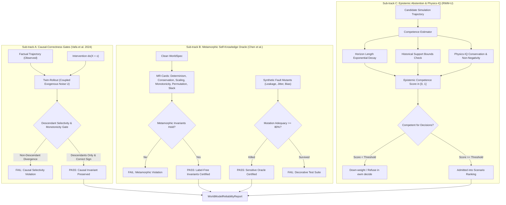

# Beyond Rollout Error: Causal Correctness, Metamorphic Oracles, and Epistemic Abstention

> *"A world model can achieve zero rollout error while encoding an entirely fictional causal topology. Realism and perceptual likelihood are completely uncorrelated with physical correctness. A genuine enterprise world model must be certified against interventional selectivity, metamorphic conservation laws, and certified epistemic abstention."*

---

## 1. The Fundamental Evaluation Gap

In traditional machine learning and generative simulation, model performance is measured by predictive observational loss: Mean Squared Error (MSE), Continuous Ranked Probability Score (CRPS), Log-Likelihood, or Conformal Coverage under the training distribution.

However, seminal frontier research demonstrates that **rollout error cannot certify whether a world model is causally sound or physically coherent**:

1. **Causal Incoherence Under Predictive Accuracy (Vafa et al., NeurIPS 2024 / ICML 2025):**  
   In *"Evaluating the World Model Implicit in a Generative Model"* (arXiv:2406.03689) and *"What Has a Foundation Model Found?"* (arXiv:2507.06952), Vafa et al. show that a model can achieve near-perfect surface rollout accuracy while harboring internal representations that violate basic causal principles. When subjected to interventions $do(X = x)$, models frequently exhibit spurious cross-talk, perturbing non-descendants or propagating changes in inverted directions.
2. **The Physics-IQ Paradox (Motamed et al., 2025; Kang et al., ICML 2025):**  
   In *"Physics-IQ: Evaluating Physical Reasoning in World Models beyond Perceptual Realism"* (arXiv:2501.09038) and *"How Far is Video Generation from World Model"* (arXiv:2411.02385), researchers show that perceptual plausibility ("looks real") is completely uncorrelated with physical correctness. Models readily simulate convincing trajectories that silently violate conservation of mass, energy, non-negativity, and continuity.
3. **Ungrounded Extrapolation Without Refusal (RWM-U, arXiv:2504.16680):**  
   Standard simulators extrapolate with blind confidence far beyond their verified horizons or historical parameter support. Downstream decision algorithms (`ewm decide`) that optimize against ungrounded rollouts exploit these hallucinations, producing brittle, catastrophic policy failures.

The **Enterprise World Model Engine (EWM Engine)** addresses this evaluation gap by establishing **Reliability as a First-Class Scored Feature**.

---

## 2. Architecture of the Reliability Subsystem

---

## 3. The Three Pillars of Reliability

### Pillar 1: Interventional Selectivity & Counterfactual Consistency
- **Descendant Selectivity:** For an intervention $do(X = x)$, any variable $Y \notin \text{Descendants}(X) \cup \{X\}$ must remain invariant between factual and counterfactual rollouts under coupled exogenous noise ($|Y_{cf}(t) - Y_{factual}(t)| \le \epsilon$).
- **Monotonic Direction:** For any descendant $D$ with a declared directional edge sign $(X \to D)$, the observed sign of $(D_{cf} - D_{factual})$ must strictly align with the declared direction.
- **Anti-Overclaiming Gate:** Passing the causal-correctness gate certifies consistency with the assumed Structural Causal Model (SCM); it does *not* claim to have discovered unconditional physical truth.

### Pillar 2: Metamorphic Invariants as a Label-Free Oracle
Because enterprise systems operate in regimes where future ground-truth telemetry is unavailable, traditional test suites cannot provide supervised validation. EWM Engine employs **Metamorphic Testing (MR-cards)**:
- **MR-1 (Determinism):** Same seed and specification yields bit-identical cryptographic state fingerprints across all steps (Invariant 5).
- **MR-2 (Mass Conservation):** Total systemic resource drift must match recorded net external transaction flows; zero unmetered dissipation or leakage.
- **MR-3 (Scale Homogeneity):** Scaling initial resource capacities scales linear dynamics proportionally.
- **MR-4 (Monotonic Supply Adequacy):** Increasing initial inventory cannot cause terminal inventory to drop below baseline.
- **MR-5 (Entity ID Permutation Invariance):** Isomorphic renaming of entity identifiers ($e_i \to \text{permuted\_}e_i$) leaves systemic numerical levels unchanged.
- **MR-6 (Slack Constraint Invariance):** Adding a slack-satisfied soft constraint does not alter a valid simulation trajectory.
- **Mutation Adequacy Score:** To ensure MR suites are strong and not decorative, synthetic non-equivalent mutants (`UnmeteredLeakageDynamics`, `UnseededJitterDynamics`, `PermutationBiasDynamics`) are injected into the spec. The suite must achieve a mutation adequacy score $\ge 80\%$ (killing injected defects).

### Pillar 3: Epistemic Abstention & The Physics-IQ Guardrail
- **Epistemic Competence Scoring:** Trajectories receive continuous competence scores $C \in [0.0, 1.0]$. The score decays exponentially when rollouts exceed the verified horizon $H_{max}$, and penalizes states drifting outside historical telemetry support bounds.
- **Decision Engine Integration (`ewm decide`):** Rollouts triggering abstention ($C < \tau$) are down-weighted or filtered out during policy optimization, preventing decision-makers from exploiting ungrounded hallucinations.
- **The Physics-IQ Doctrine:** *Never use output plausibility or perceptual realism as a correctness proxy.* Trajectories are audited strictly against non-negativity and conservation laws, completely rejecting surface visual likelihood.

---

## 4. Governance & Verification

Reliability metrics are published as auditable JSON and Markdown artifacts (`WorldModelReliabilityReport`). Deterministic gates block CI merges, ensuring that regression or degradation in causal selectivity immediately halts deployment.
