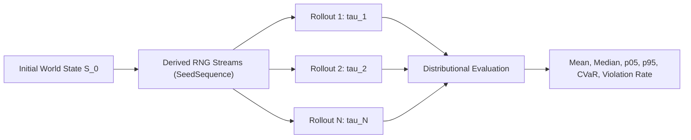
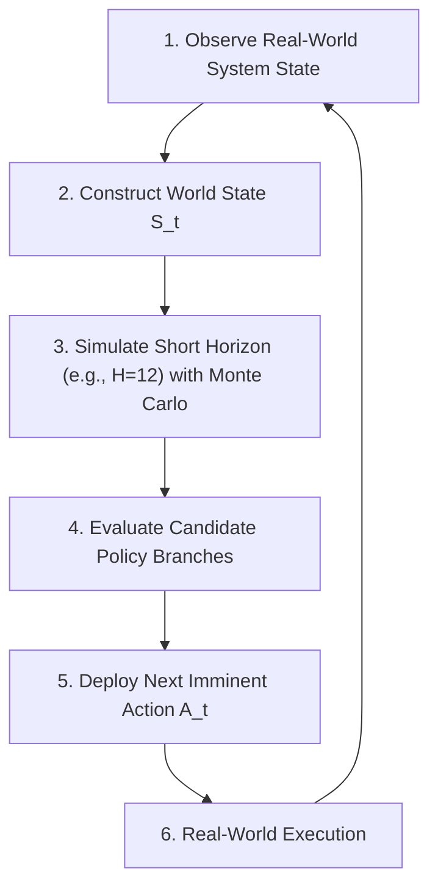

# Uncertainty Quantification: Futures as Distributions

In complex enterprise environments, the future is not a deterministic prophecy. It is a **probability distribution over possible trajectories**.

---

## Why Single-Trajectory Rollouts Fail

Deterministic point forecasts output a single scalar line:
$$\hat{Y}_{t+1:t+H}$$

In actual operational systems:
- Customer demand fluctuates stochastically with heavy-tailed spikes.
- Transport corridors experience weather and congestion delays.
- Supplier lead times exhibit fat-tailed disruptions.
- Machine breakdowns and labor shortages occur intermittently.

A policy that optimizes solely for the *expected average* case frequently collapses under tail-risk events. In mission-critical logistics, healthcare, or disaster relief, evaluating the 5th percentile worst-case scenario ($p_{05}$ or $\text{CVaR}_{05}$) is essential to ensure operational resilience and constraint compliance.

---

## Monte Carlo Rollouts in EWM Engine

EWM Engine uses reproducible pseudo-random seed derivation to execute $N$ independent rollout trajectories across an experimental horizon $H$:

$$\mathcal{T} = \{\tau_1, \tau_2, \dots, \tau_N\}$$

For any target metric $M$, the engine computes full distributional statistics:

- **Central Tendency**: Mean ($\mu$) and Median ($p_{50}$).
- **Spread & Dispersion**: Standard Deviation ($\sigma$) and Interquartile Range ($\text{IQR} = p_{75} - p_{25}$).
- **Tail Risks**:
  - $p_{05}$ (5th percentile lower bound)
  - $p_{95}$ (95th percentile upper bound)
  - $\text{CVaR}_{05}$ (Conditional Value-at-Risk / Expected Shortfall in worst 5% cases)
- **Constraint Violation Probability**:
  $$P(\text{Violation}) = \frac{1}{N} \sum_{k=1}^N \mathbb{I}(\text{Violations}(\tau_k) > 0)$$

---

## The Reproducibility Contract (AC-004)

Enterprise decision making demands cryptographic auditability and exact experiment replication across different machines. EWM Engine guarantees:

> **The Reproducibility Invariant:**
> Same logical initial state + scenario specification + component versions + master seed $\implies$ the exact same built-in logical trajectory across runs and operating systems.

### Deterministic RNG Derivation (AC-009)
- The engine uses `numpy.random.SeedSequence(scenario.seed).spawn(scenario.samples)` to derive $N$ independent, mathematically non-overlapping pseudo-random streams.
- Each rollout receives its own `np.random.Generator` instance passed explicitly into dynamics, exogenous event sources, and stochastic actors.
- **Zero Global State**: Core simulation code never calls or reads global `random` or `numpy.random` state. Reseeding global RNG from host code has zero effect on simulation trajectories.

### Hardware & ML Adapter Non-Determinism Caveat
Built-in dynamics models and standard constraints adhere strictly to bitwise reproducibility. However, external **neural, deep learning, or GPU adapters** (such as PyTorch models, GPU-accelerated solvers, or CUDA kernels) are subject to hardware-level floating-point non-determinism caused by parallel thread scheduling, non-deterministic atomic reductions, and differing BLAS/cuBLAS kernels across GPU microarchitectures. Such ML adapters carry an explicit caveat that hardware-level bitwise equivalence is outside this contract.

### Branch Isolation Property (AC-005)
Scenario branches spawned from a world snapshot via `world.branch()` share no mutable references. Mutating resources, scheduling actions, or running rollouts on branch $B_1$ leaves branch $B_2$ and parent initial state fingerprints completely unaltered.

---

## Model Predictive Control (MPC) and Re-grounding

Long open-loop simulations naturally accumulate variance and diverge from physical reality over extended horizons.

EWM Engine advocates a **receding-horizon execution loop** (Model Predictive Control):

By coupling anticipatory forward simulation over a short window with continuous empirical re-grounding at each discrete decision step, organizations prevent simulation drift while retaining forward visibility.

---

## The 6-Part Uncertainty Taxonomy (`UncertaintyTaxonomyBreakdown`)

A result object must never hide distinct sources of ignorance behind a generic "uncertainty" scalar. EWM decomposes uncertainty into six distinct sources via `UncertaintyTaxonomyBreakdown`:

| Source (`UncertaintySourceType`) | Field in `UncertaintyTaxonomyBreakdown` | Epistemic / Ontic Meaning | Default Status in Pure Simulation |
| :--- | :--- | :--- | :--- |
| `aleatoric` | `aleatoric_std` | Irreducible stochastic dispersion within the declared transition/observation model ($\sigma_{\text{aleatoric}}$). | Estimated when $N \ge 2$ (`estimated_from_rollouts` or `zero_deterministic`). |
| `parameter` | `parameter_std` | Epistemic dispersion induced by posterior uncertainty over continuous parameters $\theta \sim p(\theta \mid x_{\text{obs}})$. | Flagged in `unestimable_sources` unless parameter ensemble draws are supplied. |
| `structural_model` | `structural_model_std` | Epistemic dispersion across competing mechanism graphs or functional forms. | Flagged in `unestimable_sources` under a single `WorldSpec`. |
| `runtime_context` | `runtime_context_std` | Dispersion attributable to shifting or partially observed operational context $C_t$. | Flagged in `unestimable_sources` unless context sweeps are executed. |
| `monte_carlo_error` | `monte_carlo_standard_error` | Finite-sample Monte Carlo estimation standard error ($\text{SE}_{\text{MC}} = \hat{\sigma}_{N-1} / \sqrt{N}$), vanishing as $N \to \infty$. | Estimated when $N \ge 2$. |
| `model_discrepancy_vs_reality` | `model_discrepancy_vs_reality` | Kennedy & O'Hagan (2001) structural discrepancy $\|Y_{\text{real}} - Y_{\text{model}}\|$. | **Always `None` and flagged in `unestimable_sources`** unless external real-world validation residuals are provided. |

---

## Counterfactual Comparison, Conformal Prediction & Multi-Objective Evaluation

Evaluating candidate interventions against a baseline requires explicit estimands, honest interval assumptions, and multi-criteria decision analysis:

### 1. Bootstrap Confidence Intervals, Paired Designs & Zero-Variance Guardrails

Every simulated statistical result explicitly states its in-simulator **estimand** ($\mathbb{E}_{P_{\text{model}}}[Y_{\text{cand}}] - \mathbb{E}_{P_{\text{model}}}[Y_{\text{base}}]$ for independent rollouts, or $\mathbb{E}_{P_{\text{model}}}[Y_{\text{cand}}(U) - Y_{\text{base}}(U)]$ for paired common-random-numbers rollouts).

- **Five Explicitly Named Interval Strategies**: `compute_bootstrap_ci`, `compute_bootstrap_delta`, and `compare_scenarios` support `interval_method` in `{"percentile", "basic", "normal", "studentized", "bca"}` (Efron, 1987).
- **Paired vs. Independent Resampling Design**: Setting `paired=True` when baseline and candidate share coupled trajectory seeds resamples paired differences $d_i = Y_{\text{cand},i} - Y_{\text{base},i}$ (`resampling_unit="paired_seed_trajectory"`), removing shared exogenous noise.
- **Zero-Variance Deterministic Guard**: When both baseline and candidate trajectories have zero sample variance ($\hat{\sigma} = 0$ or $N < 2$), EWM sets `is_deterministic=True`, `is_significant=False`, `p_value=1.0`, and `status_label="deterministic_difference"` (rendered as `(det)` in tables). Deterministic arithmetic differences are **never** labeled as frequentist statistical significance (`*`).
- **Small-Sample Warning**: When $\min(N_{\text{base}}, N_{\text{cand}}) < 30$, `small_sample_warning=True` is emitted to flag potential tail under-coverage.

> [!IMPORTANT]
> **Simulator ($P_{\text{model}}$) vs. Real-World ($P_{\text{real}}$) Inference**:
> Confidence intervals and significance flags in EWM Engine quantify whether a metric difference is distinguishable from zero **under the simulation model's internal stochasticity** ($P_{\text{model}}$). They **do not** establish a real-world causal effect ($P_{\text{real}}(Y \mid \text{do}(X))$) unless external causal identification and empirical validation support the model.

### 2. Conformal Prediction: Marginal vs. Conditional Coverage & Distribution Shift

`ConformalIntervalPredictor` calibrates non-conformity scores on a hold-out calibration population of size $n_{\text{cal}}$ using the exact finite-sample order statistic $\lceil (n_{\text{cal}} + 1)(1 - \alpha) \rceil$:

- **Marginal Coverage Guarantee**: Under exchangeability of calibration and test pairs $(X_i, Y_i)$, split conformal prediction guarantees finite-sample **marginal** coverage:
  $$\mathbb{P}\big(Y_{n_{\text{cal}}+1} \in \hat{C}(X_{n_{\text{cal}}+1})\big) \in \left[1 - \alpha, \, 1 - \alpha + \frac{1}{n_{\text{cal}} + 1}\right]$$
- **Never Marginal = Conditional**: Distribution-free pointwise conditional coverage $\mathbb{P}(Y \in \hat{C}(X) \mid X = x) \ge 1 - \alpha$ is impossible without distributional assumptions (Foygel Barber et al., 2021). `ConformalEvaluationSummary` explicitly sets `coverage_scope="marginal"` and reports subgroup `slice_coverages`, `worst_slice_coverage`, and `slice_coverage_gap_warning`.
- **Distribution Shift & Online ACI**: When non-stationary dynamics or regime shifts violate exchangeability, static split conformal intervals can under-cover. `AdaptiveConformalInference` (Gibbs & Candès, 2021) updates $\alpha_{t+1} = \alpha_t + \gamma(\alpha - \text{err}_t)$ online, and `evaluate_conformal_under_shift` quantifies both static degradation and online recovery.

### 3. Safe-Testing e-Processes vs. Confounding Sensitivity E-Values

EWM maintains strict terminology and type separation between:
1. **Safe-Testing e-Values / e-Processes (`SafeTestingEProcess`, `compute_safe_e_value`)**: Sequential test supermartingales ($\mathbb{E}_{H_0}[e_t \mid \mathcal{F}_{t-1}] \le 1$; Grünwald et al., 2024; Ramdas et al., 2023) providing anytime-valid Type-I error control $\mathbb{P}_{H_0}(\exists t : E_t \ge 1/\alpha) \le \alpha$ under optional stopping.
2. **Confounding Sensitivity E-Values (`SensitivityEValueResult`, `compute_sensitivity_e_value`)**: VanderWeele & Ding's (2017) observational causal sensitivity metric $E_{\text{sens}} = RR + \sqrt{RR(RR-1)} \ge 1$ on the risk-ratio scale, quantifying the minimum unmeasured confounder association required to nullify an estimated treatment effect.

### 4. Multi-Objective Optimization & Pareto Frontiers

In enterprise socio-technical systems, interventions involve inherent trade-offs (e.g., holding inventory costs vs. stockout rates vs. constraint violations).

- **Objective Specifications**: Each metric can be configured with an `ObjectiveDirection` (`MINIMIZE` or `MAXIMIZE`) and an optional preference weight.
- **Pareto Dominance**: A scenario $A$ dominates scenario $B$ ($A \succ B$) if it is at least as good in all objectives and strictly better in at least one.
- **Non-Dominated Frontier**: The engine extracts the non-dominated set and tracks explicit pairwise dominance relationships.

> [!NOTE]
> **The Anti-Winner Guardrail**:
> Unless explicit, normalized decision-maker preference weights are supplied, EWM Engine **refuses to declare an automated "winner"** among non-dominated scenarios. Instead, it surfaces the Pareto frontier and trade-offs so stakeholders can perform principled Multi-Criteria Decision Analysis (MCDA).
