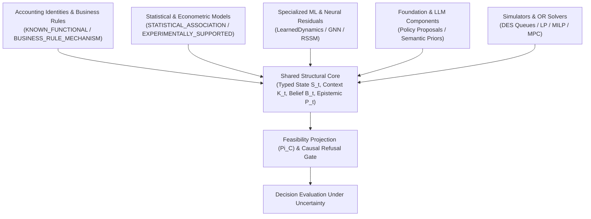
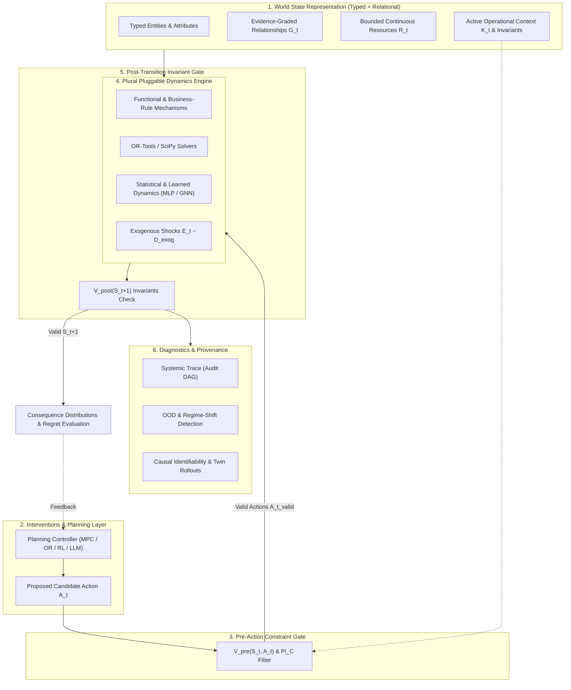

# World Models & Hybrid Enterprise Architecture

!!! info "Scientific Demarcation & Comparison to Mature Neighbors"
    For the complete working definition of an Enterprise World Model, the two guiding research questions, a neutral comparison against nine neighboring disciplines (SCMs, System Dynamics, DES, ABM, Digital Twins, Process Mining, State-Space Models, Operations Research, and Neural World Models), and a guide on **when you do NOT need an EWM**, see **[What Is an Enterprise World Model? (Scientific Demarcation)](../explanation/what-is-an-ewm.md)**.

## Complementary Modeling Paradigms (Hybrid Pluralism)

Rather than viewing modeling paradigms as a linear ladder where one replaces another, `ewm-engine` treats rules, statistical estimators, specialized ML, foundation models, discrete-event simulation, and mathematical optimization as **coexisting, plural mechanisms** that serve different operational regimes:

### 1. Specialized Statistical & Machine Learning Models
Statistical and supervised ML models estimate conditional distributions $\hat{y} = f_\theta(x)$ or $P(Y \mid X)$. For stationary forecasting and single-step classification, a calibrated supervised predictor is often sufficient on its own. Inside an EWM, learned models serve as first-class transition or demand components (`STATISTICAL_ASSOCIATION` or `EXPERIMENTALLY_SUPPORTED`), while the causal refusal gate prevents observational fits from being silently used for unidentifiable policy interventions.

### 2. Foundation Models & LLMs
Foundation models and LLMs excel at unstructured extraction, semantic synthesis, hypothesis generation, and policy proposal. When coupled to an EWM, they operate alongside explicit conservation and feasibility gates ($\Pi_{\mathcal{C}}$) so that proposed actions and state transitions satisfy domain accounting and capacity invariants.

### 3. Engineering Digital Twins vs. Enterprise World Models
Industrial digital twins mirror physical assets (turbines, reactors, assembly lines) governed by stationary physical laws. An Enterprise World Model addresses **socio-technical domains** where physical capacities interact with mutable contracts, SLAs, financial ledgers, and policy context $K_t$.

### 4. Agent Frameworks vs. World Models
Agent frameworks (LangGraph, CrewAI, AutoGen) govern **how an agent reasons and invokes tools**. An Enterprise World Model models **the environment and decision contract** against which candidate policies—whether proposed by a human manager, an OR solver, or an LLM agent—are evaluated before production deployment.

---

## Academic Lineage of World Models

The concept of a *World Model* spans control theory, causal inference, operations research, and reinforcement learning:

1. **Forrester (1961) & Sterman (2000)**: *System Dynamics* established stock-and-flow conservation and feedback-loop analysis for industrial and corporate systems.
2. **Pearl (2009) & Peters, Janzing, & Schölkopf (2017)**: *Structural Causal Models (SCMs)* formalized the distinction between observational conditioning $P(Y \mid X)$, interventional surgery $P(Y \mid do(X))$, and counterfactuals.
3. **Ha & Schmidhuber (2018)**: *World Models* ([arXiv:1803.10122](https://arxiv.org/abs/1803.10122)) demonstrated that an agent can learn a compact latent representation and recurrent transition dynamics to train policies inside simulated rollouts.
4. **Schrittwieser et al. (2020) & Hafner et al. (2023)**: *MuZero* and *DreamerV3* ([arXiv:2301.04104](https://arxiv.org/abs/2301.04104)) showed that action-conditioned latent world models can master games and continuous control when given online environment interaction.
5. **LeCun (2022) & Assran et al. (2025)**: Joint Embedding Predictive Architectures (*JEPA*, *V-JEPA 2*, [arXiv:2506.09985](https://arxiv.org/abs/2506.09985)) predict abstract representations from sensory streams for visual understanding and robotic planning.

---

## Structural Core + Plural Components, Judged on Decisions

> An **Enterprise World Model (EWM)** is a computational, domain-scoped representation that models the relevant states of an environment, their evidence-graded dependencies, their temporal evolution, and—when supported by identification evidence—the effects of interventions, in order to support prediction, simulation, planning, and decision evaluation under uncertainty.

### Rejecting the Myth of a Universal Determinism Hierarchy

`ewm-engine` explicitly rejects the notion that symbolic rules are "inherently trustworthy," classical ML is "intermediate," and neural/LLM components are "second-class":

- **Execution determinism $\neq$ epistemic certainty:** A hand-coded business rule executes deterministically, but if it reflects an unvalidated heuristic, its epistemic standing is merely `CAUSAL_HYPOTHESIS`. Conversely, a trained neural network evaluated with fixed weights is a deterministic function at inference time, and an experimentally validated ML uplift model carries `EXPERIMENTALLY_SUPPORTED` (`INTERVENTIONAL`) standing.
- **Plural mechanisms under one contract:** Accounting identities (`KNOWN_FUNCTIONAL`), institutional policies (`BUSINESS_RULE_MECHANISM`), experimentally identified effects (`EXPERIMENTALLY_SUPPORTED`), causal hypotheses (`CAUSAL_HYPOTHESIS`), and observational predictors (`STATISTICAL_ASSOCIATION`) coexist within the same simulation loop:

$$\begin{aligned}
\textbf{Known Functional & Policy Mechanisms} &\quad\longleftrightarrow\quad \text{Accounting conservation, capacity bounds, contractual rules } (K_t) \\
\textbf{Statistical, Learned & Stochastic Mechanisms} &\quad\longleftrightarrow\quad \text{Demand elasticity, transit delays, learned residual dynamics, exogenous shocks}
\end{aligned}$$

---

## Positioning: Enterprise World Models vs. Sensory/Visual World Models

The term **world model** is used across two distinct application domains with different data regimes and constraints:

1. **Sensory & Physical World Models** (Ha & Schmidhuber, MuZero, DreamerV3, V-JEPA 2, NVIDIA Cosmos, Genie):
   Models operating on pixels, video frames, or continuous proprioceptive states where physical laws are stationary and high-volume simulator or sensory data is available.
2. **Enterprise World Models** (`ewm-engine`):
   Models operating on typed socio-technical state (entities, resources, queues, contracts) where historical logs are observationally confounded, institutional rules $K_t$ shift discontinuously, and hard accounting/feasibility invariants must be audited.

### Domain & Contract Comparison

| Dimension | Enterprise World Model Engine (`ewm-engine`) | Sensory / Visual World Models (Cosmos, Genie, V-JEPA 2) | Latent RL World Models (MuZero, DreamerV3) |
| :--- | :--- | :--- | :--- |
| **Target Domain** | Socio-technical operational systems (supply chains, inventory, workflows, capacity planning). | Video generation, 3D spatial scenes, visual representation learning, physical robotics. | Games (Atari, Go) and continuous/discrete control with online interaction. |
| **State Representation** | Typed relational state ($S_t$), institutional context ($K_t$), belief state ($B_t$), and epistemic state ($P_t$). | Visual tokens, pixel frames, or self-supervised video embeddings. | Compact latent vector ($z_t$) optimized for reward/value prediction or reconstruction. |
| **Constraint Handling** | Explicit pre/post constraint gates ($\mathcal{V}_{\text{pre}}, \mathcal{V}_{\text{post}}$) and feasibility projection ($\Pi_{\mathcal{C}}$) with logged residuals. | Implicitly learned from training sequences; physical conservation is approximated statistically. | Soft reward penalties or environment termination signals. |
| **Dynamics Mechanisms** | **Plural Hybrid**: Functional identities, business rules, OR solvers, statistical models, and learned residuals (`DynamicsModel`, `LearnedDynamics`). | Spatio-temporal transformers, diffusion models, or joint-embedding predictors. | Recurrent State-Space Models (RSSM) or latent dynamics networks. |
| **Epistemics & Causality** | Explicit `DependencyEvidenceNature` & `EvidenceLevel` grading, backdoor/refuter checks, and causal refusal gates. | Observational / action-conditioned sequence modeling over sensory streams. | Action-conditioned latent rollouts trained via online exploration or replay buffers. |
| **Core Runtime Footprint** | CPU-first deterministic kernel; optional PyTorch/SciPy/OR-Tools adapters. | GPU/TPU accelerators for large-scale neural training and inference. | GPU/TPU accelerators for neural rollout and policy optimization. |
| **Primary Evaluation Target** | Calibrated decision regret, constraint violation rate, and epistemic honesty against strong baselines. | Frame fidelity, representation transfer, or robotic task completion. | Cumulative episode return in the target environment. |

---

## Subsystem Architecture & Execution Lifecycle

The relationship between typed state, plural dynamics mechanisms, constraint engines, and the planning layer is illustrated below:

