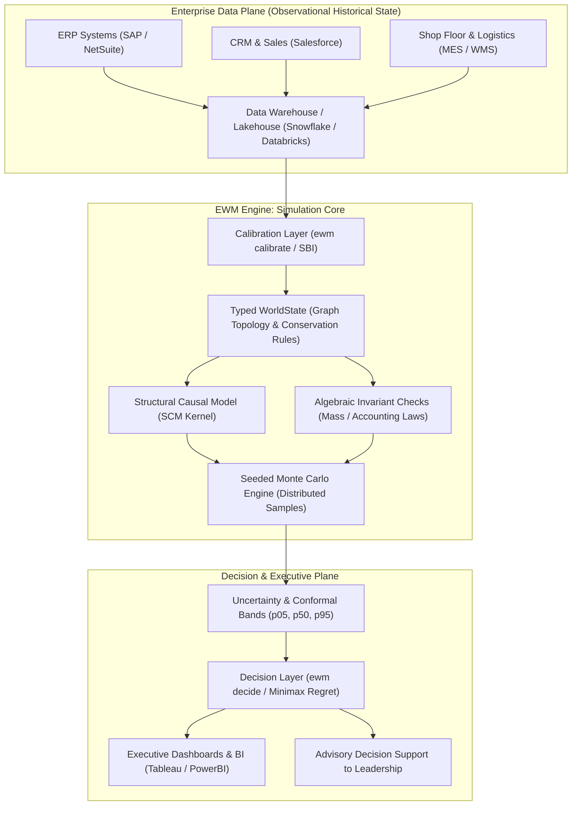
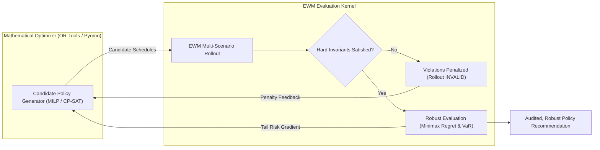
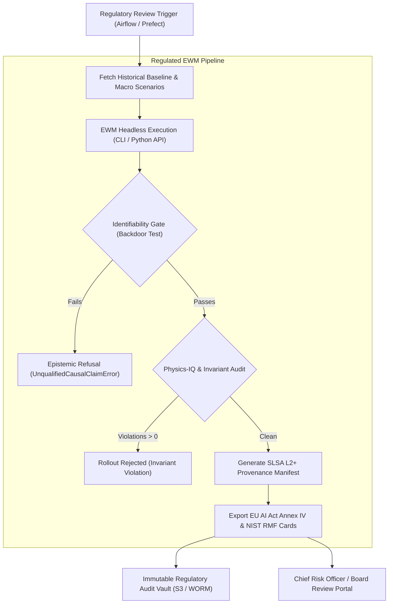

# Enterprise Reference Architectures & Market Context

> *"How the Enterprise World Model Engine integrates into existing IT, analytics, and operational infrastructure — as the simulation core of a Digital Twin of an Organization, behind mathematical optimizers, and within regulated risk pipelines."*

---

## 1. Executive Summary

EWM Engine is not an isolated monolith or a rip-and-replace analytics platform. It is a **modular structural simulation kernel** designed to embed cleanly into modern enterprise architectures.

This document details three canonical reference architectures:
1. **Architecture 1:** EWM as the Core Simulation Kernel of a Digital Twin of an Organization (DTO).
2. **Architecture 2:** EWM Behind a Mathematical Optimizer (OR-Tools / Pyomo / MILP).
3. **Architecture 3:** EWM Embedded in a Regulated Model Risk & Governance Pipeline.

Followed by an objective, dated analysis of the broader **Decision Intelligence** and **Digital Twin** enterprise market context.

---

## Architecture 1: The Core Simulation Kernel of a Digital Twin of an Organization (DTO)

In a Digital Twin of an Organization, transactional systems (ERP, CRM, MES, SCM) record past and present enterprise states. EWM acts as the **forward-looking simulation core**, projecting future states under hypothetical strategic decisions and external shocks.

### Architectural Principles
* **Separation of Record from Projection:** The operational data store remains the single source of historical truth; EWM consumes snapshots to calibrate state parameters and executes forward rollouts without writing speculative states back into production transactional databases.
* **Hermetic Execution:** The simulation kernel executes locally or across distributed workers with zero network egress, preserving complete data confidentiality.

---

## Architecture 2: EWM Behind a Mathematical Optimizer (OR-Tools / Pyomo)

Traditional mixed-integer linear programming (MILP) solvers find mathematically optimal solutions under static assumptions, but struggle when dynamics are stochastic, non-linear, and delayed. EWM pairs with solvers in a **Generate $\rightarrow$ Evaluate $\rightarrow$ Refine** loop:

### Architectural Principles
* **Solvers Propose, EWM Disposes:** The optimizer generates candidate schedules (e.g., crew shifts, warehouse transfer orders); EWM simulates them across 1,000 stochastic futures, verifying that physical capacity and labor invariants hold even under severe demand spikes.
* **Robustness Over Peak Efficiency:** Prevents the solver from choosing a "brittle optimum" that performs brilliantly on paper but collapses under the first real-world shock.

---

## Architecture 3: EWM in a Regulated Model Risk Pipeline (Airflow / Prefect / Kafka)

In regulated banking, healthcare, and critical infrastructure environments, model decisions must pass strict validation gates before executive sign-off:

### Architectural Principles
* **Automated Compliance Artifacts:** The pipeline automatically exports `ModelCard.to_annex_iv()` and cryptographic provenance manifests alongside the simulation output.
* **Fail-Closed Governance:** If unobserved confounding renders a policy non-identifiable, the pipeline halts immediately, preventing unverified claims from reaching the Board.

---

## 4. Market Context: Decision Intelligence & Digital Twins of an Organization

Enterprise technology analysts have identified a structural shift from passive historical reporting toward prescriptive decision simulation:

### Category Definitions
* **Decision Intelligence (DI)[^1]:** Defined by analyst firms as an emerging discipline that encompasses a wide range of decision-making techniques (including simulations, causal graphs, and optimization) to model, evaluate, and execute business choices.
* **Digital Twin of an Organization (DTO)[^2]:** A dynamic software model of an enterprise that relies on operational telemetry to understand how an organization executes its business model, responds to changes, and allocates resources.

### Honest Market Perspective & Sourcing Caveats
> [!NOTE]
> **Market Data Discipline**: While various market research reports project the Decision Intelligence and Digital Twin markets to grow significantly through 2030, **specific compound annual growth rates (CAGRs) and market valuation estimates vary widely across research publishers (e.g., Gartner, IDC, MarketsandMarkets)**. In alignment with EWM's anti-overclaiming principles, we deliberately omit unverified dollar estimates.
>
> What is empirically verifiable is that enterprises benefit from **composing boundary LLM agents with deterministic, conservation-enforcing simulation kernels** when operational decisions traverse coupled departmental queues and hard regulatory constraints.

### Complementary Roles in the Enterprise Stack
1. **Traditional BI & Observational ML (Tableau, PowerBI, GBT):** Excel at historical reporting and 1-step stationary forecasting, and suffice whenever policy rules and downstream capacities remain stationary.
2. **Proprietary DTO Suites (Palantir, AnyLogic):** Provide integrated enterprise modeling but operate as closed-source runtimes.
3. **Boundary LLM Copilots (`ewm mcp`):** Excel at translating natural-language executive questions into structured scenario parameters and explaining trace outputs, while delegating numerical balance-sheet and queue transitions to a deterministic CPU engine.

**EWM Engine supplies the modular dynamics core:** an open-source, deterministic, auditable simulation and decision-evaluation engine that composes cleanly with BI, mathematical solvers, and boundary LLM agents.

---

## References & Analyst Citations

[^1]: Gartner Research, *Innovation Insight for Decision Intelligence*, published 2022–2024. `[UNVERIFIED - Analyst Market Definition]`  
[^2]: Gartner Research, *Market Guide for Digital Twin of an Organization*, published 2021–2023. `[UNVERIFIED - Analyst Market Definition]`
