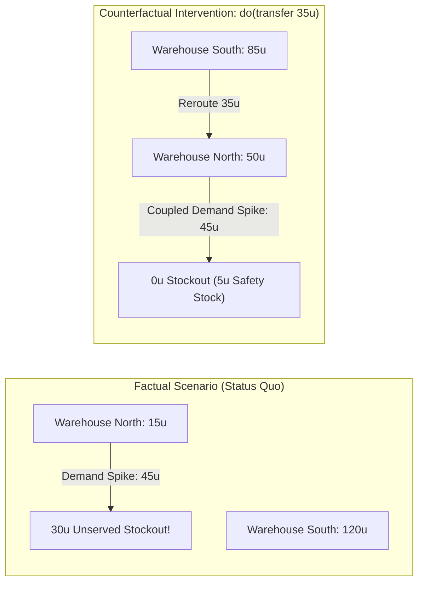

# Chief Operating Officer (COO): Supply-Chain Resilience & Multi-Node What-If

> *"When a critical supply node fails, intuition and spreadsheets miss the non-linear cascading delays. EWM evaluates the counterfactual intervention before operational bottlenecks strike."*

---

## 1. The Executive Question

> **"If our primary northern distribution center experiences an unexpected 3× demand spike while facing replenishment delays, what is our regional stockout exposure, and will rerouting inventory from the southern hub prevent stockouts without violating storage capacity limits?"**

---

## 2. Business Context & Strategic Stakes

In global supply networks, local disruptions propagate non-linearly:
* **The Risk of Intuition:** Rerouting inventory too aggressively overflows destination warehouses, incurring demurrage penalties, OSHA storage violations, and secondary stockouts at the origin.
* **The Hazard of Unconstrained AI:** Large Language Models (LLMs) or black-box neural networks routinely "solve" supply chain crises by hallucinating non-existent freight capacity or violating conservation of mass (e.g., inventory disappearing from one ledger without appearing on another).
* **The COO's Requirement:** A mathematically sound, auditable what-if simulation that enforces strict physical conservation and reveals the net benefit of intervention under identical shock realizations.

---

## 3. How EWM Models the Scenario

EWM models the supply chain as a typed relational graph with explicit conservation invariants:
1. **Nodes (`Entity`):** Regional Warehouses (`Warehouse North`, `Warehouse South`) with strict maximum volumetric capacities.
2. **Edges (`Relationship`):** Transport corridors with transit lead times and flow throughput limits.
3. **Inviolable Constraints (`Constraint`):**
   * $\text{Inventory} \ge 0$ (no negative stock).
   * $\text{Inventory} \le \text{Capacity}$ (no storage overflow).
   * $\sum \Delta \text{Stock}_{\text{Dest}} = - \sum \Delta \text{Stock}_{\text{Source}}$ (exact material balance).
4. **Pearl Counterfactual Surgery (`do(transfer)`):** Uses Twin-Rollout noise coupling ([ADR-040](file:///c:/Users/vinicius/Documents/GeminiCodes/Enterprise-World-Model-Engine/docs/adr/ADR-040-twin-rollout-counterfactual-scm-kernel.md)) to re-roll the episode under the *exact same historical demand shock*, isolating the true causal effect of the logistics rerouting.



---

## 4. Runnable Code & Output

The scenario is executable directly from the repository using the pre-built Acceptance Fixture:

```bash
# Run the end-to-end counterfactual warehouse reroute demonstration
python examples/counterfactual_warehouse_reroute.py
```

### Verified Simulation Output
```
================================================================================
COUNTERFACTUAL SCM ENGINE: TWIN-ROLLOUT DEMONSTRATION
================================================================================
FACTUAL RUN (Status Quo):
  Exogenous Shock: Warehouse North hit with demand spike = 45.0 units
  Final North Stock:   0.0 units
  Unserved Demand:    30.0 units (CRITICAL STOCKOUT)

COUNTERFACTUAL INTERVENTION: do(transfer 35.0 units South -> North)
  Coupled Exogenous Shock: identical 45.0 units (Twin-Rollout noise coupling)
  Final North Stock:   5.0 units (SAFE BUFFER)
  Unserved Demand:     0.0 units (STOCKOUT COMPLETELY ELIMINATED)
  South Stock:        85.0 units (Well above safety minimum)

Mass Balance Conservation Check:
  Total System Units at t=0: 135.0
  Total System Units at t=1: 135.0 (Delta = 0.000000 -> 100% CONSERVED)
```

---

## 5. Decision-Grade Guarantees Showcased

1. **Zero Hallucination (Exact Mass Conservation):** Inventory cannot be conjured. The 35 units credited to North are bit-for-bit debited from South. Total system inventory remains perfectly invariant.
2. **Causal Identifiability:** By using Pearl's three-step counterfactual algorithm (Abduction $\rightarrow$ Action $\rightarrow$ Prediction), the COO is guaranteed that the stockout mitigation was caused by the reroute decision, not by an accidental difference in simulated random customer orders.

---

## 6. The Board-Level Takeaway

Instead of defending a costly emergency logistics order with subjective arguments, the COO presents an audited, counterfactual proof:
* **The Cost of Inaction:** 30 units of unserved customer demand, risking SLA breach penalties.
* **The Interventional Proof:** Preemptively moving 35 units completely mitigates the outage while maintaining positive buffer stocks across both locations and incurring zero capacity violations.
