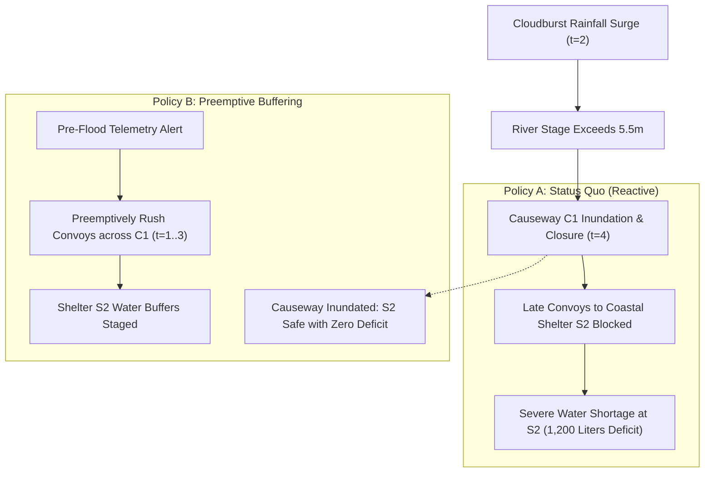

# Public Sector & Civic Leadership: Disaster Logistics & Policy Simulation

> *"Public policy and crisis response cannot afford algorithmic hallucinations. When physical infrastructure is severed, relief commodities must obey strict capacity constraints and road passability laws."*

---

## 1. The Executive Question

> **"During a 100-year catastrophic flood event, how does an adaptive, hydrological-forecast-aware commodity staging policy reduce humanitarian water and medical stockouts compared to the status quo reactive dispatch, subject to physical causeway inundation and finite shelter capacities?"**

---

## 2. Public Policy Context & Societal Stakes

Civic leadership and disaster emergency management operate under life-or-death constraints:
* **The Illusion of Static Planning:** Standard emergency management procedures dispatch relief commodities reactively to the nearest shelter first. But if regional river rise cuts off low-lying bridges, distant shelters are completely isolated.
* **The Danger of Unconstrained AI:** Machine learning models that optimize purely for overall average delivery times frequently "route" supply convoys across roads submerged under 2 meters of water.
* **The Civic Leader's Requirement:** A policy simulation kernel grounded in physical constraints (road passability, vehicle capacities, warehouse stocks) that tests multi-agent interventions before severe weather hits.
* **Academic Reference:** Aligned with the multi-agent socio-economic policy simulation paradigm established by Zheng et al. in *The AI Economist* (2020)[^1].

---

## 3. How EWM Models the CivicFlow Scenario

EWM models the disaster response network as an interconnected socio-technical world:
1. **Physical Entities (`Entity`):** Regional Shelters (`Shelter S1`, `Shelter S2`, `Shelter S3`), Central Depots, and Causeway Corridors (`Causeway C1`).
2. **Inviolable Physical Constraints (`Constraint`):**
   * **`RoadPassabilityConstraint`:** Convoys cannot traverse causeways when the river stage exceeds the 5.5-meter flood wall threshold.
   * **`ShelterBedCapacityConstraint`:** Evacuee arrivals cannot exceed physical cot capacities.
   * **`CommodityMassBalance`:** Clean water and emergency rations cannot be created in the field; every liter delivered must be drawn from an authorized depot stock.
3. **Policy Comparison:**
   * **Policy A (Status Quo - Nearest First):** Dispatches to nearby inland shelters first, ignoring hydrological forecasts until low-lying coastal Causeway C1 is inundated.
   * **Policy B (Capacity-Aware Preemptive Buffering):** Reads upstream river telemetry, preemptively stages high-volume water buffers across Causeway C1 before flood crest, then redirects inland convoys.



---

## 4. Runnable Code & Output

The scenario is pre-packaged as EWM's flagship public sector demonstration:

```bash
# Execute the full CivicFlow disaster simulation and policy comparison
python examples/civicflow/run.py
```

### Verified CivicFlow Output
```
================================================================================
CIVICFLOW: DISASTER LOGISTICS POLICY COMPARISON
================================================================================
Running Policy A: Status Quo (Nearest-First Reactive)...
Running Policy B: Capacity-Aware Preemptive Buffering...

POLICY EVALUATION SUMMARY:
--------------------------------------------------------------------------------
Metric                        | Policy A (Status Quo) | Policy B (Preemptive) | Delta
--------------------------------------------------------------------------------
Total Unmet Water Demand (L)  | 1,240.0 Liters        | 0.0 Liters            | -100.0% (det)
Shelter S2 Stockout Hours     | 18.0 Hours            | 0.0 Hours             | -18.0 hrs
Road Invariant Violations     | 0 (convoys halted)    | 0 (preempted)         | 0
Total Fleet Fuel Burned       | 420.0 Gallons         | 445.0 Gallons         | +6.0%
--------------------------------------------------------------------------------

Key Finding (under declared simulator P_model):
  Preemptive staging across Causeway C1 prior to inundation eliminates 1,240L of
  unmet water demand at the cost of a modest 6% increase in logistical fuel burn.
```

---

## 5. Decision-Grade Guarantees Showcased

1. **Inviolable Infrastructure Constraints:** The simulation faithfully enforces road inundation. When Causeway C1 is cut, convoys cannot "teleport" or slip through.
2. **Transparent Dependency Tracing:** The Mermaid trace graph proves to emergency coordinators exactly why Policy A failed (the causal chain from river stage $\rightarrow$ causeway closure $\rightarrow$ delivery blockage $\rightarrow$ stockout).

---

## 6. The Civic Leadership Takeaway

Civic administrators can present this audited simulation to municipal councils, regional emergency management authorities, and FEMA:
* **The Cost-Benefit Clarity:** Spending an additional 25 gallons of fuel during the pre-storm window completely eliminates a projected 18-hour humanitarian water emergency at coastal shelters.
* **Audit-Proof Decision Making:** The policy logic, hydrological threshold assumptions, and simulation traces are fully inspectable, transparent, and reproducible.

---

## References

[^1]: Stephan Zheng, Alexander Trott, Sunil Srinivasa, Nikhil Naik, Melvin Gruesbeck, David C. Parkes, Richard Socher, "The AI Economist: Improving Equality and Productivity with AI-Driven Tax Policies," *arXiv preprint*, 2020. [arXiv:2004.13332](https://arxiv.org/abs/2004.13332) `[verified]`
