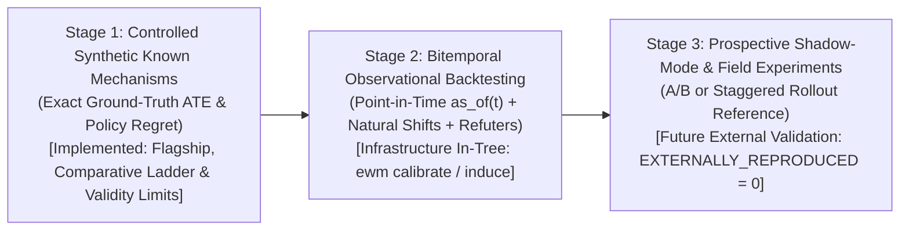
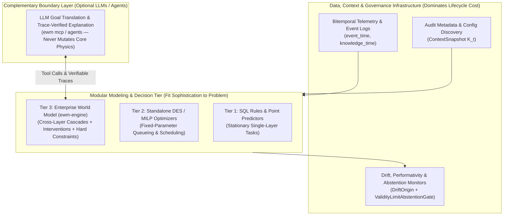

# Research Agenda: Falsifiable Hypotheses, Staged Evaluation, and Validity Limits

> **Epistemic Status**: Standing scientific research program (`ewm-engine v1.5.0`).  
> **Companion Documents**: [What Is an Enterprise World Model? (Scientific Demarcation)](what-is-an-ewm.md) · [Pre-Registration Lock (`EWME-PREREG-20261023-LADDER`)](../scientific/pre_registration_comparative_ladder.md) · [Decision-First Comparative Evaluation](../results/decision-first-comparative-evaluation.md) · [Experimental Composition & SWE Domain](../research/experimental-composition-and-swe.md) · [Claim-to-Evidence Registry (`CLM-001`–`CLM-028`)](../scientific/claim-evidence-matrix.md)

---

## 1. The Central, Conditional, Falsifiable Hypothesis

The **Enterprise World Model Engine (`ewm-engine`)** is a **research program**, not a claim that "world models" are universally superior to existing analytical, statistical, or operations-research methods. Its purpose is to investigate—comparatively, reproducibly, and with pre-registered negative outcomes—one **deliberately conditional and falsifiable hypothesis**:

> **Central Empirical Hypothesis:**  
> *In certain corporate systems with relevant interdependencies, temporal effects, and recurrent decisions, explicit representations of the environment's dynamics can improve the quality of predictions, simulations, or decisions compared with approaches that do not model those dynamics in an integrated way.*

Equally important is what this hypothesis **does not** assume:

1. **It is conditional, not universal:** It applies only when cross-process interdependencies, multi-step feedback delays, hard operational/accounting constraints, and recurrent interventions interact. In stationary, single-layer, or purely observational forecasting tasks, simpler statistical or machine-learning baselines often match or outperform an explicit world model at a fraction of the engineering cost.
2. **It is falsifiable:** Every capability claim is paired with explicit experimental conditions under which the claim would be refuted (`EWME-PREREG-20261023-LADDER`). A rigorous negative result showing where an Enterprise World Model adds zero decision value is a primary scientific contribution of this repository, not a failure.
3. **Integration alone is not a contribution:** As established in [What Is an Enterprise World Model? (Scientific Demarcation)](what-is-an-ewm.md), bundling predictors, queues, and optimizers under a new label is scientifically vacuous unless their coupling through shared typed state ($S_t$), explicit runtime institutional context ($K_t$), phase-aware constraints ($\mathcal{C}$), and evidence-nature gating (`DependencyEvidenceNature`) produces measurable improvements in downstream decision quality or prevents invalid causal extrapolations.

---

## 2. The Five Research Questions & Experimental Mapping

The research program is organized around five interlocking questions (`Q1`–`Q5`). Each question is mapped to executable modules, pre-registered experiments, and machine-readable benchmark artifacts in [`reproduction_manifest.json`](../results/reproduction_manifest.json):

| ID | Research Question | Focus | Governing Modules & Artifacts | Measured Finding in Repository (`v1.5.0`) |
| :--- | :--- | :--- | :--- | :--- |
| **Q1** | **Conceptual Demarcation:** *What, if anything, distinguishes an Enterprise World Model from a conventional combination of predictors, simulators, and optimizers?* | Anti-renaming & epistemic typing | [`what-is-an-ewm.md`](what-is-an-ewm.md), `DependencyEvidenceNature` (`src/ewm_engine/provenance/evidence.py`), `EVIDENCE_QUERY_MATRIX_CONTRACT` (`src/ewm_engine/core/trust.py`) (`CLM-023`, `CLM-026`) | Demarcates EWM against 9 mature neighbors; enforces a $5 \times 4$ evidence-to-query gate that refuses interventional (`do()`) and counterfactual queries on `STATISTICAL_ASSOCIATION` or unverified `CAUSAL_HYPOTHESIS` edges. |
| **Q2** | **Empirical Decision Value:** *Under which conditions does explicitly modeling the dynamics of a corporate system let you decide better than simply predicting its outcomes?* | Prediction vs. decision decoupling | `src/ewm_engine/flagship/comparative_evaluation.py`, [`comparative_evaluation_ladder.json`](../results/artifacts/comparative_evaluation_ladder.json), [`fraud_cascade_flagship.json`](../results/artifacts/fraud_cascade_flagship.json) (`CLM-024`, `CLM-025`) | **Direction 1:** Climbing `Rung 1` $\to$ `Rung 3` cuts 1-step call-arrival MAE by **91.49%** (`25.60` $\to$ `2.18`), yet yields **\$0.00 reduction in decision regret** (regret stays **\$124,283.57** vs. `Rung 5`'s **\$0.00**). **Direction 2:** `Arch Rules-Only` has **13.3$\times$ higher Net Cash MAE** than `Rung 3` (`\$8,023.66` vs. `\$604.06`), yet achieves **\$0.00 decision regret** because a constant additive offset preserves action-utility gradients. |
| **Q3** | **Mechanism & Integration Conditions:** *Under which structural conditions does integrated dynamics modeling help—and which components actually drive the gain?* | Component ablations & failure-mode isolation | Single-component ablations (`Ablation 1`–`6` in [`decision-first-comparative-evaluation.md`](../results/decision-first-comparative-evaluation.md)) & Families `A`–`L` in [`enterprise_benchmark_suite.json`](../results/artifacts/enterprise_benchmark_suite.json) (`CLM-021`, `CLM-025`) | Ablating cross-layer cascade dynamics (`Ablation 1`) or `do()` intervention semantics (`Ablation 2`) collapses regret from **\$0.00** to **\$124,283.57** ($p_{\text{Holm}} = 3.0 \times 10^{-6}$); ablating feasible projection (`Ablation 5`) degrades regret to **\$71,310.33**; whereas ablating residual lag features (`Ablation 6`) or risk-neutral UQ (`Ablation 4`) causes **\$0.00** regret change. |
| **Q4** | **Robustness & Validity Limits:** *How does the model behave under policy changes ($K_t$), rare events, exogenous and model-induced distribution shift (performativity, endogeneity, stylized adaptation), and partially unknown mechanisms?* | Shift recovery, performativity & abstention | `src/ewm_engine/flagship/validity_limits.py`, `src/ewm_engine/core/drift.py`, `src/ewm_engine/evaluation/abstention.py`, Families `C`, `D`, `E`, `J`, `K` (`CLM-022`, `CLM-026`) | On exogenous policy shift (`Family D`), runtime context discovery recovers after the 2-step audit delay (`MAE = 0.158` vs. `>34.6` unrecovered). Under **model-induced performative feedback**, static-optimal plans self-invalidate at step **2**, breach SLA at step **11**, and erode utility by **\$107,539.60**, triggering `"DO_NOT_USE_ME_HERE"` abstention. |
| **Q5** | **Operational Viability:** *When do the decision-quality benefits justify the engineering, specification, calibration, and maintenance costs ("benefit per unit cost")?* | Benefit per unit specification & compute cost | Section D (`OperationalCostMetrics`) & `N4` in [`comparative_evaluation_ladder.json`](../results/artifacts/comparative_evaluation_ladder.json) (`CLM-025`) | On the 4-layer cascade with policy interventions, `Rung 5` yields **\$11,298.51 regret reduction per specification component** (`11` components, `3.02 ms` latency). In the **stationary single-layer regime (`N4`)**, `Rung 1` and `Rung 2` achieve **\$0.00 regret** with `1`–`2` components, making `Rung 5` **not cost-justified**. |

---

## 3. Staged Evaluation Plan

Because observational enterprise logs lack ground-truth counterfactual outcomes $Y_t(a)$ for untaken actions $a' \neq a_t$, a scientifically honest research program must separate what can be proved at each stage of empirical grounding:

### Stage 1 — Controlled Synthetic Environments with Known Mechanisms *(Current Measured Evidence)*
- **Purpose:** Test whether candidate architectures can recover known structural elasticities, respect hard conservation invariants ($\le 10^{-12}$), isolate interventional effects $P(S_{1:H} \mid \text{do}(a), K_t)$, and minimize true decision regret $U^*(\pi^*) - U^*(\hat{\pi})$ when the data-generating mechanism is known exactly.
- **Epistemic Label:** Every artifact at this stage is explicitly stamped `CONTROLLED_SYNTHETIC_KNOWN_MECHANISMS_NOT_REAL_WORLD_EFFICACY` (or `STYLIZED_SYNTHETIC_ADVERSARY_NOT_REAL_FRAUD_RING_CLAIM`). Success here proves **architectural capability and comparative failure-mode separation**, never real-world operational efficacy.

### Stage 2 — Historical Observational Backtesting Under Bitemporal Discipline
- **Purpose:** Evaluate models on historical enterprise event logs (`OCEL 2.0`, ledger histories) under strict point-in-time knowledge filtering (`BitemporalLedger.as_of(decision_time)` where $\text{event\_time} \le \tau_t \land \text{knowledge\_time} \le \tau_t$), preventing retroactive label leakage from delayed chargebacks, churn audits, or financial restatements.
- **Identification & Refutation:** Candidate causal dependencies induced from observational logs must pass `InductionValidationGate` (`ewm induce validate`), clearing Markov equivalence-class checks (CPDAG/PAG), DoWhy refuters (Placebo Treatment, Random Common Cause, Data Subset), and VanderWeele & Ding (2017) confounding sensitivity $E$-values before promotion above `STATISTICAL_ASSOCIATION`.

### Stage 3 — Prospective Shadow-Mode & Experimental Evaluation
- **Purpose:** Score candidate world-model recommendations in parallel shadow mode against incumbent production policies, and—where operationally and ethically permissible—validate interventional predictions against randomized or staggered policy rollouts (`DependencyEvidenceNature.EXPERIMENTALLY_SUPPORTED`).
- **Registry Discipline:** Until unaffiliated third-party researchers replicate results in a peer-reviewed venue or real enterprise deployment, `EXTERNALLY_REPRODUCED` in the [Claim-to-Evidence Registry](../scientific/claim-evidence-matrix.md) is locked to **`0`** and enforced by CI (`scripts/check_release_truth.py`).

### Orthogonal Evaluation Axes Across All Stages
1. **Within-Distribution vs. Structural-Change Regimes:** Every model is evaluated both in stationary in-support conditions (`Families A, E, J`, `Hypothesis N4`) and under discontinuous policy/configuration shifts (`Families C, D`), out-of-support structural transitions (`Family K`), and model-induced performative/endogenous shifts.
2. **Predictive Metrics vs. Decision Tasks:** Evaluation never collapses into a single scalar score. The four capabilities—**Prediction** (1-step MAE, RMSE, CRPS, 90% coverage, ACE), **Simulation** (internal conservation coherence vs. external trajectory NMAE), **Intervention** (gated ATE recovery error and bias), and **Planning/Decision** (constrained policy regret and rank correlation)—are reported side by side.

---

## 4. Enumerated Legitimate Negative Outcomes

To prevent publication bias and cherry-picking, the research program pre-registers and measures **four legitimate negative outcomes (`N1`–`N4`)** alongside **two cautionary construct-validity outcomes (`F1`–`F2`)** in [`docs/scientific/pre_registration_comparative_ladder.md`](../scientific/pre_registration_comparative_ladder.md) and [`docs/results/decision-first-comparative-evaluation.md`](../results/decision-first-comparative-evaluation.md):

1. **`N1` — Traditional ML With Good Domain Features Matches or Beats EWM on 1-Step Prediction (*Confirmed*):**
   - On 1-step point-in-time observational forecasting, **Rung 3 (`ML + Engineered Features`)** achieves call-arrival MAE $= 2.18 \pm 0.25$ ( beat **Rung 5 Full EWM**'s $3.32 \pm 0.28$) at $3.7\times$ lower specification burden (`3` vs. `11` components). If the sole operational requirement is short-horizon observational point forecasting under stationary policies, an EWM is unnecessary.
2. **`N2` — A Conventional Discrete-Event Simulator Suffices for Passive Rollouts (*Confirmed*):**
   - When no policy intervention $\text{do}(a)$ or runtime configuration shift occurs, **Rung 4 (`Explicit-Dynamics Predict-Only DES`)** achieves **100.0% internal conservation/capacity coherence** (identical to **Rung 5**) and matches passive pre-shift state evolution.
3. **`N3` — Prediction Improves Dramatically Without Improving Decisions, and Some Components Add Zero Decision Value (*Confirmed*):**
   - Moving from **Rung 1** (`AR(1)`) to **Rung 3** (`GBT + Engineered Lag Features`) reduces 1-step call-arrival forecast error by **91.49%**, yet produces **\$0.00 improvement in decision regret** (`\$124,283.57` regret in both). Furthermore, single-component ablations prove that engineered residual lag features (`Ablation 6`) and conformal UQ under a risk-neutral expected-utility rule (`Ablation 4`) contribute **\$0.00** reduction in decision regret.
4. **`N4` — Explicit Dependency Modeling Raises Cost Without Benefit in Stationary Single-Layer Regimes (*Confirmed*):**
   - When the downstream contact-center cascade and rule shifts are absent (stationary single-layer authorization), **Rung 1** and **Rung 2** achieve **\$0.00 decision regret** with `1`–`2` specification components, whereas **Rung 5** requires `11` specification components for **\$0.00 incremental decision benefit**.
5. **`F1` & `F2` — An Exact World Model Cannot Rescue a Misspecified or Myopic Objective (*Confirmed*):**
   - Even inside the **exact ground-truth EWM (`Rung 5`)** with zero dynamics error, optimizing a narrow departmental KPI (`obj_narrow_fraud_loss_minimization`: Layer-1 gross margin minus direct chargebacks) or a short-horizon wage-saving objective (`obj_short_horizon_cash_myopia`) selects aggressive uncoordinated tightening ($\tau = 0.40$, 32 agents), causing **10.0 SLA breach steps**, **1,507.75 churned customers**, and **\$123,689.15 in true enterprise decision regret**.

---

## 5. Threats to Validity

Every empirical claim in this repository is subject to explicit **internal**, **external**, and **construct** validity threats:

### 5.1 Internal Validity Threats
- **Simulation Simplifications & Functional Form Assumptions:** Synthetic benchmarks (`Families A–L` and the Flagship Cascade) use piecewise-smooth analytical equations and additive Gaussian/Poisson noise. Real enterprise queues exhibit bursty heavy-tailed arrivals, multi-skill routing discontinuities, and non-stationary intraday staffing schedules.
- **Baseline Implementation Parity:** While `Rung 2` and `Rung 3` use tuned gradient-boosted regression trees with point-in-time bitemporal features, alternative sequence models or domain-specific econometric estimators could narrow the observational prediction gap further—though without causal identification they remain subject to the `do()` refusal gate.
- **Temporal & Configuration Leakage Risks:** Retroactive backfills (e.g., chargeback settlement 4 steps after authorization, churn audits 6 steps later) silently corrupt naive train/test splits. The engine mitigates this threat via `BitemporalLedger.as_of(t)` and automated `DataLeakageCertificate` verification, which fails closed if any training record has $\text{knowledge\_time} > t_{\text{split}}$ or shares state fingerprints with evaluation rollouts.

### 5.2 External Validity Threats
- **Simulator-vs-Reality Gap (`P_model != P_real`):** All bootstrap confidence intervals, conformal bands, and regret deltas in Stage 1 are computed under $P_{\text{model}}$. In-simulator precision does not bound structural discrepancy against a real banking or supply-chain operation (`UncertaintyTaxonomyBreakdown.model_discrepancy_vs_reality`).
- **Insufficient Causal Identification in Observational Deployment:** In real organizations, historical policy changes (e.g., tightening fraud rules during holiday spikes) are heavily confounded by unobserved operational crises. Graph-based backdoor/frontdoor checks (`check_backdoor_identifiability`) are only as valid as the declared `CausalGraph`; unmeasured confounders omitted from the graph require sensitivity analysis (`compute_sensitivity_e_value`) or experimental variation.
- **Performative, Endogenous & Adversarial Erosion:** Deploying a policy computed from a world model alters customer retry/call behavior (**performativity**), couples future actions to degraded queue state (**endogeneity**), and provokes strategic evasion by fraud adversaries (**adversarial adaptation**). As demonstrated in `src/ewm_engine/flagship/validity_limits.py`, static world-model relationships become self-invalidating within steps unless monitored by `check_plan_performative_validity()` and `detect_world_drift()`.

### 5.3 Construct Validity Threats
- **Departmental Silo Proxy Gaming (Goodhart's Law):** Optimizing a local team KPI (e.g., Fraud Loss Rate) inside a high-fidelity simulator externalizes severe costs onto adjacent departments (Contact-Center SLA penalties and Customer Retention LTV).
- **Horizon Truncation Myopia:** Evaluating candidate policies over a short window ($H < \Delta t_{\text{churn}}$) hides deferred customer attrition and multi-step backlog accumulation.
- **Risk-Neutral Expectation Collapse:** Ranking policies solely by expected mean utility $\mathbb{E}[U]$ ignores catastrophic tail-risk queue blowups unless hard SLA constraints or CVaR penalties are explicitly included in the decision criterion.

---

## 6. Multi-Dimensional Success Criteria

In accordance with the research program's thesis, an Enterprise World Model is **never** evaluated by a single composite score. A candidate model is judged across **eight explicit criteria**:

1. **Point-in-Time Predictive Accuracy:** Forecast MAE, RMSE, and CRPS evaluated strictly on bitemporal point-in-time views (`as_of(t)`) without future-knowledge leakage.
2. **Uncertainty Calibration:** Empirical coverage vs. nominal credibility ($90\%$ split-conformal intervals and TARP posterior coverage error $\le 0.05$) across both within-distribution and shifted slices.
3. **Intervention-Effect Accuracy (Where a Valid Reference Exists):** Recovery error and relative bias on Average Treatment Effects ($\text{ATE}$) against a known synthetic mechanism or experimental reference—paired with **mandatory fail-closed refusal** (`UnqualifiedCausalClaimError`) when `DependencyEvidenceNature` is `STATISTICAL_ASSOCIATION` or unverified `CAUSAL_HYPOTHESIS`.
4. **Downstream Decision Quality:** Constrained policy selection regret $U^*(\pi^*) - U^*(\hat{\pi})$, Spearman policy rank correlation $\rho$, and hard constraint violation rate across candidate decision sets.
5. **Robustness Under Exogenous & Model-Induced Change:** Time-to-recovery after runtime configuration shifts ($K_0 \to K_t$), detection of performative/endogenous self-invalidation (`check_plan_performative_validity`), and bounded degradation under stylized adversarial adaptation.
6. **Total Operating & Specification Cost ("Benefit per Unit Cost"):** Wall-clock rollout latency (ms), peak memory footprint (KB), and specification burden (number of structural equations, context keys, and constraints required per dollar of regret reduction).
7. **Verifiable Mechanistic Explainability (Not Narrative Prose):** Every explanation (`VerifiableMechanisticExplanation`) must cite the exact mechanism IDs, context keys ($K_t$), evidence natures, active constraints, and counterfactual sensitivity deltas from the recorded execution trace—and pass `verify_narrative_explanation_fidelity()`, which rejects plausible-sounding prose that cites non-existent edges, omits binding constraints, or reverses delta signs.
8. **Calibrated Self-Limitation (`"DO_NOT_USE_ME_HERE"`):** The model must recognize and declare when its own output should **not** be used (`ValidityLimitAbstentionGate`), distinguishing **epistemic uncertainty** (collect data/calibrate), **structural/identification uncertainty** (refuse causal claim), **aleatoric uncertainty** (switch to tail-risk/CVaR objective), and **performative/adversarial feedback** (halt autonomous execution).

---

## 7. Positioning in the Broader AI-Systems Context

As Sculley et al. (*NeurIPS 2015*, "Hidden Technical Debt in Machine Learning Systems") established, the core modeling code represents only a small fraction of a production decision system; data collection, bitemporal feature/state verification, configuration management, monitoring, and governance dominate total lifecycle cost.

### 7.1 Modular Blueprint: Fit Sophistication to the Problem
An Enterprise World Model is **one optional, modular capability** within a broader decision architecture—included only when cross-departmental cascades, policy interventions, and hard constraints justify its specification burden:
- Use **Tier 1 (SQL rules or point predictors like `Rung 1`–`Rung 3`)** when decisions are local, stationary, and well-served by conditional expectations $P(Y \mid X)$.
- Use **Tier 2 (standalone SimPy/DES or OR-Tools MILP)** when physical queueing or combinatorial scheduling has fixed, known parameters without cross-domain policy shifts or causal identification ambiguity.
- Use **Tier 3 (`ewm-engine`)** when an intervention in one domain (e.g., Fraud Authorization threshold $\tau$ in $K_t$) propagates through triggered workflows, secondary customer reactions, and downstream resource capacities (Contact-Center queues and SLA penalties), requiring coupled dynamics, bitemporal non-leakage, and evidence-graded causal gates.

### 7.2 Capability + Composition: CPU Core and Optional LLM/GPU Boundary
The repository's runtime dependency architecture reflects a **composition principle**, not an anti-LLM or anti-GPU stance:

> **The deterministic core runs fully on CPU with no required GPU or LLM dependency. GPUs and LLMs are optional and complementary:** LLM agents operate at the boundary (natural-language goal interpretation, scenario authoring, and trace-audited explanation via `ewm mcp` and `agents`), and optional neural/GPU backends (`[ml]`, `[jax]`, `[cuda]`) accelerate residual learning and large-batch rollouts, while the dynamics core stays deterministic, conservation-preserving, and cryptographically auditable.

This boundary pattern mirrors the emerging enterprise consensus (*Business World Model*; *World of Workflows*): foundation models excel at semantic interface translation and hypothesis generation at the system boundary, whereas state evolution, double-entry conservation, and causal refusal gates belong in an auditable mathematical kernel that LLM agents *call*.

---

## 8. Manuscript-Readiness Checklist

In accordance with the repository's truth-first release policy, **no `paper/` directory and no arXiv, DOI, Zenodo, JOSS, or SWHID identifiers for this project exist until a manuscript is formally authored and deposited**. Should the maintainer decide to prepare a peer-reviewed methods or benchmark manuscript, the following 10-item readiness checklist governs submission:

- [x] **1. Demarcation & Anti-Renaming:** Formal definition, 9-neighbor comparison table with primary citations, and `DependencyEvidenceNature` refusal gate committed in [`docs/explanation/what-is-an-ewm.md`](what-is-an-ewm.md).
- [x] **2. Controlled Synthetic Flagship with Known Mechanisms:** 4-layer Fraud $\to$ Declines $\to$ Call-Center cascade with bitemporal ledger (`as_of(t)`), 6/6 analytical mechanism-recovery checks, and 4 capability queries committed in `src/ewm_engine/flagship/fraud_cascade.py` and [`docs/reference/fraud-cascade-scenario.md`](../reference/fraud-cascade-scenario.md).
- [x] **3. Pre-Registered Comparative Ladder & Ablations:** Locked pre-registration (`EWME-PREREG-20261023-LADDER`), 5-rung ladder, 4 architectural baselines, 6 single-component ablations, and de-scripted 12-family suite (`A`–`L`) committed in [`docs/results/decision-first-comparative-evaluation.md`](../results/decision-first-comparative-evaluation.md).
- [x] **4. First-Class Negative & Construct-Validity Results:** `N1`–`N4` and cautionary misspecified-objective cases (`F1`, `F2`) measured and reported with equal prominence alongside positive findings.
- [x] **5. Validity Limits & Verifiable Explainability:** Model-induced drift (`DriftOrigin`), performative plan invalidation, stylized adversarial adaptation, trace-backed `VerifiableMechanisticExplanation`, and `"DO_NOT_USE_ME_HERE"` abstention gate committed and tested.
- [x] **6. Airtight Evidence & Stale-Artifact CI Gate:** 28-claim [Claim-to-Evidence Registry](../scientific/claim-evidence-matrix.md) (`EXTERNALLY_REPRODUCED = 0`), [`reproduction_manifest.json`](../results/reproduction_manifest.json), and `scripts/check_release_truth.py` downgrade/sync guards passing.
- [ ] **7. Clean-Worktree Release Certification (`CERTIFIED_RELEASE`):** Commit all changes to a clean Git worktree and run `python scripts/reproduce.py --require-clean` so `certification_status` transitions from `REPRODUCIBLE_DIRTY_WORKTREE` to `CERTIFIED_RELEASE`.
- [ ] **8. Real-World Stage-2 Observational Case Study *(Required for Empirical Domain Claims)*:** Execute walk-forward bitemporal backtesting on at least one public or de-identified real enterprise dataset before making any claim beyond `CONTROLLED_SYNTHETIC_KNOWN_MECHANISMS_NOT_REAL_WORLD_EFFICACY`.
- [ ] **9. Archival Deposition *(Upon Release Tagging Only)*:** Mint a real Zenodo DOI and Software Heritage SWHID from the tagged release commit before adding persistent identifiers to `CITATION.cff` or `README.md`.
- [ ] **10. Independent Third-Party Replication:** Keep `EXTERNALLY_REPRODUCED: 0` in `docs/scientific/claim-evidence-matrix.md` until an unaffiliated group reproduces the benchmark suite from the published archive.
