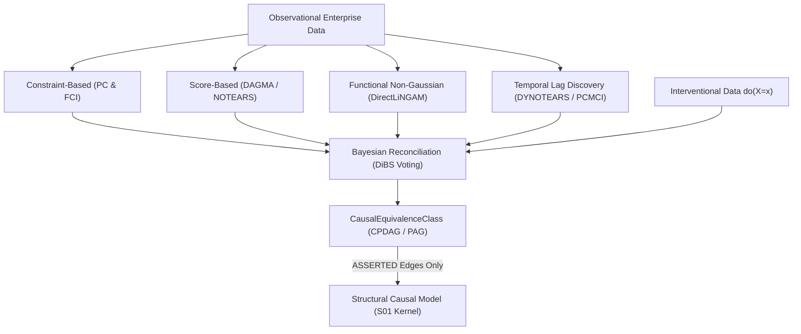

# Causal Structure, Dynamics & Invariant Induction

> **Discipline**: Causal Discovery, System Identification & Symbolic Regression  
> **Theoretical Anchors**: PC/FCI ([Spirtes et al., 2000](https://mitpress.mit.edu/9780262194402/causation-prediction-and-search/)), DAGMA ([arXiv:2209.08037](https://arxiv.org/abs/2209.08037)), DirectLiNGAM ([arXiv:1101.2489](https://arxiv.org/abs/1101.2489)), DYNOTEARS ([arXiv:2002.00498](https://arxiv.org/abs/2002.00498)), DiBS ([arXiv:2105.11839](https://arxiv.org/abs/2105.11839)), SINDy ([Brunton et al., PNAS 2016](https://doi.org/10.1073/pnas.1517384113)), PySR ([arXiv:2305.01582](https://arxiv.org/abs/2305.01582)), AI-Poincaré ([arXiv:2011.04698](https://arxiv.org/abs/2011.04698)).

Enterprise World Model Engine includes automated induction engines for the **causal dependency layer** (feeding the Structural Causal Model kernel, `S01`) and the **dynamics and conservation-law layer** (feeding the grey-box simulation kernel, ADR-042).

Rather than asserting unearned causal claims or opaque neural black boxes, EWM enforces **mathematical honesty by construction**:
- Purely observational data identifies only a **Markov-equivalence class**, never a unique DAG.
- Spurious correlations and unoriented edges are surfaced explicitly.
- Candidate physical conservation laws are promoted to `WorldSpec` hard constraints **only after passing seeded Monte Carlo stress testing**.
- GPL-3.0 libraries (such as Tigramite) are quarantined out-of-process to protect core licensing.

---

## 1. The Epistemic Gap: Why Single Asserted DAGs Are Unscientific

In empirical data science, it is common practice to run a continuous score-based algorithm (e.g., NOTEARS) and assert the single resulting Directed Acyclic Graph (DAG) as "the causal graph."

In enterprise decision modeling, this practice is catastrophic:
1. **Markov Equivalence**: Observational data under Gaussian noise cannot distinguish $X \to Y$ from $Y \to X$ or $X \leftarrow Z \to Y$. They belong to the same Markov Equivalence Class (represented as a CPDAG). Asserting one direction arbitrarily leads to inverted counterfactual policies.
2. **Latent Confounders**: Real-world enterprise systems contain unmeasured variables. Standard DAG algorithms mistake confounded associations for direct causal links. A Partial Ancestral Graph (PAG) with bidirected edges ($X \leftrightarrow Y$) is necessary to represent latent common causes.
3. **Variance Scaling Vulnerability**: As demonstrated in recent literature (*"Tearing Apart NOTEARS"*), continuous optimization methods are sensitive to variable scaling; artificially rescaling a column can reverse induced edge directions.

EWM Engine resolves this by emitting a **`CausalEquivalenceClass`** annotated with per-edge **`EvidenceLevel`**:

| Edge Type | Notation | Meaning | Epistemic Level |
| :--- | :---: | :--- | :--- |
| **Directed** | $X \to Y$ | Orientation proven via non-Gaussianity, temporal lag, or intervention | `ASSERTED` |
| **Undirected** | $X \text{ --- } Y$ | Dependency exists, but orientation is observationally equivalent | `DIRECTIONAL_UNCERTAIN` |
| **Bidirected** | $X \leftrightarrow Y$ | Latent common cause detected (FCI independence failure) | `CONFOUNDED` |

In accordance with [ADR-039](file:///c:/Users/vinicius/Documents/GeminiCodes/Enterprise-World-Model-Engine/docs/adr/ADR-039-responsible-ai-trust-and-anti-overclaiming-enforcement.md), no raw `"causes"` edge is ever emitted into `WorldSpec`; edges are formally designated `"directed_dependency"`, `"structural_dependency"`, or `"associated_with"`.

---

## 2. Ensemble Causal Discovery Architecture

EWM runs a multi-paradigm ensemble that reconciles complementary causal discovery engines via Bayesian model aggregation (DiBS style):



### Discovery Paradigms
- **Constraint-Based (PC & FCI)**: Conducts conditional independence tests ($p$-values) to prune non-adjacent variables and orient v-structures ($X \to Z \leftarrow Y$). FCI detects latent confounding ($X \leftrightarrow Y$).
- **Score-Based (DAGMA)**: Minimizes continuous reconstruction loss with log-determinant acyclicity constraints and $\ell_1$ sparsity penalties.
- **Functional (DirectLiNGAM)**: Evaluates non-Gaussian third and fourth moments (skewness and kurtosis) to determine root-to-leaf causal ordering when residuals deviate from normality.
- **Temporal Lag Discovery**: Evaluates cross-variable time lags ($X_{t-k} \to Y_t$) where chronological precedence breaks observational equivalence.
- **Interventional Fusion**: When experimental or policy shift data $\text{do}(X=x)$ is available, conditional distributions invariant under intervention validate true causal targets and upgrade `DIRECTIONAL_UNCERTAIN` edges to `ASSERTED`.

---

## 3. Dynamics Induction: SINDy & Sparse System Identification

For state trajectories $X(t) \in \mathbb{R}^{T \times D}$, EWM Engine uses **Sparse Identification of Nonlinear Dynamics (SINDy)** via Sequential Thresholded Least Squares (STLSQ) to extract closed-form differential or difference equations:

$$\dot{x}_i \approx \sum_{j} w_{ij} \theta_j(X)$$

where $\Theta(X)$ is an interpretable library of polynomial and interaction features ($1, x_1, x_2, x_1^2, x_1 x_2, \dots$).

### Rate Law Calibration
Each induced rate law receives an empirical coefficient of determination ($R^2$):
- $R^2 \ge 0.95 \implies$ `CALIBRATED` (High-confidence dynamical law).
- $R^2 \ge 0.80 \implies$ `PREDICTIVE` (Empirically useful, subject to residual correction).
- $R^2 < 0.80 \implies$ `HYPOTHETICAL` (Weak candidate rate law).

Induced rate laws compile directly into `LinearResidualDynamics` within `WorldSpec`, providing a deterministic, interpretable grey-box baseline with **zero dependency on large language models in the core simulation path**.

---

## 4. Conservation-Law Induction & Monte Carlo Stress Testing

Enterprise systems possess fundamental conservation laws (e.g. inventory conservation: $\text{stock} + \text{in-transit} = \text{const}$; financial accounting: $\sum \text{balances} = \text{const}$). EWM implements **AI-Poincaré**-style invariant discovery:

1. **SVD Nullspace Estimation**: Given trajectory state matrix $X$, compute Singular Value Decomposition $X = U \Sigma V^T$. Right singular vectors corresponding to singular values $\sigma_k < \epsilon$ define candidate linear invariants:
   $$\mathbf{w}^T \mathbf{x} \approx C$$
2. **Rational Weight Simplification**: Continuous weights are normalized and snapped to integer ratios (e.g., $[1.0002, 0.9998] \to [1.0, 1.0]$).
3. **Seeded Monte Carlo Stress Gate**:
   - The candidate is tested across $N$ stochastic rollout trajectories.
   - If the invariant holds within tolerance across **100% of sampled rollouts**, it is promoted to a **`HardConstraintSpec`** (`ASSERTED`).
   - If violations occur, it is rejected from the hard constraint set and logged as a soft constraint with an audited empirical violation rate.

---

## 5. GPL-3.0 License Isolation (Tigramite Quarantine)

> [!IMPORTANT]
> **License Trap Prevention**: Tigramite is licensed under **GPL-3.0**. Importing Tigramite into an Apache-2.0 or MIT package directly in-process can create copyleft license contamination.

EWM isolates Tigramite behind a **hard subprocess quarantine boundary**:
- `tigramite_worker.py`: A self-contained CLI script run in an isolated OS process via `subprocess.run()`.
- `tigramite_bridge.py`: An IPC bridge that serializes time-series arrays to JSON and retrieves discovered lagged edge graphs.
- Core EWM functions (`induce_causal`, `induce_dynamics`, `induce_invariants`) execute with zero third-party dependencies using pure NumPy/SciPy native routines, while allowing optional Tigramite acceleration with complete license safety.

---

## 6. End-to-End Counterfactual Twin Rollout

Once an ensemble produces a `CausalEquivalenceClass`, compiling it to an executable SCM enables **Pearl Rung-3 Counterfactual Rollouts**:

```python
import numpy as np
from ewm_engine.core.scm import counterfactual_rollout
from ewm_engine.induction.causal import induce_causal

# 1. Provide observational & interventional data
data = {
    "marketing_spend": np.array([10.0, 15.0, 20.0, 25.0, 30.0, 35.0]),
    "sales": np.array([22.0, 31.0, 41.0, 52.0, 61.0, 72.0]),
    "inventory": np.array([100.0, 90.0, 78.0, 69.0, 58.0, 49.0]),
}

# 2. Induce causal equivalence class
equiv_class, report = induce_causal(data=data, seed=42)

# 3. Compile ASSERTED edges into an executable SCM
scm = equiv_class.to_scm()

# 4. Perform Pearl Rung-3 Counterfactual:
# "Given observed sales=41 when marketing=20, what would sales have been if marketing had been 35?"
cf_result = counterfactual_rollout(
    scm=scm,
    factual_observations={"marketing_spend": 20.0, "sales": 41.0},
    intervention={"marketing_spend": 35.0},
)

print(f"Counterfactual Sales: {cf_result.counterfactual_state['sales']:.2f}")
```

---

## 7. Command-Line Interface (CLI)

The `ewm induce` command suite provides single-command execution for all induction pathways:

```bash
# 1. Induce causal dependency equivalence class
ewm induce causal data.json --output-spec causal_spec.yaml --report causal_report.md

# 2. Induce dynamical rate laws
ewm induce dynamics trajectory.json --threshold 0.05 --report dynamics_report.md

# 3. Induce conservation laws with Monte Carlo stress testing
ewm induce invariants trajectory.json --mc-samples 500 --tolerance 1e-4 --output-spec invariant_spec.yaml
```

Every run outputs a deterministic, SHA-256 fingerprinted audit report documenting all considered candidates, $p$-values, $R^2$ fit scores, and stress-testing pass/fail decisions.
