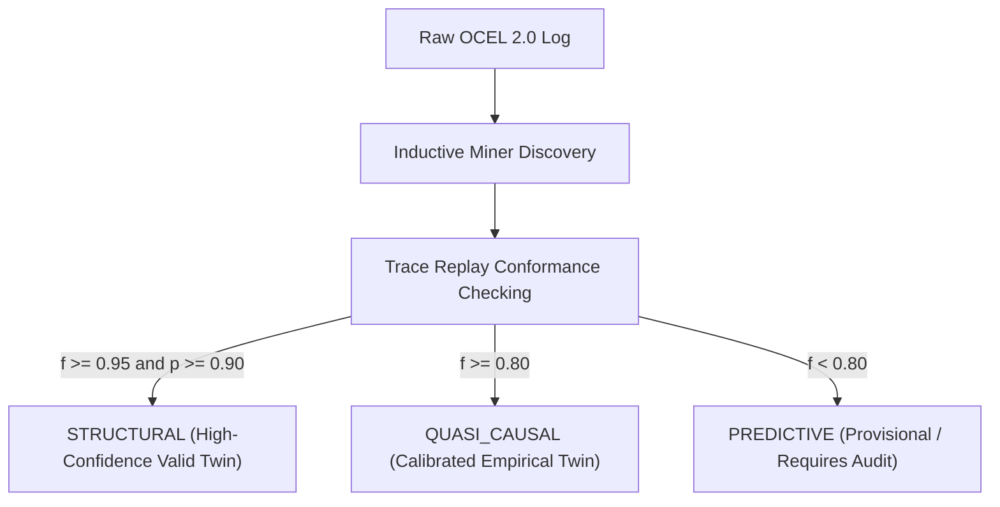

# Object-Centric Process Induction (OCEL 2.0)

> **Discipline**: Process Mining & Sound World Induction  
> **Theoretical Anchors**: OCEL 2.0 Standard ([arXiv:2403.01975](https://arxiv.org/abs/2403.01975)), Inductive Miner ([Leemans et al., 2013](https://doi.org/10.1007/978-3-642-40176-3_16)), Conformance Checking ([Carmona et al., 2018](https://doi.org/10.1007/978-3-319-99414-7)).

Enterprise World Model Engine enables organizations to **point the engine at raw operational event logs** and automatically derive a validated, executable simulation twin. Rather than hand-authoring complex state machines and transitions, EWM ingests standard **OCEL 2.0 (Object-Centric Event Logs)** to discover typed entities, multi-object relationships, sound control-flow transitions, and candidate conservation laws.

---

## 1. The OCEL 2.0 to WorldSpec Mapping

In modern enterprise architectures, events do not occur in isolation within a single "case ID"; they simultaneously touch multiple interacting business entities (e.g., an `approve_order` event involves an `order`, an `approver`, a `customer`, and a `credit_account`). OCEL 2.0 formally captures this object-centric reality:

| OCEL 2.0 Element | EWM Engine Construct | Epistemic Status |
| :--- | :--- | :--- |
| **Object Types** | `EntitySpec.type` declarations | `ASSERTED` (Domain Schema) |
| **Object Instances** | `EntitySpec.id` and initial attributes | Ground-truth state snapshot |
| **Object-to-Object (O2O)** | `RelationshipSpec` (typed directed edges) | `STRUCTURAL` (Asserted FK / link) |
| **Event Types** | Mined Transition Actions | `STRUCTURAL` or `QUASI_CAUSAL` |
| **Event-to-Object (E2O)** | Action target bindings & participants | Replay alignment bindings |
| **Numerical Flows** | `ResourceSpec` (e.g. inventory, balance) | Bounded Continuous State |
| **Token Conservation** | Candidate Hard Constraints | Validated Conservation Laws |

---

## 2. Inductive Miner: Soundness-Guaranteed Transitions

A critical danger in empirical process discovery is producing state machines with deadlocks, unreachable states, or infinite livelocks. EWM implements the **Inductive Miner** framework (Leemans et al., 2013):

1. **Directly-Follows Graph (DFG)**: Constructs transition frequency matrices for each object type lifecycle.
2. **Recursive Cut Discovery**:
   - **Sequence Cut ($\to$)**: Partitions events into strict chronological stages.
   - **Exclusive Choice Cut ($\times$)**: Identifies alternative workflow branches.
   - **Parallelism Cut ($\wedge$)**: Identifies concurrent, independent operations.
   - **Loop Cut ($\circlearrowleft$)**: Detects rework cycles and feedback loops.
3. **Soundness Guarantee**: Every induced transition system is guaranteed to be free of deadlocks and proper completion is mathematically verified.

---

## 3. Conformance Checking as an Auto-Validation Gate

EWM Engine rejects the practice of unvalidated black-box induction. Every induced model undergoes automated **token-based replay alignment** against the source log to compute two formal metrics:

$$\text{Fitness } (f) = \frac{\text{Consumed Tokens} - \text{Missing Tokens}}{\text{Consumed Tokens}} \in [0, 1]$$

$$\text{Precision } (p) = \frac{\text{Observed Transitions}}{\text{Model-Allowed Transitions}} \in [0, 1]$$

These conformance metrics map directly to the engine's rigorous **EvidenceLevel** hierarchy:



---

## 4. Bounded-Resource Invariant Discovery

As events transition objects across stages, quantitative attributes fluctuate. EWM analyzes token and quantity flows to discover candidate conservation laws:

$$\sum_{t} \Delta Q_t = 0 \quad \text{or} \quad S_{t+1} = S_t + \text{Inflow}_t - \text{Outflow}_t$$

When flow conservation holds across $\ge 95\%$ of observed transitions with zero or negligible net leakage, EWM automatically generates candidate hard constraints (such as `resource_non_negative` or `capacity`).

---

## 5. AGPL-3.0 License Isolation (PM4Py Quarantine)

> [!IMPORTANT]
> **Permissive Core Invariant**: EWM Engine's core runtime is permissively licensed (Apache 2.0 / MIT). To prevent license contamination from copyleft third-party libraries (such as PM4Py, which is AGPL-3.0), EWM enforces a **strict out-of-process subprocess boundary**.

- **Default Engine (`native`)**: Executes EWM's pure-Python/NumPy Inductive Miner and trace replay engine directly in-process with **zero optional external dependencies**.
- **Optional Engine (`pm4py`)**: When the user explicitly requests `--engine pm4py` (via optional extra `[pm4py]`), EWM invokes an isolated external worker process communicating strictly through standard JSON pipes (`pm4py_bridge.py`). EWM core never links or imports PM4Py directly in-process ([ADR-047](file:///c:/Users/vinicius/Documents/GeminiCodes/Enterprise-World-Model-Engine/docs/adr/ADR-047-world-model-induction-and-agpl-isolation.md)).

---

## 6. Programmatic Python Usage

```python
from pathlib import Path
from ewm_engine.core.spec import WorldFactory, WorldSpec
from ewm_engine.induction.process import induce_process

# 1. Induce WorldSpec from OCEL 2.0 JSON or JSONL log
spec, report = induce_process(
    ocel_data=Path("procurement_log.json"),
    engine="native",
    name="ProcurementTwin",
    seed=42,
)

# 2. Inspect Conformance Audit
for obj_type, conf in report.conformance.items():
    print(
        f"Type: {obj_type:<10} | Fitness: {conf.fitness:.3f} | Evidence: {conf.evidence_level.value}"
    )

# 3. Instantiate Executable World and Simulate Counterfactual
factory = WorldFactory()
world = factory.create_world(spec)
baseline = world.simulate(horizon=10, samples=50, seed=42)
```

---

## 7. CLI Usage

```bash
# Propose WorldSpec and audit report from event log
ewm induce process \
    --ocel log.json \
    --engine native \
    --out induced_world.yaml \
    --report audit_report.json
```
