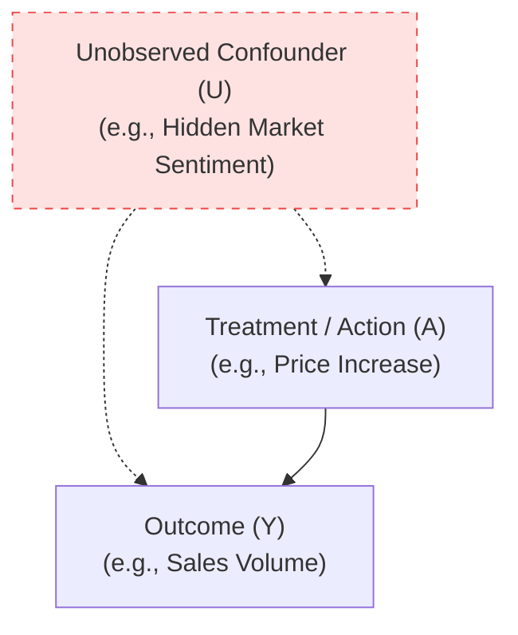

# Causal Identifiability & Graphs: "Is This Effect Even Identifiable?"

> **Core Question**: *"Given an observational enterprise graph, does there exist an unobserved confounder or an open backdoor path that renders our proposed policy intervention mathematically non-identifiable from observational data?"*

---

## 1. Mathematical & Theoretical Formulation

### The Identifiability Problem
A causal effect $P(Y \mid do(A=a))$ is **identifiable** from observational distribution $P(V)$ if and only if it can be uniquely computed from observational probabilities without relying on unmeasured quantities.

If unobserved variables $U$ influence both treatment $A$ and outcome $Y$ (e.g., executive intent, macro sentiment), the causal effect is generally **non-identifiable** without strong structural assumptions or randomized trials.



### The Backdoor Criterion (Pearl, 2009)
A set of observed variables $Z$ satisfies the **Backdoor Criterion** relative to treatment $A$ and outcome $Y$ in a directed acyclic graph (DAG) $\mathcal{G}$ if:
1. No node in $Z$ is a descendant of $A$.
2. $Z$ blocks every path between $A$ and $Y$ that contains an arrow into $A$ (backdoor paths).

If $Z$ satisfies the backdoor criterion, the interventional distribution is identifiable via the adjustment formula:

$$P(Y=y \mid do(A=a)) = \sum_{z} P(Y=y \mid A=a, Z=z) P(Z=z)$$

### The Positivity (Common Support) Condition
Even if a DAG is structurally identifiable, empirical identification fails if certain covariate strata never experience the treatment:

$$\forall z \text{ with } P(Z=z) > 0, \quad 0 < P(A=a \mid Z=z) < 1$$

---

## 2. Practical Usage & API Pattern

```python
from ewm_engine.core.scm import CausalGraph
from ewm_engine.core.trust import validate_causal_claim
from ewm_engine.provenance.evidence import EvidenceLevel

# 1. Define Causal DAG Topology
graph = CausalGraph(
    nodes={"unobserved_sentiment", "competitor_pricing", "price_action", "quarterly_sales"},
    edges={
        ("competitor_pricing", "price_action"),
        ("competitor_pricing", "quarterly_sales"),
        ("price_action", "quarterly_sales"),
    },
    unobserved_nodes={"unobserved_sentiment"},
)

# 2. Test Backdoor Identifiability
identifiable, adjustment_set = graph.check_backdoor_identifiability(
    treatment="price_action",
    outcome="quarterly_sales",
)

print(f"Is Causal Effect Identifiable? {identifiable}")
print(f"Minimal Valid Adjustment Set:  {adjustment_set}")

# 3. Gate Causal Claim at the Trust Boundary
# If an unobserved backdoor path existed, strict validation raises UnqualifiedCausalClaimError
validated_level = validate_causal_claim(
    claimed_level=EvidenceLevel.INTERVENTIONAL,
    is_identifiable=identifiable,
    overlap_satisfied=True,
    strict=True,
)
print(f"Certified Evidence Level: {validated_level}")
```

---

## 3. Implementation & Computational Notes

* **D-Separation Algorithm:** EWM implements d-separation over the relational graph using the Bayes-ball and ancestral graph algorithms in $\mathcal{O}(|V| + |E|)$ time ([`ewm_engine.core.scm`](https://github.com/vfcarida/Enterprise-World-Model-Engine/blob/main/src/ewm_engine/core/scm.py)).
* **Strict Causal Gating:** By default, calling `validate_causal_claim()` with `strict=True` halts code execution with an [`UnqualifiedCausalClaimError`](https://github.com/vfcarida/Enterprise-World-Model-Engine/blob/main/src/ewm_engine/exceptions.py) if unobserved confounding is present.
* **Trace Metadata Sealing:** When an interventional claim passes identifiability, the minimal adjustment set $Z$ and graph hash are sealed into the simulation trace manifest.

---

## 4. Common Pitfalls & Epistemic Traps

> [!WARNING]
> **Pitfall 1: Conditioning on a Collider (M-Bias)**  
> If variable $C$ is caused by both $A$ and $Y$ ($A \rightarrow C \leftarrow Y$), conditioning on $C$ **opens** an otherwise closed non-causal path, introducing artificial correlation. EWM’s automated d-separation algorithm explicitly protects against collider conditioning.

> [!CAUTION]
> **Pitfall 2: Confusing DAG Identifiability with Physical Causality**  
> Identifiability is a property of the **assumed DAG**, not empirical proof that the DAG is correct in reality. If the analyst fails to draw a critical unobserved confounding arrow, the mathematics will cheerfully compute a "valid" adjustment that is completely false in practice.

> [!TIP]
> **Best Practice: Use Sensitivity Analysis for Unobserved Confounders**  
> When unobserved confounding cannot be ruled out, compute **E-values for unmeasured confounding** (VanderWeele & Ding, 2017) to determine how strongly an unmeasured confounder would have to be associated with treatment and outcome to explain away the observed effect.
