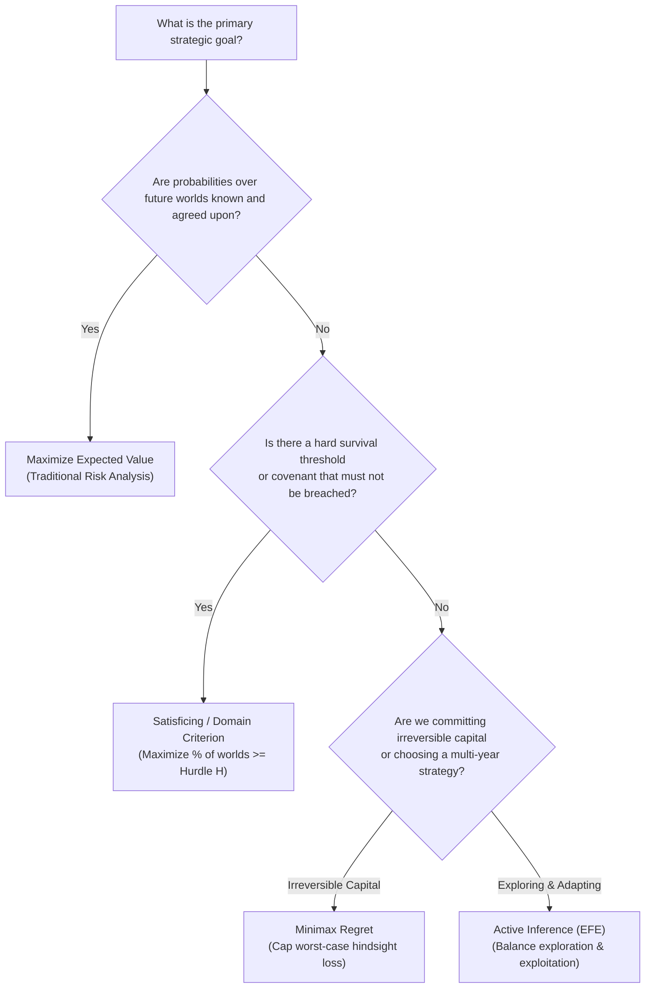

# Concept Guide: Choosing a Robustness Metric Under Deep Uncertainty

> *"Under deep uncertainty, standard expected utility maximization fails because probabilities cannot be reliably quantified. Robust decision making replaces expected values with formal bounds on regret, survival thresholds, and information gaps."*

---

## 1. The Deep Uncertainty Challenge

In standard decision theory, if an analyst knows the probability distribution $P(S)$ over future states of the world $S$, the optimal decision $a^*$ is simply the one that maximizes Expected Value:

$$a^* = \arg\max_{a \in A} \sum_{s \in S} P(s) \cdot V(a, s)$$

However, in strategic enterprise planning, geopolitical regime shifts, emerging technologies, and unprecedented climate disruptions represent **deep uncertainty**:
* Parties cannot agree on the probability distribution $P(s)$.
* Different stakeholders hold fundamentally divergent models of how the world operates.
* The true probabilities may be unknowable.

To make defensible decisions under deep uncertainty, EWM’s decision engine (`ewm decide`, [ADR-041](https://github.com/vfcarida/Enterprise-World-Model-Engine/blob/main/docs/adr/ADR-041-decision-focused-scenario-discovery.md)) implements four non-probabilistic and robust decision metrics:

```
                     Taxonomy of Robust Decision Metrics
                                       │
     ┌──────────────────┬──────────────┴──────────────┬──────────────────┐
     ▼                  ▼                             ▼                  ▼
1. MINIMAX REGRET   2. SATISFICING                3. INFO-GAP        4. ACTIVE INFERENCE
   (Savage, 1954)      (Simon, 1956)                 (Ben-Haim, 2006)   (Friston, 2017)
   Minimizes maximum   Maximizes % of worlds         Maximizes horizon  Balances epistemic
   opportunity loss.   surpassing hurdle threshold.  uncertainty limit. info & goal value.
```

---

## 2. Metric 1: Minimax Regret (Savage, 1954)

### Formulation
Regret represents the **cost of hindsight**: if world $s$ manifests, how much worse is action $a$ compared to the action $a'$ that would have been optimal had we known $s$ in advance?

$$\text{Regret}(a, s) = \max_{a' \in A} V(a', s) - V(a, s)$$

The Minimax Regret strategy selects the action that minimizes the maximum regret across all plausible worlds:

$$a^*_{\text{Regret}} = \arg\min_{a \in A} \left[ \max_{s \in S} \text{Regret}(a, s) \right]$$

### When to Use Minimax Regret
* When the Board asks: *"If our core macroeconomic assumptions turn out to be completely wrong, what is the absolute worst hindsight penalty we could suffer?"*
* For irreversible capital allocation and long-term infrastructural commitments.

---

## 3. Metric 2: Satisficing & The Domain Criterion (Simon, 1956)

### Formulation
Rather than seeking an elusive global optimum, satisficing seeks actions that are **"good enough"** across the largest variety of plausible futures. Given a minimum acceptable performance hurdle threshold $H$:

$$\text{Satisficing Rate}(a) = \frac{|\{ s \in S : V(a, s) \ge H \}|}{|S|}$$

### When to Use Satisficing
* When the priority is corporate survival, covenant compliance, or regulatory solvency.
* When achieving $100\%$ compliance across all worlds is more valuable than achieving $+20\%$ upside in one specific boom scenario.

---

## 4. Metric 3: Info-Gap Robustness (Ben-Haim, 2006)

### Formulation
Info-Gap analysis does not define a fixed set of future worlds; instead, it asks: **"How much can reality deviate from our nominal estimate before policy $a$ fails to satisfy critical performance requirement $H$?"**

Given an uncertainty parameter $\alpha$ expanding around nominal estimate $\tilde{u}$:

$$\hat{\alpha}(a, H) = \max \left\{ \alpha : \min_{u \in \mathcal{U}(\alpha, \tilde{u})} V(a, u) \ge H \right\}$$

An action with high Info-Gap robustness $\hat{\alpha}$ can withstand severe model error before falling below the hurdle rate.

### When to Use Info-Gap
* When operational parameters (such as supplier lead times or raw material costs) are poorly understood and can widen unpredictably.
* When testing engineering resilience against uncalibrated parameters.

---

## 5. Metric 4: Active Inference & Expected Free Energy (Friston, 2017)

### Formulation
In dynamic, multi-step environments, decisions should not only seek immediate reward; they should also **gather information to resolve future uncertainty**.

Expected Free Energy ($G$) decomposes candidate policies into an **Instrumental (Pragmatic) Value** and an **Epistemic (Information-Seeking) Value**:

$$G(\pi) = \underbrace{- \mathbb{E}_{Q}[\ln P(o_\tau \mid C)]}_{\text{Pragmatic Cost (Preference Gap)}} - \underbrace{\mathbb{E}_{Q}\left[ D_{\text{KL}}(Q(s_\tau \mid o_\tau, \pi) \parallel Q(s_\tau \mid \pi)) \right]}_{\text{Epistemic Information Gain}}$$

### When to Use Active Inference
* In receding-horizon controllers and autonomous agents that must probe their environment (e.g., launching an exploratory market pilot) before scaling capital investment.

---

## 6. The Decision Tree: Which Metric to Choose?


