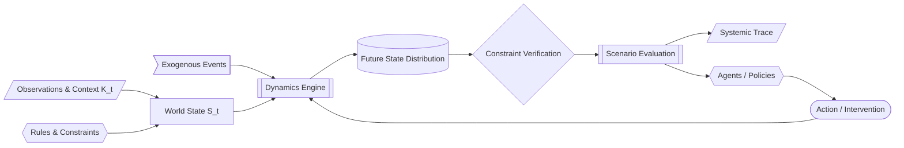

# Enterprise World Model Engine (EWM Engine)

**A research program and executable framework investigating when explicitly modeling organizational dynamics improves decisions over predicting outcomes.**

An open-source framework for building, stress-testing, and comparatively evaluating executable, action-conditioned models of organizational and socio-technical systems.

  
  
  
  

!!! tip "Reproduce All Published Results in One Command"
    EWM Engine's results gallery, comparative evaluation ladder, and SHA-256 state fingerprints are reproducible:
    - **In-Browser Jupyter**:  [Launch Binder](https://mybinder.org/v2/gh/vfcarida/Enterprise-World-Model-Engine/HEAD?filepath=notebooks%2Freproduce.ipynb)
    - **Cloud Codespaces**:  [Open Codespaces](https://codespaces.new/vfcarida/Enterprise-World-Model-Engine)
    - **Local Terminal**: `make reproduce` or `python scripts/reproduce.py`
    - **Decision-First Ladder**: `python scripts/run_comparative_evaluation.py --seed 42 --smoke`
    - **Manifest**: Every run verifies against [`reproduction_manifest.json`](results/index.md#run-manifest-provenance).

---

## The Conditional Research Thesis

Traditional machine learning optimizes specialized predictive mappings:
$$\text{input} \longrightarrow \text{prediction}$$

Examples include:
- `text` $\to$ `intent`
- `customer history` $\to$ `churn probability`
- `sensor stream` $\to$ `failure probability`
- `demand time-series` $\to$ `demand forecast`

Observational prediction is often sufficient—and **not every enterprise application needs an Enterprise World Model**. When decisions are single-shot, operational constraints are slack, or no action-conditioned policy change is under evaluation, a well-calibrated tabular predictor or static optimizer is simpler and superior (see **[What Is an EWM? (Scientific Demarcation)](explanation/what-is-an-ewm.md)** and **[Research Agenda & Falsifiable Hypotheses](explanation/research-agenda.md)**).

When decisions traverse delayed multi-department cascades, hard accounting invariants, and shifting runtime context ($K_t$), an **Enterprise World Model** formalizes an executable representation of organizational dynamics:

$$\begin{aligned}
&\text{Current World State } (S_t) + \text{Runtime Context } (K_t) \\
+\; &\text{Intervention / Proposed Action } (A_t) \\
+\; &\text{Exogenous Environmental Shocks } (E_t) \\
+\; &\text{Systemic Dynamics } (\mathcal{T}) \\
\hline
\longrightarrow\; &\textbf{Distribution Over Future States } (S_{t+1:t+H})
\end{aligned}$$

---

## The Four Fundamental Capabilities

EWM Engine separates and measures four distinct capabilities rather than collapsing them into a single score:

| Capability | Mathematical Form | System Goal |
|---|---|---|
| **Prediction** | $P(Y \mid X)$ | Forecast accuracy and marginal calibration under stationary correlations. |
| **Simulation** | $P(S_{1:T} \mid S_0, K_{0:T}, \theta)$ | Multi-step trajectory fidelity and conservation coherence (distinguishing internal coherence from external reality fidelity). |
| **Intervention** | $P(Y \mid \text{do}(A_t), K_t)$ | Counterfactual effect estimation gated by `DependencyEvidenceNature`. |
| **Decision / Planning** | $\arg\min_{\pi \in \Pi_{\text{feasible}}} \text{Regret}(\pi)$ | Downstream policy regret and SLA safety under operational constraints. |

---

## Architectural North Star

> *"The deterministic core runs fully on CPU with no required GPU or LLM dependency. GPUs and LLMs are optional and complementary: LLM agents operate at the boundary (natural-language goal interpretation and result explanation via `mcp`/`agents`), while the dynamics core stays deterministic and auditable."*

> *"Prediction estimates what may happen. A world model tests whether explicitly modeling system dynamics improves downstream decisions when the system is changed."*

> *"Learn what is uncertain. Encode what is known. Simulate the interaction between both—and emit `"DO_NOT_USE_ME_HERE"` when validity limits are breached."*

---

## Scope & Architectural Composition (What EWM Engine Is NOT)

To preserve intellectual honesty and architectural focus, EWM Engine is **not**:
- **Not an LLM agent orchestrator / prompt-workflow runner — a deterministic engine that LLM agents call** (via Python or `ewm mcp`).
- **Not a replacement for simpler predictive or optimization tools** when single-step forecasting or static MILP suffices.
- **Scoped to typed socio-technical state** (entities, ledgers, queues, and policy context $K_t$), occupying a distinct problem domain from pixel, video, or 3D rigid-body physics simulators.
- **Not an assumption-free causal discovery oracle** (`ewm induce causal` emits Markov Equivalence Classes and fails closed under unmeasured confounding).
- **One optional, modular capability inside a larger AI-systems architecture** (cf. Sculley et al., 2015)—not a standalone end-to-end data platform.
