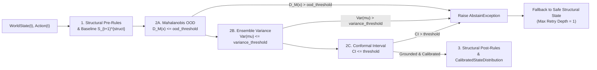

# MLOps Guide: Learned Dynamics Calibration, OOD Thresholds, and Abstention Tuning (`EWM-003`)

This document specifies the mathematical contracts, default configurations, and operational tuning procedures for **Conformal Prediction Intervals**, **Ensemble Variance**, **Out-of-Distribution (OOD) Detection**, and **Structural Abstention Fallbacks** in the Enterprise World Model Engine (`ewm_engine.dynamics.calibration` and `ewm_engine.dynamics.router`).

---

## 1. Architecture Overview

When deterministic structural compliance rules (`Pre-rules`) end, learned neural or empirical models estimate the residual state transition. To prevent uncalibrated extrapolation in high-stakes enterprise environments, every learned predictor wrapped by [`ConformalPredictorWrapper`](../src/ewm_engine/dynamics/calibration.py) (aliased as [`Predictor`](../src/ewm_engine/dynamics/calibration.py)) enforces the contract:

```python
prediction, confidence_interval = predictor.predict(state, actions)
if confidence_interval > threshold:
    raise AbstainException(...)
```



---

## 2. Mathematical Foundations & Uncertainty Metrics

### 2.1 Multivariate Mahalanobis OOD Distance (`ood_threshold`)

[`MahalanobisOODAndDriftDetector`](../src/ewm_engine/dynamics/calibration.py) extracts canonical state-action feature vectors $x \in \mathbb{R}^d$ and fits the empirical mean $\hat{\mu}$ and regularized precision matrix $(\hat{\Sigma} + \lambda I_d)^{-1}$ on in-distribution reference transitions:

$$D_M(x) = \sqrt{(x - \hat{\mu})^\top (\hat{\Sigma} + \lambda I_d)^{-1} (x - \hat{\mu})}$$

If $D_M(x) > \tau_{\text{OOD}}$ (`ood_threshold`), the predictor raises [`AbstainException`](../src/ewm_engine/dynamics/calibration.py) with `trigger="ood_mahalanobis_threshold"`.

### 2.2 Ensemble Epistemic Variance (`variance_threshold`)

For an ensemble of $N$ learned models $\{\mu_1(x), \dots, \mu_N(x)\}$, [`compute_ensemble_variance`](../src/ewm_engine/dynamics/calibration.py) computes the exact population epistemic variance:

$$\bar{\mu}(x) = \frac{1}{N} \sum_{i=1}^N \mu_i(x), \qquad \text{Var}(\mu(x)) = \frac{1}{N} \sum_{i=1}^N \left(\mu_i(x) - \bar{\mu}(x)\right)^2$$

If $\max_r \text{Var}(\mu_r(x)) > \tau_{\text{var}}$ (`variance_threshold`), the predictor raises [`AbstainException`](../src/ewm_engine/dynamics/calibration.py) with `trigger="ensemble_variance_threshold"`.

### 2.3 Split Conformal Prediction Intervals (`threshold`)

Grounded in **Vovk, Gammerman, & Shafer (2005)** (*Algorithmic Learning in a Random World*), [`ConformalPredictorWrapper.calibrate`](../src/ewm_engine/dynamics/calibration.py) computes absolute nonconformity residuals $R_j = |\Delta y_j - \bar{\mu}(x_j)|$ on a held-out calibration dataset of size $n$ and selects the finite-sample order statistic at index:

$$k = \lceil (n + 1)(1 - \alpha) \rceil, \qquad \hat{q}_{1-\alpha} = R_{(k)}$$

Under exchangeability, this guarantees finite-sample marginal coverage $\mathbb{P}(\Delta Y_{\text{test}} \in [\bar{\mu}(X_{\text{test}}) - \hat{q}_{1-\alpha}, \bar{\mu}(X_{\text{test}}) + \hat{q}_{1-\alpha}]) \ge 1 - \alpha$. At inference time, the conformal half-width is combined with epistemic ensemble spread $\sqrt{\text{Var}(\mu)}$ and OOD inflation to form [`ConfidenceInterval`](../src/ewm_engine/dynamics/calibration.py).

---

## 3. Threshold Reference & Legacy Compatibility Defaults

To preserve backwards compatibility with legacy pipelines (EWM-003 Section 13), **all abstention thresholds default to `float("inf")` (disabled)** unless explicitly configured or auto-tuned:

| Parameter | Default | Scope | Physical / Statistical Meaning | Recommended Production Range |
| :--- | :--- | :--- | :--- | :--- |
| `threshold` | `float("inf")` | `Predictor`, `HybridTransitionRouter` | Maximum allowed `ConfidenceInterval.effective_uncertainty` ($\max(\text{width}, \text{Var}(\mu), D_M)$) before triggering `AbstainException`. | $2.5 \times \hat{q}_{1-\alpha}$ to $4.0 \times \hat{q}_{1-\alpha}$ |
| `ood_threshold` | `float("inf")` | `MahalanobisOODAndDriftDetector`, `Predictor`, `HybridTransitionRouter` | Maximum multivariate Mahalanobis distance $D_M(x)$ from training support. | `tune_quantile=0.99`, `safety_margin=1.25` (typically $3.5\text{--}6.0$ depending on $d$) |
| `variance_threshold` | `float("inf")` | `MahalanobisOODAndDriftDetector`, `Predictor`, `HybridTransitionRouter` | Maximum ensemble epistemic variance $\text{Var}(\mu) = \frac{1}{N}\sum (\mu_i - \bar{\mu})^2$. | $99\text{th}$ percentile of validation ensemble variance $\times 1.5$ |
| `max_fallback_retries` | `1` | `HybridTransitionRouter`, `TransitionEngine` | Maximum retry depth if a custom structural fallback handler raises an error (hard-capped at `1` to prevent infinite loops). | `1` (strictly enforced) |

---

## 4. Step-by-Step Threshold Tuning Protocol

### Step 1: Chronological Split (Train / Calibration / Validation)

Split historical transitions chronologically using `TransitionDataset.temporal_split()` so future states never leak into training or conformal calibration:

```python
train_ds, holdout_ds = dataset.temporal_split(train_ratio=0.60)
cal_ds, val_ds = holdout_ds.temporal_split(train_ratio=0.50)
```

### Step 2: Fit the OOD Detector and Tune `ood_threshold`

Use `tune_quantile=0.99` and `safety_margin=1.25` on the calibration dataset to bound the in-distribution false-abstention rate at $\le 1\%$ while rejecting $>95\%$ of out-of-distribution or random noise inputs:

```python
from ewm_engine.dynamics.calibration import MahalanobisOODAndDriftDetector, Predictor

ood_detector = MahalanobisOODAndDriftDetector(regularization=1e-5)
ood_detector.fit(cal_ds, tune_quantile=0.99, safety_margin=1.25)
```

### Step 3: Calibrate Conformal Intervals and Verify ECE

Wrap the trained model (or ensemble of models) in `Predictor` (`ConformalPredictorWrapper`), run split conformal calibration at target coverage $1 - \alpha = 0.90$, and evaluate Expected Calibration Error (ECE) on the validation split:

```python
predictor = Predictor(
    models=ensemble_models,
    ood_detector=ood_detector,
    ood_threshold=ood_detector.ood_threshold,
    variance_threshold=2.0,
    threshold=6.0,
    nominal_coverage=0.90,
)
predictor.calibrate(cal_ds, alpha=0.10, tune_ood_quantile=0.99)

cal_report = predictor.evaluate_calibration(val_ds, num_bins=10)
assert cal_report.expected_calibration_error < cal_report.uncalibrated_ece
```

### Step 4: Wire into `HybridTransitionRouter` / `TransitionEngine`

Attach the calibrated `predictor` to `TransitionEngine`. When an OOD or high-uncertainty state triggers `AbstainException`, the router automatically falls back to the deterministic structural state with `max_fallback_retries=1`:

```python
from ewm_engine.dynamics.router import TransitionEngine

engine = TransitionEngine(
    structural_equations=structural_equations,
    ml_predictor=predictor,
    max_fallback_retries=1,
)
outcome = engine.step(state, action)
if outcome.abstained:
    # Safe structural state was executed; inspect outcome.abstention_reason
    assert outcome.fallback_executed is True
    assert outcome.next_state == outcome.structural_state
```

---

## 5. Online Drift Monitoring

During multi-step rollouts or production shadow deployment, query `ood_detector.drift_report()` to inspect the sliding-window Mahalanobis score (`window_mean_ood_score`) and fraction of abstained steps (`window_ood_rate`). When `drift_detected is True` (`window_ood_rate >= 0.25`), trigger model recalibration on recent verified transitions before re-enabling learned residual actuation.
