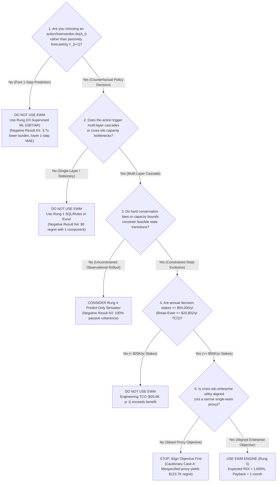

# When to Use — and When NOT to Use — an Enterprise World Model

**Version**: 1.0.0  
**Date**: 2026-10-30  
**Author**: Vinicius Caridá  
**Related Documents**: [Scientific Demarcation](../explanation/what-is-an-ewm.md), [Cost-Benefit Protocol](../methodology/cost_benefit_protocol.md), [Fraud Cascade TCO Analysis](../results/fraud_cascade_tco.md)  

---

## 1. Executive Summary

An Enterprise World Model (`ewm-engine`) is **not** a universal replacement for SQL business rules, spreadsheets, or supervised machine learning (`XGBoost`/`LightGBM`). It is a specialized decision-evaluation capability designed for **interconnected operational systems where policy interventions trigger multi-layer cascades under hard capacity or conservation constraints**.

---

## 2. Practitioner Decision Tree

Use this 5-question decision tree before investing engineering hours in an Enterprise World Model:

---

## 3. High-ROI Use Cases vs. Anti-Use Cases

### 3.1 When to Use `ewm-engine` (High-Value Use Cases)

| Use Case | Why Standard ML / Rules Fail | EWM Mechanism Used | Verified Benchmark Evidence |
| :--- | :--- | :--- | :--- |
| **1. Payment Fraud Threshold vs. Call-Center Capacity Cascade** | Lag-feature GBT (`Rung 3`) reduces 1-step call MAE by `91.49%` (`25.60` $\to$ `2.18`) yet still incurs `$124,283.57` regret because $P(Y \mid X) \ne P(Y \mid \text{do}(\tau))$ | 4-layer structural transition + `BitemporalLedger.as_of(t)` + KKT cohort conservation | [`comparative_evaluation_ladder.json`](../results/artifacts/comparative_evaluation_ladder.json) (`$0.00` regret, `2,089%–2,290%` ROI) |
| **2. Post-Deployment Policy Shift Recovery** | Static learned models degrade permanently (`MAE > 34.6`) when an upstream routing rule changes silently | Runtime `ContextSnapshot` ($K_t$) audit discovery ($\Delta t_{\text{audit}} = 2$ steps) | Benchmark Family D (`MAE = 0.158` after `2` steps) |
| **3. Multi-Echelon Supply Chain & Bullwhip Mitigation** | Unconstrained neural regressors violate mass balance (`CONSTRAINT_PRESERVATION = 0.7847`) | `ConservationProjectionLayer` nullspace projection ($\le 10^{-12}$) | Benchmark Family I & Beer Game Card (`bullwhip = 3.8025`, `1.0000` preservation) |
| **4. Performative & Adversarial Policy Stress-Testing** | Open-loop planners ignore policy-induced drift and adversary adaptation | `DriftOrigin` tracking + `ValidityLimitAbstentionGate` (`"DO_NOT_USE_ME_HERE"`) | [`validity_limits.py`](../../src/ewm_engine/flagship/validity_limits.py) (`$107,539.60` erosion detected) |

### 3.2 When NOT to Use `ewm-engine` (Anti-Use Cases)

1. **Pure 1-Step Observational Forecasting (`Negative Result N1`)**:
   - *Scenario*: Forecasting tomorrow's call volume or ticket arrivals without changing operational policies.
   - *Better Tool*: `Rung 3` Gradient Boosted Trees with engineered lag features (`MAE = 2.18` vs. EWM `3.32` at $3.7\times$ lower specification burden).
2. **Stationary Single-Layer Thresholding (`Negative Result N4`)**:
   - *Scenario*: Tuning a single-queue threshold where downstream capacity never saturates.
   - *Better Tool*: `Rung 1` AR(1) or simple SQL rule (`$0.00` decision regret with `1` specification component vs. `11`–`12` for EWM).
3. **Low-Stakes Operational Decisions (`< $20,000/year`)**:
   - *Scenario*: Internal scheduling or low-volume workflows where suboptimal policies cost `< $5,000` per quarter.
   - *Better Tool*: Excel spreadsheet (`$4,800` first-year TCO vs. `$20,802` for EWM).
4. **Unobserved Confounding Without Interventional Identification**:
   - *Scenario*: Attempting to infer causal effects from purely observational logs with unmeasured confounders.
   - *EWM Behavior*: `ewm-engine` will fail closed (`UnqualifiedCausalClaimError` / `REFUSED_UNIDENTIFIABLE_AS_DESIGNED`) rather than fabricate a causal estimate.

---

## 4. Practitioner FAQ

### Q1: Does `ewm-engine` require a GPU cluster or paid LLM API keys?
**No.** The entire deterministic simulation, constraint verification, counterfactual SCM, and evaluation core runs on standard CPUs using only `numpy`, `pydantic`, and `pyyaml` (`~$2/year` compute cost). GPUs (`[ml]`, `[jax]`, `[cuda]`) and LLM boundary tools (`[mcp]`, `[agents]`) are strictly optional extras.

### Q2: How much engineering time is required to build a first production world model?
Based on the [Fraud Cascade TCO Analysis](../results/fraud_cascade_tco.md), an experienced senior data scientist requires approximately **`176` initial hours (`~4.4` weeks / `$17,600`)** for modeling, constraints, and bitemporal data wiring, plus **`32` hours/year (`$3,200/year`)** for quarterly recalibration. First-time teams should budget `2x` (`8–9` weeks).

### Q3: What happens if a team uses `ewm-engine` with a siloed KPI (e.g., minimizing fraud loss alone)?
As proven in **Cautionary Case A (`obj_narrow_fraud_loss_minimization`)** in the comparative ladder, an accurate world model paired with a misspecified single-team proxy objective still chooses the overly aggressive threshold $\text{do}(\tau = 0.40)$ and incurs **`$123,689.15` (`$124,283.57` 10-seed mean) in enterprise regret**. Aligning the cross-silo objective is mandatory before deployment.

### Q4: How do we know when the world model is out of its validity envelope?
`ValidityLimitAbstentionGate` continuously monitors structural residual drift, conservation violations, and unmodeled regime shifts (Benchmark Family K). When out-of-validity conditions are detected, the engine emits `"DO_NOT_USE_ME_HERE"` and abstains from automated policy ranking.
