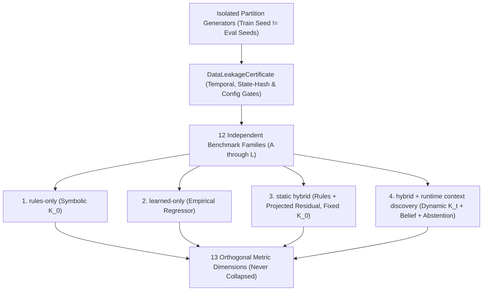
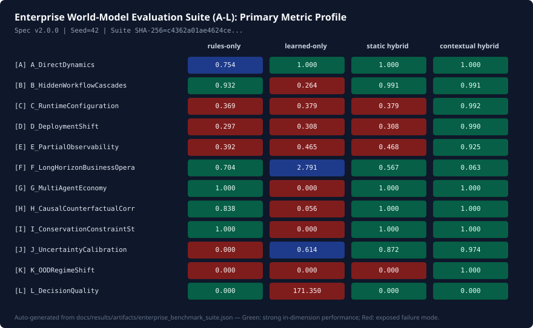
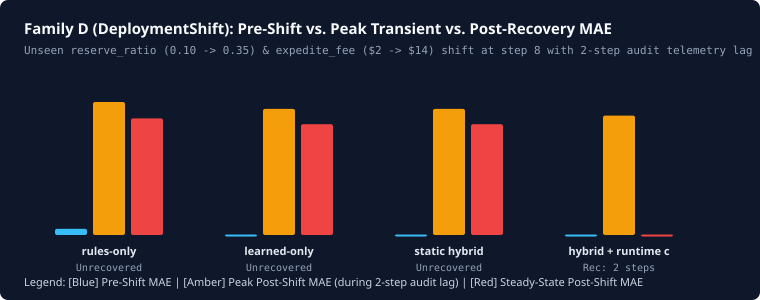

# Enterprise World-Model Evaluation & Failure-Mode Suite (A-L)

!!! info "Scientifically Defensible Failure-Mode Instrument — ADR-054"
    This benchmark suite answers: ***"When is an enterprise world model actually useful, correct, calibrated, robust, and decision-relevant?"***
    Every table and figure on this page is **automatically generated** from the committed machine-readable artifact [`docs/results/artifacts/enterprise_benchmark_suite.json`](../results/artifacts/enterprise_benchmark_suite.json) (`suite_fingerprint = c4362a01ae4624ce912f81535e6acd73d54c01bb22dce0daa697ab7adbe0cbb1`). Numbers are never copied by hand.

---

## 1. Design Philosophy & Research Lineage

Standard machine-learning evaluation reduces world modeling to a single observational one-step accuracy score. Recent research across enterprise workflow simulation, causal representation learning, and physical world models—including *World of Workflows*, *CascadeBench* (*Do Enterprise Systems Need Learned World Models?*), *Vending-Bench 2*, *Vending-Bench Arena*, Vafa et al. ([arXiv:2406.03689](https://arxiv.org/abs/2406.03689), [arXiv:2507.06952](https://arxiv.org/abs/2507.06952)), *Physics-IQ* ([arXiv:2501.09038](https://arxiv.org/abs/2501.09038)), and *RWM-U* ([arXiv:2504.16680](https://arxiv.org/abs/2504.16680))—shows that observational MSE conceals catastrophic operational failures.

**Anti-Optimization Mandate**: This benchmark is **not** tuned to make EWM Engine look artificially perfect. It explicitly exposes where each paradigm fails—including where `hybrid + runtime context discovery` incurs transient errors during audit-telemetry delays (Family D), bounded filtering lag under partial observability (Family E), raw state-prediction breakdown on unmodeled OOD structural physics requiring abstention (Family K), and higher compute latency/memory overhead.



---

## 2. Benchmark Card & Dataset/Scenario Cards (Families A-L)

### 2.1 Suite Benchmark Card

- **Suite Identifier**: `EWM_Enterprise_World_Model_Benchmark_Suite` (Spec `v2.0.0`, Metrics `v2.0.0`)
- **Governing ADR**: [`ADR-054: Enterprise World-Model Evaluation & Failure-Mode Benchmark Suite`](../adr/ADR-054-enterprise-world-model-evaluation-benchmark-suite.md)
- **Master Seed**: `42` (cryptographically partitioned via `np.random.SeedSequence` with domain tags `0xE03_1001` for training and `0xE03_2002` for evaluation)
- **Eleven Task Types Evaluated**: `next_state_prediction`, `action_effect_prediction`, `constraint_prediction`, `workflow_side_effect_prediction`, `audit_trace_reconstruction`, `configuration_context_inference`, `counterfactual_query`, `policy_ranking`, `robust_action_selection`, `model_abstention`, `confidence_calibration`
- **Intended Use**: Comparative diagnostic auditing of enterprise world-model architectures across transition fidelity, constraint preservation, causal selectivity, calibration, shift recovery, and decision regret.
- **Out-of-Scope Use**: Claiming real-world deployment readiness or empirical domain superiority from synthetic benchmark scores without domain-specific backtesting and causal identification.

### 2.2 Independent Family Scenario Cards (A through L)

| Family | Scenario Card & Data-Generating Mechanism | Task Types | Primary Dimensions |
| :---: | :--- | :--- | :--- |
| **A** | **`A_DirectDynamics`**: Deterministic inventory transfer with quadratic valve-friction loss above flow threshold $\tau = 10$. Exact analytical oracle ($\le 10^{-12}$). | `next_state_prediction`, `action_effect_prediction` | `TRANSITION_FIDELITY`, `CONSTRAINT_PRESERVATION`, `TRACE_PROVENANCE_COMPLETENESS` |
| **B** | **`B_HiddenWorkflowCascades`**: *World of Workflows* probe. Expedited orders ($q > 25$) trigger compliance hold backlogs, throttling dispatch and incurring SLA cash penalties never excited in routine training logs ($q \le 22$). | `workflow_side_effect_prediction`, `action_effect_prediction`, `audit_trace_reconstruction` | `TRANSITION_FIDELITY`, `CAUSAL_CORRECTNESS`, `TRACE_PROVENANCE_COMPLETENESS` |
| **C** | **`C_RuntimeConfiguration`**: Cross-tenant deployment (`tenant_us_standard` vs. `tenant_eu_strict`) sharing nominal schemas but differing in `ContextSnapshot` $K_t$ (22% VAT withholding + $15 dual-control fee). | `configuration_context_inference`, `next_state_prediction`, `workflow_side_effect_prediction` | `SHIFT_ROBUSTNESS`, `TRANSITION_FIDELITY`, `TRACE_PROVENANCE_COMPLETENESS` |
| **D** | **`D_DeploymentShift`**: Mid-rollout shift at step 8 (`reserve_ratio` $0.10 \to 0.35$, `expedite_fee` $\$2 \to \$14$) with a **2-step runtime audit telemetry delay**. | `configuration_context_inference`, `next_state_prediction`, `audit_trace_reconstruction` | `SHIFT_ROBUSTNESS`, `TIME_TO_RECOVERY_AFTER_SHIFT`, `TRANSITION_FIDELITY` |
| **E** | **`E_PartialObservability`**: `ObservationFilter` withholds latent `supplier_congestion` and secret rules while exposing noisy `audit_fill_shortfall` telemetry. | `next_state_prediction`, `audit_trace_reconstruction`, `confidence_calibration` | `TRANSITION_FIDELITY`, `CALIBRATION`, `TRACE_PROVENANCE_COMPLETENESS` |
| **F** | **`F_LongHorizonBusinessOperation`**: *Vending-Bench 2* spirit. Multi-step inventory, cash, demand, 3% per-step spoilage, and mid-horizon supplier wholesale price shift. | `next_state_prediction`, `workflow_side_effect_prediction`, `constraint_prediction` | `LONG_HORIZON_ERROR_GROWTH`, `TRANSITION_FIDELITY`, `CONSTRAINT_PRESERVATION` |
| **G** | **`G_MultiAgentEconomy`**: *Vending-Bench Arena* spirit. Buyer, Primary Supplier, and Arbitrage Desk clear scarce goods under 3-way conservation ($\sum \Delta R = 0$) and scarcity diversion. | `action_effect_prediction`, `workflow_side_effect_prediction`, `policy_ranking` | `CONSTRAINT_PRESERVATION`, `TRANSITION_FIDELITY`, `DECISION_REGRET` |
| **H** | **`H_CausalCounterfactualCorrectness`**: Synthetic SCM testing abducted-noise twin counterfactuals, non-descendant invariance (`macro_index`), and fail-closed refusal under latent confounding $U_{\text{macro}}$. | `counterfactual_query`, `action_effect_prediction`, `model_abstention` | `CAUSAL_CORRECTNESS`, `ABSTENTION_QUALITY`, `TRANSITION_FIDELITY` |
| **I** | **`I_ConservationConstraintStress`**: Adversarial overdraft transfers attempting negative stock and phantom mass fabrication across closed vaults ($V_A + V_B = 500$). Exact oracle ($\le 10^{-12}$). | `constraint_prediction`, `next_state_prediction` | `CONSTRAINT_PRESERVATION`, `TRANSITION_FIDELITY`, `TRACE_PROVENANCE_COMPLETENESS` |
| **J** | **`J_UncertaintyCalibration`**: Heteroscedastic load- and context-scaled Gaussian simulator testing 90% interval coverage, coverage error, and proper scoring (CRPS). | `confidence_calibration`, `next_state_prediction` | `CALIBRATION`, `TRANSITION_FIDELITY`, `SHIFT_ROBUSTNESS` |
| **K** | **`K_OODRegimeShift`**: Severe out-of-support load ($[180, 300]$ vs. $[10, 50]$) with an **unmodeled quadratic grid collapse** absent from `ContextSnapshot`, testing epistemic abstention. | `model_abstention`, `next_state_prediction`, `confidence_calibration` | `ABSTENTION_QUALITY`, `TRANSITION_FIDELITY`, `DECISION_REGRET` |
| **L** | **`L_DecisionQuality`**: Decouples prediction error from policy regret $U^*(\pi^*) - U^*(\hat{\pi})$ under confounded observational history vs. additive fixed-overhead offset. | `policy_ranking`, `robust_action_selection`, `counterfactual_query` | `DECISION_REGRET`, `TRANSITION_FIDELITY`, `CAUSAL_CORRECTNESS` |

---

## 3. Baseline Paradigms Evaluated

1. **`rules-only` (`RulesOnlyStructuralModel`)**: First-principles symbolic rules configured with compile-time context $K_0$, hard constraint enforcement, zero learned residual, and deterministic point predictions.
2. **`learned-only` (`LearnedPolynomialRidgeModel`)**: Empirical polynomial ridge regressor fitted strictly on training partition transitions $(S_t, A_t) \mapsto \Delta S_t$ without structural conservation projections, causal graph constraints, or runtime context $K_t$.
3. **`static hybrid` (`StaticHybridProjectedModel`)**: Symbolic rules + feasible-set projected learned residual (`InfeasibleResidualPolicy.PROJECT`), locked to compile-time context $K_0$ without runtime audit discovery or belief updating.
4. **`hybrid + runtime context discovery` (`ContextualHybridDiscoveryModel`)**: Symbolic rules + feasible-set projected learned residual + `AuditMetadataContextDiscovery` evolving $K_t$ from runtime audit telemetry + `ExponentialSmoothingBeliefUpdater` for partial observability + `CompetenceEstimator` for OOD abstention.

---

## 4. Comparative Results Across Families A-L (Auto-Generated)



| Code | Benchmark Family | Oracle | Primary Metric | `rules-only` | `learned-only` | `static hybrid` | `hybrid + runtime context discovery` |
|:----:|:-----------------|:------:|:---------------|:------------:|:--------------:|:---------------:|:------------------------------------:|
| **A** | `A_DirectDynamics` | Exact (`det`) | `TRANSITION_FIDELITY` | 0.7545 (det) | 1.0000 (det) | 1.0000 (det) | **1.0000 (det)** |
| **B** | `B_HiddenWorkflowCascades` | Stochastic ($M=5$) | `TRANSITION_FIDELITY` | 0.9324 ± 0.0024 | 0.2640 ± 0.0183 | 0.9911 ± 0.0015 | **0.9911 ± 0.0015** |
| **C** | `C_RuntimeConfiguration` | Stochastic ($M=5$) | `SHIFT_ROBUSTNESS` | 0.3686 ± 0.0074 | 0.3785 ± 0.0073 | 0.3785 ± 0.0073 | **0.9920 ± 0.0003** |
| **D** | `D_DeploymentShift` | Stochastic ($M=5$) | `SHIFT_ROBUSTNESS` | 0.2970 ± 0.0060 | 0.3076 ± 0.0059 | 0.3076 ± 0.0059 | **0.9900 ± 0.0012** |
| **E** | `E_PartialObservability` | Stochastic ($M=5$) | `TRANSITION_FIDELITY` | 0.3925 ± 0.0552 | 0.4652 ± 0.0785 | 0.4681 ± 0.0795 | **0.9250 ± 0.0121** |
| **F** | `F_LongHorizonBusinessOperation` | Stochastic ($M=5$) | `LONG_HORIZON_ERROR_GROWTH` | 0.7039 ± 0.0189 | 2.7908 ± 0.2572 | 0.5666 ± 0.0051 | **0.0632 ± 0.0051** |
| **G** | `G_MultiAgentEconomy` | Stochastic ($M=5$) | `CONSTRAINT_PRESERVATION` | 1.0000 ± 0.0000 | 0.0000 ± 0.0000 | 1.0000 ± 0.0000 | **1.0000 ± 0.0000** |
| **H** | `H_CausalCounterfactualCorrectness` | Stochastic ($M=5$) | `CAUSAL_CORRECTNESS` | 0.8377 ± 0.0027 | 0.0556 ± 0.0004 | 1.0000 ± 0.0000 | **1.0000 ± 0.0000** |
| **I** | `I_ConservationConstraintStress` | Exact (`det`) | `CONSTRAINT_PRESERVATION` | 1.0000 (det) | 0.0000 (det) | 1.0000 (det) | **1.0000 (det)** |
| **J** | `J_UncertaintyCalibration` | Stochastic ($M=5$) | `CALIBRATION` | 0.0000 ± 0.0000 | 0.6137 ± 0.0506 | 0.8725 ± 0.0620 | **0.9738 ± 0.0300** |
| **K** | `K_OODRegimeShift` | Stochastic ($M=5$) | `ABSTENTION_QUALITY` | 0.0000 ± 0.0000 | 0.0000 ± 0.0000 | 0.0000 ± 0.0000 | **1.0000 ± 0.0000** |
| **L** | `L_DecisionQuality` | Stochastic ($M=5$) | `DECISION_REGRET` | 0.0000 ± 0.0000 | 171.3500 ± 0.0000 | 0.0000 ± 0.0000 | **0.0000 ± 0.0000** |

> **Statistical Protocol Note**: Entries marked `(det)` denote deterministic exact-oracle evaluations where statistical significance is not applicable and exact/tolerance correctness is reported. Entries with `±` report the sample mean and 95% non-parametric bootstrap confidence half-width across independent seeds spawned via `np.random.SeedSequence`, with Holm-Bonferroni step-down adjusted $p$-values and paired Cohen's $d_z$ recorded in the JSON artifact.

---

## 5. Thirteen Orthogonal Metric Dimensions Profile (Auto-Generated)

The thirteen evaluation dimensions are formally defined in `benchmarks/protocol.py` (`METRIC_DEFINITIONS`) and are **never collapsed** into a single aggregate score:

| Metric Dimension | Direction | Unit | `rules-only` | `learned-only` | `static hybrid` | `hybrid + runtime context discovery` |
|:-----------------|:---------:|:-----|:------------:|:--------------:|:---------------:|:------------------------------------:|
| `TRANSITION_FIDELITY` | Higher ↑ | score in (0, 1] | 0.5624 | 0.4662 | 0.7083 | 0.8720 |
| `CONSTRAINT_PRESERVATION` | Higher ↑ | pass rate in [0, 1] | 1.0000 | 0.7847 | 1.0000 | 1.0000 |
| `CAUSAL_CORRECTNESS` | Higher ↑ | score in [0, 1] | 0.6543 | 0.3116 | 0.7166 | 0.9772 |
| `CALIBRATION` | Higher ↑ | score in [0, 1] | 0.1755 | 0.2677 | 0.5012 | 0.9084 |
| `LONG_HORIZON_ERROR_GROWTH` | Lower ↓ | error units / step | 1.0225 | 1.2192 | 1.0071 | 0.8208 |
| `SHIFT_ROBUSTNESS` | Higher ↑ | score in (0, 1] | 0.5347 | 0.3762 | 0.7153 | 0.9033 |
| `TIME_TO_RECOVERY_AFTER_SHIFT` | Lower ↓ | steps | 18.1667 | 12.2000 | 15.9667 | 2.8333 |
| `DECISION_REGRET` | Lower ↓ | utility units | 15.0719 | 46.6619 | 12.3680 | 0.2105 |
| `ABSTENTION_QUALITY` | Higher ↑ | score in [0, 1] | 0.3333 | 0.1727 | 0.5113 | 0.6645 |
| `TRACE_PROVENANCE_COMPLETENESS` | Higher ↑ | recall in [0, 1] | 0.7417 | 0.0000 | 0.8417 | 1.0000 |
| `LATENCY` | Lower ↓ | ms / step | 0.0727 | 0.1435 | 0.1121 | 0.2304 |
| `MEMORY` | Lower ↓ | KB | 11.2116 | 10.5332 | 10.8370 | 12.9655 |
| `THROUGHPUT` | Higher ↑ | steps / sec | 30373.0519 | 10743.8827 | 18565.0203 | 9814.4781 |

---

## 6. Deployment & Configuration Shift Protocol Analysis (Auto-Generated)



| Family | Baseline Paradigm | Train Context | Eval Context | Audit Delay | Pre-Shift MAE | Peak Shift MAE | Steady Post-Shift MAE | Steps to Recovery | Recovered in Budget |
|:-------|:------------------|:-------------:|:------------:|:-----------:|:-------------:|:--------------:|:---------------------:|:-----------------:|:-------------------:|
| **C** (`C_RuntimeConfiguration`) | `rules-only` | `1.0.0-us` | `2.0.0-eu` | 0 steps | 1.887 | 44.561 | 44.561 | Unrecovered (∞) | FAIL |
| **C** (`C_RuntimeConfiguration`) | `learned-only` | `1.0.0-us` | `2.0.0-eu` | 0 steps | 0.001 | 42.673 | 42.673 | Unrecovered (∞) | FAIL |
| **C** (`C_RuntimeConfiguration`) | `static hybrid` | `1.0.0-us` | `2.0.0-eu` | 0 steps | 0.000 | 42.674 | 42.674 | Unrecovered (∞) | FAIL |
| **C** (`C_RuntimeConfiguration`) | `hybrid + runtime context discovery` | `1.0.0-us` | `2.0.0-eu` | 0 steps | 0.000 | 0.195 | 0.195 | 0 | PASS |
| **D** (`D_DeploymentShift`) | `rules-only` | `1.0.0` | `2.0.0` | 2 steps | 1.940 | 41.570 | 36.447 | Unrecovered (∞) | FAIL |
| **D** (`D_DeploymentShift`) | `learned-only` | `1.0.0` | `2.0.0` | 2 steps | 0.153 | 39.394 | 34.632 | Unrecovered (∞) | FAIL |
| **D** (`D_DeploymentShift`) | `static hybrid` | `1.0.0` | `2.0.0` | 2 steps | 0.154 | 39.395 | 34.632 | Unrecovered (∞) | FAIL |
| **D** (`D_DeploymentShift`) | `hybrid + runtime context discovery` | `1.0.0` | `2.0.0` | 2 steps | 0.154 | 37.326 | 0.158 | 2 | PASS |

---

## 7. Surfaced Failure Modes Across All Baselines (Auto-Generated)

| Family | `rules-only` Failure Mode | `learned-only` Failure Mode | `static hybrid` Failure Mode | `hybrid + runtime context discovery` Limitation / Behavior |
|:------:|:--------------------------|:----------------------------|:-----------------------------|:-----------------------------------------------------------|
| **A** | Misses empirical quadratic valve-friction above flow threshold (measured MAE=3.255). | Lacks explicit structural conservation/provenance trace (measured trace completeness=0.00). | Optimal in-regime behavior (0 violations). | Optimal in-regime behavior (0 violations). |
| **B** | Captures workflow cascade trigger (backlog MAE=0.00) but misses empirical handling friction (total MAE=1.85). | Blind to latent compliance-hold and SLA penalty cascade never excited in training logs (cascade MAE=74.00). | Optimal in-regime behavior (0 violations). | Optimal in-regime behavior (0 violations). |
| **C** | Applies compile-time US tenant rules (0% withholding) to EU strict tenant deployment (measured MAE=44.56). | Conditioned only on ontic state/action; blind to cross-tenant configuration K_t (measured MAE=42.67). | Applies compile-time US tenant rules (0% withholding) to EU strict tenant deployment (measured MAE=42.67). | Optimal in-regime behavior (0 violations). |
| **D** | Never recovers after mid-rollout deployment shift (steady post-shift MAE=36.45). | Never recovers after mid-rollout deployment shift (steady post-shift MAE=34.63). | Never recovers after mid-rollout deployment shift (steady post-shift MAE=34.63). | Experiences transient error spike (MAE=37.33) during the 2-step audit telemetry lag before recovering. |
| **E** | Cannot infer latent supplier congestion from visible stock alone (POMDP MAE=25.72); systematically overpredicts deliveries. | Cannot infer latent supplier congestion from visible stock alone (POMDP MAE=19.91); systematically overpredicts deliveries. | Cannot infer latent supplier congestion from visible stock alone (POMDP MAE=19.72); systematically overpredicts deliveries. | Tracks latent congestion via audit belief filtering, but retains bounded filtering lag error (MAE=1.01) vs. an omniscient oracle. |
| **F** | Ignores 3% per-step perishability spoilage and mid-horizon supplier contract shift (rollout MAE=21.55). | Autoregressive compounding drift (growth slope=2.80/step) causes severe long-horizon cash/inventory divergence. | Captures perishability spoilage in first half, but drifts after step H/2 supplier price change (growth slope=0.567/step). | Optimal in-regime behavior (0 violations). |
| **G** | Conserves goods (pass rate=1.00) but ignores strategic arbitrage diversion during supply scarcity (MAE=2.88). | Violates multi-agent clearing conservation (pass rate=0.00, sum of goods deltas != 0). | Optimal in-regime behavior (0 violations). | Optimal in-regime behavior (0 violations). |
| **H** | Satisfies descendant selectivity (1.00) and confounding refusal (1.00), but misses nonlinear diminishing-returns residual (CF MAE=14.27). | Conflates observational correlation with do(discount) (CF MAE=74.9), spuriously perturbs non-descendant macro_index (selectivity=0.00), and fails to refuse unidentifiable queries. | Optimal in-regime behavior (0 violations). | Optimal in-regime behavior (0 violations). |
| **I** | Optimal in-regime behavior (0 violations). | Violates non-negativity and closed-system mass conservation on 100% of adversarial transfer requests (max mass drift=0.00). | Optimal in-regime behavior (0 violations). | Optimal in-regime behavior (0 violations). |
| **J** | Deterministic point rules emit zero-width intervals (0% empirical coverage). | Homoscedastic training variance severely undercovers (70.0% vs 90% nominal) under high-load heteroscedastic noise. | Undercovers (86.2% vs 90% nominal) when runtime volatility regime shifts from 1.0x to 1.4x. | Optimal in-regime behavior (0 violations). |
| **K** | Silently extrapolates linear dynamics into severe OOD phase collapse without abstaining (OOD MAE=288.8, Abstention F1=0.00). | Silently extrapolates linear dynamics into severe OOD phase collapse without abstaining (OOD MAE=288.7, Abstention F1=0.00). | Silently extrapolates linear dynamics into severe OOD phase collapse without abstaining (OOD MAE=288.8, Abstention F1=0.00). | Honest limitation: raw OOD state prediction fails on unmodeled quadratic phase collapse (OOD MAE=288.8), requiring CompetenceEstimator abstention (F1=1.00). |
| **L** | Moderate state prediction error (MAE=18.07 from unmodeled fixed overhead) yet zero decision regret (0.0) because structural action gradients are preserved. | Low observational prediction error (MAE=1.03) yet high decision regret (171.3) due to confounded action-effect slope. | Optimal in-regime behavior (0 violations). | Optimal in-regime behavior (0 violations). |

---

## 8. Data Non-Leakage & Reproducibility Certificates (Auto-Generated)

| Code | Family | Train Seed | Eval Seeds | State Overlap | Temporal Gate | Config Gate | Dataset SHA-256 (prefix) | Output SHA-256 (prefix) |
|:----:|:-------|:----------:|:----------:|:-------------:|:-------------:|:-----------:|:------------------------:|:-----------------------:|
| **A** | `A_DirectDynamics` | `4026233938` | `388545` | 0 | PASS | PASS | `e36274109853` | `74f443f286e1` |
| **B** | `B_HiddenWorkflowCascades` | `4026233938` | `388545,358187,+3` | 0 | PASS | PASS | `ddb0ee9b418c` | `9ad0918000bd` |
| **C** | `C_RuntimeConfiguration` | `4026233938` | `388545,358187,+3` | 0 | PASS | PASS | `c83e6b01716e` | `8d6f0ff775aa` |
| **D** | `D_DeploymentShift` | `4026233938` | `388545,358187,+3` | 0 | PASS | PASS | `df8564ab5334` | `5925b6882244` |
| **E** | `E_PartialObservability` | `4026233938` | `388545,358187,+3` | 0 | PASS | PASS | `2e19ba979f40` | `c4373903e7dd` |
| **F** | `F_LongHorizonBusinessOperation` | `4026233938` | `388545,358187,+3` | 0 | PASS | PASS | `49120fc48d3d` | `16d155fd58ef` |
| **G** | `G_MultiAgentEconomy` | `4026233938` | `388545,358187,+3` | 0 | PASS | PASS | `860a03f15221` | `5c05464ad0f3` |
| **H** | `H_CausalCounterfactualCorrectness` | `4026233938` | `388545,358187,+3` | 0 | PASS | PASS | `cdc025d16e1e` | `973e88649cbd` |
| **I** | `I_ConservationConstraintStress` | `4026233938` | `388545` | 0 | PASS | PASS | `c8a4a9693609` | `92185816d5e4` |
| **J** | `J_UncertaintyCalibration` | `4026233938` | `388545,358187,+3` | 0 | PASS | PASS | `d8f9f6316c3c` | `68d3f28190ad` |
| **K** | `K_OODRegimeShift` | `4026233938` | `388545,358187,+3` | 0 | PASS | PASS | `424d8ee0c90e` | `796a2970285f` |
| **L** | `L_DecisionQuality` | `4026233938` | `388545,358187,+3` | 0 | PASS | PASS | `7a13f5882c7a` | `6bcf30c1a763` |

---

## 9. Limitations & Threats to Validity

1. **Internal Validity**:
   - **Threat**: Procedural generator seed coupling or accidental overlap between training and evaluation states could inflate learned baseline scores.
   - **Mitigation**: `derive_partition_seeds` uses distinct cryptographic domain tags (`0xE03_1001` vs. `0xE03_2002`), and `verify_no_data_leakage` enforces zero ontic state-fingerprint overlap, strict temporal precedence ($\max t_{\text{train}} < \min t_{\text{eval}}$), and held-out context version isolation across all 12 families.
2. **Construct Validity**:
   - **Threat**: Collapsing accuracy, safety, calibration, and latency into a single scalar score masks critical operational trade-offs (e.g., `learned-only` is fast and fits smooth curves, but violates conservation in Family G/I and incurs high decision regret in Family L).
   - **Mitigation**: All 13 `MetricDimension`s are reported separately, and Family L explicitly separates predictive MAE from decision regret $U^*(\pi^*) - U^*(\hat{\pi})$.
3. **External Validity**:
   - **Threat**: Synthetic enterprise scenarios are stylized abstractions of production ERP/SCM workflows; when an unseen physical/structural change falls outside the schema of `ContextSnapshot` (as demonstrated in **Family K**), runtime context discovery alone cannot predict the new trajectory.
   - **Mitigation**: Family K explicitly tests and documents this boundary—showing that `hybrid + runtime context discovery` suffers high raw prediction error on unmodeled OOD physics and must rely on `CompetenceEstimator` abstention rather than claiming omniscient extrapolation.
4. **Statistical Conclusion Validity**:
   - **Threat**: Manufacturing $p$-values on deterministic simulators or ignoring multiple comparisons across baselines.
   - **Mitigation**: Deterministic oracle families (A, I) set `statistical_significance_applicable = False` and verify numerical tolerances ($\le 10^{-12}$), while stochastic families separate Monte Carlo standard error ($\text{SE}_{\text{MC}}$) from internal model uncertainty spread and apply Holm-Bonferroni adjustments across baseline comparisons.

---

## 10. Reproduction Instructions

```bash
# Run the full 12-family Enterprise Benchmark Suite and regenerate JSON + SVG + Markdown artifacts
python -m benchmarks.enterprise_suite --seed 42 --update-artifacts

# Run fast smoke configuration (< 0.5s) for CI verification
python -m benchmarks.enterprise_suite --seed 42 --fast

# Run specific families (e.g., Hidden Workflow Cascades, Deployment Shift, Decision Quality)
python -m benchmarks.enterprise_suite --family B D L

# Execute the self-validation test suite verifying oracles, metrics, repeatability, and non-leakage
pytest tests/benchmark/test_enterprise_benchmark_suite.py -q
```
