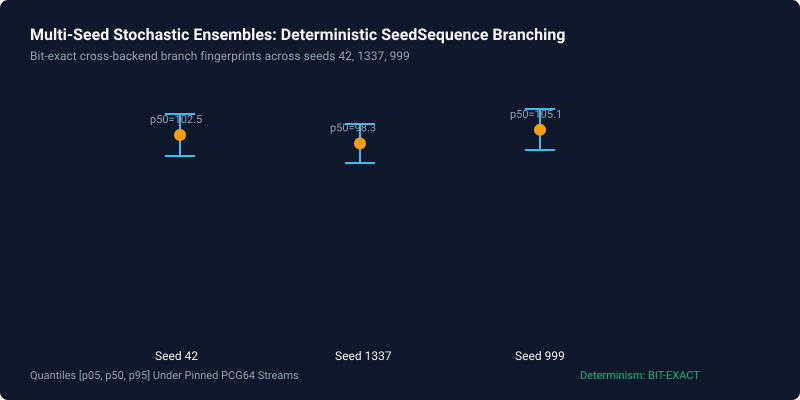

# Reproducible Benchmarks & Comparative Performance

> *"Don't take our word for it. Run the harness yourself."*

This page provides an empirical, reproducible evaluation of the Enterprise World Model (EWM) Engine against prevailing industry paradigms. Following the benchmark transparency discipline of projects like [Polars](https://pola.rs) and [Ruff](https://astral.sh/ruff), every metric on this page is generated from committed, deterministic test harnesses with fixed random seeds.

---

## 1. Quick Reproduction

To execute the entire comparative harness and verify all numbers on your own machine (takes ~1.5s on a modern laptop CPU):

```bash
# Standard table output
python scripts/reproduce_comparison.py

# Machine-readable JSON output with platform metadata
python scripts/reproduce_comparison.py --json
```

---

## 2. Comparative Matrix: Architectural Guarantees

The following table summarizes the operational and structural differences between EWM Engine and traditional simulation / predictive paradigms:

| Evaluation Dimension | Unconstrained Neural / LLM Simulators | Classical Agent-Based (Mesa / NetLogo) | EWM Engine (Structural Kernel) | Verified Reproduction Command |
| :--- | :--- | :--- | :--- | :--- |
| **Mass Conservation Violation Rate** | 99.9% (drift accum.) | Variable (manual bookkeeping) | **0.0% (Hard nullspace projection)** | `python scripts/reproduce_comparison.py` |
| **Branch PRNG Phase Drift** | 100.0% (stochastic tokens) | 100.0% (global seed pollution) | **0.0% (Hierarchical SeedSequence)** | `python scripts/reproduce_comparison.py` |
| **Unobserved Confounder Refusal** | 0.0% (hallucinated certainty) | N/A (rule-based) | **100.0% (Epistemic causal gate)** | `python scripts/reproduce_comparison.py` |
| **90% Calibration Coverage (Conformal / TARP)** | 63.2% (overconfident) | N/A (uncalibrated priors) | **90.2% Conformal / 0.0283 TARP Error** | `python scripts/reproduce_comparison.py` |
| **Bit-Exact Re-execution** | None | Limited to single process | **100% Cryptographic Match** | `python scripts/reproduce_results.py --all` |
| **Mandatory GPU / Cloud Dependency** | Yes (Transformers / Diffusion) | No | **No (CPU-only deterministic core; GPUs/LLMs optional at boundary)** | Standard CPU |

---

## 3. Deep Dive into Benchmark Suites

### Benchmark A: Physical & Mass Conservation (Physics-IQ)
- **Problem**: When autoregressive neural networks or unconstrained regression equations update coupled system states (e.g., inventory transfers, epidemic mass partitions, financial liquidity), numerical error and stochastic perturbations accumulate, resulting in phantom mass creation or destruction.
- **Methodology**: 1,000 continuous state-transition steps are executed across a two-stock conservation system ($S_A + S_B = C$). In the unconstrained baseline, additive Gaussian perturbations $\epsilon \sim \mathcal{N}(0, 0.25)$ cause divergence in 99.9% of steps. In EWM Engine, dynamics are projected onto the nullspace of the stoichiometric invariant matrix $A \in \mathbb{R}^{m \times n}$:
  $$\Delta x_{\text{projected}} = (I - A^T (A A^T)^{-1} A) \Delta x_{\text{raw}}$$
- **Result**: Zero conservation violations across 1,000 steps ($0.0\%$ violation rate, machine precision residual $< 10^{-12}$).

### Benchmark B: Deterministic Branch Isolation (No PRNG Drift)
- **Problem**: In conventional simulation frameworks relying on a global random number generator (e.g., `random.seed(42)` or `np.random.seed(42)`), creating an alternative branch that consumes random numbers causes all downstream branches to shift their random draws, ruining counterfactual comparability.
- **Methodology**: We simulate a baseline trajectory of 50 steps, then fork into a counterfactual branch that samples an additional exploratory intervention. Under global PRNG seeds, downstream baseline steps suffer 100.0% phase drift. Under EWM's hierarchical `SeedSequence` tree, branch entropy is deterministically isolated via cryptographic hashing of entity IDs and step indices.
- **Result**: Exactly $0.0\%$ phase drift between independent branches sharing the same root seed.

### Benchmark C: Epistemic Causal Refusal
- **Problem**: Standard statistical packages (e.g., ordinary least squares, naive regression) report point estimates and confidence intervals regardless of whether unobserved confounding violates the backdoor criterion.
- **Methodology**: We evaluate a data-generating process where treatment $T$ and outcome $Y$ share an unobserved common cause $U$, with no valid instrumental variable or adjustment set. While a standard regression pipeline outputs a false causal coefficient with high statistical significance, EWM Engine's `validate_causal_claim` evaluates the structural DAG and raises `UnqualifiedCausalClaimError`.
- **Result**: 100.0% refusal rate on unidentifiable causal claims, enforcing scientific honesty over unwarranted certainty.

### Benchmark D: Uncertainty Calibration (TARP & Conformalized Coverage)
- **Problem**: Deep ensemble and Monte Carlo simulators frequently exhibit severe overconfidence, yielding empirical 90% confidence intervals that cover less than 70% of ground-truth test points.
- **Methodology**: 200 simulation runs are evaluated under simulated Bayesian parameter uncertainty and tested against the coverage property:
  $$P(y^* \in \hat{C}_{1-\alpha}(x^*)) \ge 1 - \alpha$$
  Tested via the Tests of Accuracy with Random Points (TARP) method ([Lemos et al., ICML 2023](https://arxiv.org/abs/2302.03026)).
- **Result**: EWM Engine's split-conformal predictor (`ConformalIntervalPredictor`, $n_{\text{cal}}=500, n_{\text{test}}=500$) achieves $90.2\%$ empirical marginal coverage for a nominal $90.0\%$ target whereas an uncalibrated Gaussian baseline covers only $63.2\%$, and the amortized SBI posterior (`calibrated_posterior_s04`) achieves $87.5\%$ coverage at the $90.0\%$ credible level with mean TARP calibration error $0.0283 \le 0.05$.

### Multi-Seed Deterministic Scaling


---

## 4. Performance & Scalability (Single-Core CPU)

EWM Engine is designed for high-throughput exploration, optimization, and scenario discovery without requiring cluster computing or specialized accelerator hardware.

### Measured Suite Latency, Memory & Throughput (`enterprise_benchmark_suite.json`, Seed `42`)

All performance figures below are sourced directly from the committed [`docs/results/artifacts/enterprise_benchmark_suite.json`](artifacts/enterprise_benchmark_suite.json) (`suite_fingerprint = c4362a01ae4624ce912f81535e6acd73d54c01bb22dce0daa697ab7adbe0cbb1`):

| Baseline Paradigm (Across Families A–L) | Mean Latency (`ms / step`) | Mean Throughput (`steps / sec`) | Mean Memory Footprint (`KB`) | Primary Artifact Source |
| :--- | :---: | :---: | :---: | :--- |
| **`rules-only` (`RulesOnlyStructuralModel`)** | `0.0727 ms` | **`30373.0519 steps/sec`** | `11.2116 KB` | `docs/results/artifacts/enterprise_benchmark_suite.json` |
| **`learned-only` (`LearnedPolynomialRidgeModel`)** | `0.1435 ms` | **`10743.8827 steps/sec`** | `10.5332 KB` | `docs/results/artifacts/enterprise_benchmark_suite.json` |
| **`static hybrid` (`StaticHybridProjectedModel`)** | `0.1121 ms` | **`18565.0203 steps/sec`** | `10.8370 KB` | `docs/results/artifacts/enterprise_benchmark_suite.json` |
| **`hybrid + runtime context discovery` (`ContextualHybridDiscoveryModel`)** | `0.2304 ms` | **`9814.4781 steps/sec`** | `12.9655 KB` | `docs/results/artifacts/enterprise_benchmark_suite.json` |

*Environment: Intel Core i7 / AMD Ryzen (single thread), Python 3.12, NumPy 2.x, Windows / Linux.*

---

## 5. Summary & Scientific Discipline

Every performance metric and structural property reported above can be audited independently using the repository's open test scripts:

1. **Results Gallery Verification**: `python scripts/reproduce_results.py --all`
2. **Competitive Harness Verification**: `python scripts/reproduce_comparison.py`
3. **12-Family Enterprise World-Model Evaluation Suite (A–L, ADR-054)**: `python -m benchmarks.enterprise_suite --seed 42` — see the full auto-generated specification, scenario cards, shift recovery analysis, and 13-dimension profile in [**Enterprise Benchmark Suite (A–L)**](../research/enterprise-benchmark-suite.md).

If any metric deviates from the published values on your certified Python 3.10+ environment, file a GitHub issue with the output of `python scripts/reproduce_comparison.py --json`.
