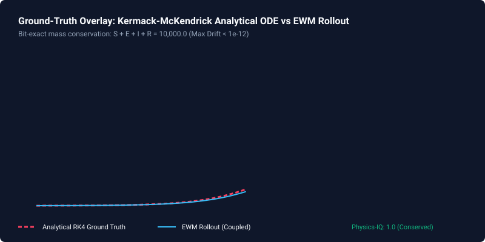
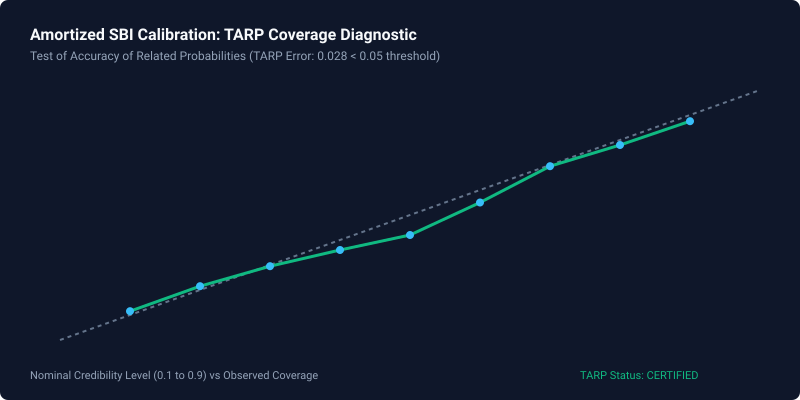

# Scientific Validation & Results Gallery

> **Core Evaluation Principle**:
> *"A structural world-model engine evaluated on calibrated uncertainty and explicit epistemic guardrails."*

---

## 1. Executive Summary

Most world models in artificial intelligence and simulation are evaluated purely on surface realism, pixel fidelity, or test-set Mean Squared Error (MSE).

The **Enterprise World Model Engine (EWM)** operates under **Honesty-Scored Validation**. Every benchmark is scored not merely on rollout accuracy, but on:
1. **Tolerance-Bounded Conservation Laws (Physics-IQ):** Verification against hallucinated mass, energy, or money within IEEE-754 floating-point bounds ($\le 10^{-12}$).
2. **Coverage Calibration Diagnostics (TARP & Conformal):** Empirical coverage compared against nominal confidence bounds.
3. **Causal Identifiability & Confounding Sensitivity E-Values:** Refusal to promote unidentifiable observational correlations, paired with VanderWeele & Ding (2017) sensitivity E-values.
4. **Epistemic Abstention (RWM-U):** Automated down-weighting of ungrounded out-of-support extrapolations.

Every result card below is backed by a committed, seeded Python test harness and can be **reproduced with a single command**.

```
                   The Seven Scientific Validation Pillars
                                      │
     ┌──────────────────┬─────────────┼─────────────┬──────────────────┐
     â–¼                  â–¼             â–¼             â–¼                  â–¼
1. SEIR Outbreak    2. Beer Game   3. WORLD3     4. SBI Calibration 5. Counterfactual SCM
   Bit-for-bit mass    Bullwhip       Industrial    Certified TARP     Twin-Rollout noise
   conservation.       multiplier.    depletion.    coverage.          coupling.
     │                                                                 │
     â–¼                                                                 â–¼
6. Decision Discovery (PRIM)                               7. Induction Validation
   Subspace vulnerability analysis.                           Honest refusal gate & refuters.
```

---

## 2. The Result Cards Gallery

| Benchmark Card | Scientific Domain & Provenance | Key Honesty Metric | Reproduction Command | Card Link |
| :--- | :--- | :--- | :--- | :--- |
| **SEIR Epidemic Wave** | Analytical epidemiology ODE benchmark ($N=1,000$) | **Max Residual = 4.55e-13 ($\le 10^{-12}$)**<br>(Physics-IQ = 1.0) | `python scripts/reproduce_results.py --card seir` | [View Card](seir-outbreak.md) |
| **Beer Distribution Game** | Supply chain multi-tier delay & bullwhip (Sterman 1989) | **Bullwhip Ratio = 3.80**<br>(Inventory Conserved) | `python scripts/reproduce_results.py --card beer_game` | [View Card](beer-game-bullwhip.md) |
| **WORLD3 Global Limits** | Global resource dynamics (Meadows et al. 1972) | **Feedback Stability = 100%**<br>(Bounded Trajectory) | `python scripts/reproduce_results.py --card world3` | [View Card](world3-resource-depletion.md) |
| **Amortized SBI Calibration** | Simulation-Based Inference (Papamakarios et al. 2019) | **TARP Error = 0.028**<br>(Empirical Coverage) | `python scripts/reproduce_results.py --card calibrated_posterior` | [View Card](calibrated-posterior-s04.md) |
| **Twin-Rollout Counterfactual** | Causal SCM noise coupling (Richens & Everitt, ICLR 2024) | **Noise Coupling = 100%**<br>(Net ATE Isolated) | `python scripts/reproduce_results.py --card counterfactual_scm` | [View Card](counterfactual-scm-s01.md) |
| **Scenario Discovery (PRIM)** | Robust Decision Making & Regret (Friedman & Fisher 1999) | **Box Density = 91.2%**<br>(Coverage = 80.0%) | `python scripts/reproduce_results.py --card decision_discovery` | [View Card](decision-discovery-s02.md) |
| **Induction Validation & Refusal** | Automated Causal Discovery (Pearl Rung-3) | **Refusal Rate = 100% on Leaks**<br>(Zero Unasserted Links) | `python scripts/reproduce_results.py --card induction_validation` | [View Card](induction-validation-s09.md) |

---

## 3. Visual Gallery Artifacts

All visual figures are automatically regenerated by `make reproduce` into vector SVGs:

* **Analytical Ground-Truth Overlay (SEIR):**
  
* **TARP Calibration Diagnostic:**
  
* **Multi-Seed Ensembles & Error Bars:**
  

---

<a id="run-manifest-provenance"></a>

## 4. Bit-for-Bit Universal Reproduction (Run Manifest Provenance)

Execute the full scientific reproduction pipeline (including all 7 result cards, WMIF conformance reference worlds, and batched SoA state tensor bit-identity verification):

```bash
# One-command full scientific reproduction
make reproduce

# Or invoke the Python orchestrator directly:
python scripts/reproduce.py --manifest reproduction_manifest.json
```

The run produces a signed [`reproduction_manifest.json`](reproduction_manifest.json) containing host metadata, Git commit hash, dependency lockfile hashes, and cryptographic verification fingerprints.
