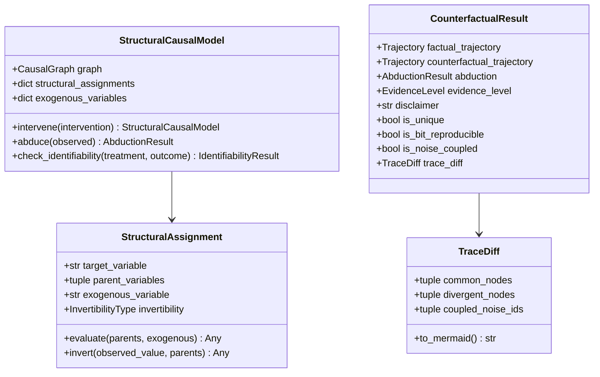

# FEAT-008: Twin-Rollout Counterfactual SCM Kernel

- **Status:** Approved / Implemented
- **Horizon:** v1.6.0 "Twin-Rollout SCM Kernel & Native Pearl Counterfactuals"
- **Authors:** Causal Simulation Engineering & Platform Architecture
- **Governance:** [`frontier-roadmap.md`](../../architecture/frontier-roadmap.md) (Causal Epistemics), ADR-040, ACP-009
- **Dependencies:** Core engine (Zero new dependencies: stdlib, NumPy, Pydantic); Optional extras: `[causal]` (DoWhy, Causal-Learn)

---

## 1. Motivation & Context

The 2024–2026 causal machine learning and simulation frontier is converging on explicit causal world models: grounding simulation substrate in explicit structural assignments, interventional graph surgery (`do()`), and counterfactual rollouts. However, existing commercial and open-source simulators focus predominantly on raw pixels or robotics physics engines, leaving enterprise decision systems without a formal causal simulation substrate.

The scientific license for EWM Engine's architecture is anchored in the landmark theorem by **Richens & Everitt ("Robust agents learn causal world models", ICLR 2024 oral, arXiv:2402.10877)**:
> *Any agent capable of robustly generalizing across arbitrary distribution shifts must have learned an internal model that approximates the true structural causal model of the environment.*

By separating **KNOWN** deterministic structural rules and constraints from **LEARNED** probabilistic dynamics, EWM Engine provides an honest, auditable, and mathematically grounded foundation for enterprise simulation.

Prior to FEAT-008, EWM Engine treated causality primarily as an evaluation and claim-validation gate (backdoor/ID checks, E-values, observational vs interventional tagging). FEAT-008 elevates the typed world graph into a **first-class Structural Causal Model (SCM)**, delivering honest, seeded, bit-reproducible **Pearl Rung-3 counterfactuals** via **Twin-Rollout noise coupling**.

---

## 2. Requirements & Acceptance Criteria

### 1. Typed Graph to Structural Causal Model Compilation
- **AC-058 (SCM View & Structural Assignments):**
  - Compile `World`, `WorldSpec`, and `WorldState` into an immutable `StructuralCausalModel` view without creating a disjoint mutable state model.
  - Model every rule, transition, and dynamic update as a structural assignment $V_i := f_i(\text{PA}_i, U_i)$, where $\text{PA}_i$ are endogenous parent variables and $U_i$ are addressable exogenous noise variables.
  - Derive exogenous noise streams deterministically from the hierarchical `SeedSequence` tree; forbid global unseeded RNGs.
  - Record addressable exogenous noise draws in `SystemicTrace.exogenous_noise` with canonical SHA-256 fingerprinting (`exogenous_noise_fingerprint`).

### 2. Native Pearl Counterfactuals & Twin-Rollout Coupling
- **AC-059 (Abduction–Action–Prediction Engine):**
  - Implement Pearl's three-step counterfactual algorithm natively in `CounterfactualEngine` and expose via `world.counterfactual(observed_trajectory, intervention=...)`:
    1. **Abduction:** Given an observed trajectory $\tau_{\text{fact}}$, invert structural assignments to recover or sample the posterior over exogenous noise $P(U \mid \tau_{\text{fact}})$.
    2. **Action:** Apply causal surgery $do(X = x)$ by mutilating the targeted structural assignments $V_k := x$ while holding non-targeted mechanisms intact.
    3. **Prediction:** Re-run simulation rollouts under the intervened structural assignments using the exact same coupled noise draws $U$.
  - Enforce **Twin-Rollout coupling**: factual and counterfactual branches share exogenous noise bit-for-bit, ensuring that observed differences are purely attributable to the causal intervention.
  - Enforce **Invariant 5 (Bit-Level Reproducibility)**: identical factual trajectories and interventions produce bit-identical counterfactual states and fingerprints across independent runs.

### 3. Epistemic Honesty Guardrails
- **AC-060 (Rung-3 Evidence Scoping & Identifiability Guard):**
  - Tag all counterfactual outputs with `EvidenceLevel.COUNTERFACTUAL = "counterfactual"`.
  - Attach a mandatory epistemic disclaimer: counterfactuals are evaluated strictly within the simulated SCM and represent *model-counterfactuals*, not validated real-world counterfactuals without empirical ground truth.
  - When mechanism inversion is algebraically non-unique (non-invertible mechanism), warn via `NonUniqueAbductionWarning`, set `is_unique = False`, and return a posterior distribution of candidate trajectories; never emit a false point counterfactual.
  - Integrate with the population ID-gate: refuse population-level causal claims if the graph structure fails mathematical identifiability (e.g. unobserved confounding across treatment and outcome).
  - Strictly prohibit emitting synthetic `"causes"` graph relationships.

### 4. Legibility & Trace Divergence
- **AC-061 (Systemic Trace Divergence & Visualization):**
  - Implement `TraceDiff` and `SystemicTrace.diff()` calculating structural divergence between factual and counterfactual executions.
  - Isolate invariant nodes, divergent target nodes, and unobserved noise variables.
  - Export Mermaid flowchart notation (`TraceDiff.to_mermaid()`) highlighting causal paths and invariant boundaries.
  - Provide a reference worked example (`examples/counterfactual_warehouse_reroute.py`) modeling warehouse stockout prevention under identical exogenous demand shocks.

---

## 3. Data Model & Formal Semantics

---

## 4. Verification & Testing Matrix

| Test Suite | File | Focus |
| :--- | :--- | :--- |
| **Unit (SCM)** | `tests/unit/test_scm.py` | SCM compilation, graph surgery, exact & sampled abduction, ID-gate integration. |
| **Unit (Counterfactual)** | `tests/unit/test_counterfactual.py` | Pearl 3-step rollout, Twin-Rollout coupling, bit-reproducibility, non-unique abduction guards. |
| **Contract** | `tests/contract/test_scm_counterfactual_contract.py` | Fingerprint equivalence, structural locality preservation, disclaimer enforcement, prohibition of `"causes"`. |
| **Worked Example** | `examples/counterfactual_warehouse_reroute.py` | Executable warehouse stockout reroute, Mermaid diagram export, zero-leak treasury locality. |
