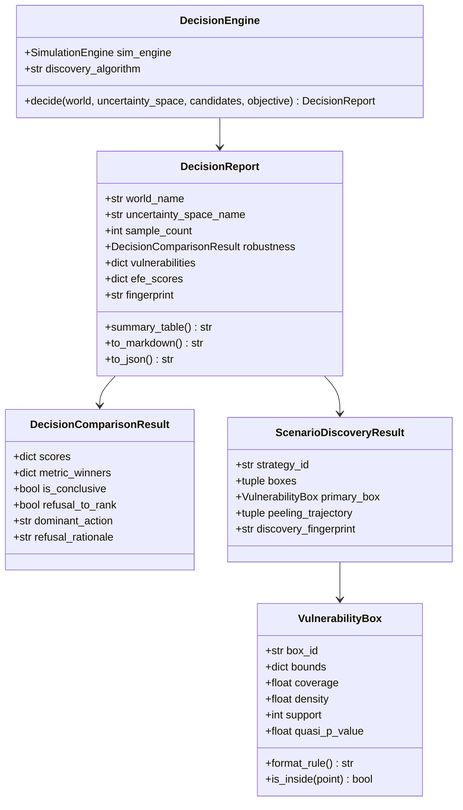

# FEAT-009: Decision-Focused Scenario Discovery & Multi-Robustness Adjudication

- **Status:** Approved / Implemented
- **Horizon:** v1.7.0 "Decision-Focused Scenario Discovery & Multi-Robustness Adjudication"
- **Authors:** Decision Science, Platform Architecture & Optimization Teams
- **Governance:** [frontier-roadmap.md](../../architecture/frontier-roadmap.md) (Decision Intelligence), ADR-041, ACP-010
- **Dependencies:** Core engine (Zero new mandatory dependencies: stdlib, NumPy, Pydantic); Optional extras: `[decision]` (ema-workbench), `[cli]` (rich)

---

## 1. Motivation & Context

Prior to FEAT-009, EWM Engine evaluated simulations and models primarily through **rollout accuracy, trajectory calibration, and Pareto scorecards**. However, decades of research across Robust Decision Making (RDM; Lempert et al., 2003, 2006) and Decision-Focused Learning (DFL; Elmachtoub & Grigas, 2022; Mandi et al., 2023) demonstrate that under **deep uncertainty**, minimizing forecast error does not yield robust real-world decisions.

Decision-makers face two critical challenges:
1. **Scenario Generation vs. Scenario Discovery:** Generating Monte Carlo clouds shows *what could happen*, but fails to answer *under which specific conditions a given strategy breaks*.
2. **The Metric Trap:** Forcing a single optimization criterion or expected-utility ranking assumes a known probability distribution over futures. In reality, different robustness criteria (Min-Max Regret, Tail Regret, Satisficing) favor completely different policies (McPhail et al., 2018).

FEAT-009 reframes the Enterprise World Model Engine from a predictive simulator into a **decision instrument**, introducing:
1. **Patient Rule Induction Method (PRIM)** and **CART** to automatically discover interpretable vulnerability regions.
2. **Multi-Robustness Evaluation** (Min-Max Regret, CVaR Regret, Satisficing) with an explicit, programmatic **refusal to rank** when metrics disagree.
3. **Active Inference Expected Free Energy (EFE)** action scoring, mathematically rewarding actions that reduce the engine's own uncertainty.
4. The **`ewm decide`** command-line interface and structured multi-surface reports.

---

## 2. Requirements & Acceptance Criteria

### Sub-track 1: Scenario Discovery via PRIM & CART
- **AC-062 (Vulnerability Box Discovery):**
  - Implement the Patient Rule Induction Method (PRIM; Friedman & Fisher, 1999) in pure NumPy with iterative peeling, density/coverage trade-off analysis, and quasi-p-value significance testing.
  - Implement CART rule extraction via recursive binary Gini partitioning.
  - Provide `VulnerabilityBox` capturing restricted parameter intervals, coverage (recall), density (precision), support, and human-readable predicate representations.
  - Enforce Invariant 5 (Bit-Level Reproducibility): discovery algorithms are deterministic and yield canonical SHA-256 fingerprints (`discovery_fingerprint`).
  - Provide an optional integration adapter for EMA Workbench (`[decision]` extra).

### Sub-track 2: Multi-Robustness Adjudication & Refusal to Rank
- **AC-063 (Multi-Metric Robustness & Disagreement Refusal):**
  - Evaluate candidate decisions across at least three distinct robustness criteria:
    1. **Min-Max Regret:** Worst-case regret minimization (Savage, 1951).
    2. **Percentile / CVaR(90) Regret:** Conditional Value at Risk over tail regrets (Rockafellar & Uryasev, 2000).
    3. **Starr's Domain Criterion / Satisficing:** Probability of meeting an operational target threshold (Starr, 1962; Simon, 1955).
  - Compute exact regret matrices relative to the hindsight-optimal action in each scenario.
  - **Epistemic Honesty Invariant:** When robustness metrics disagree on the winning candidate (McPhail et al., 2018), the engine must **refuse to declare a single winner** (`refusal_to_rank=True`, `dominant_action=None`), emit a detailed rationale explaining the trade-offs, and prohibit algorithmic overclaiming.

### Sub-track 3: Active Inference Expected Free Energy Scorer
- **AC-064 (Active Inference Action Scoring):**
  - Implement `ActiveInferenceScorer` computing Expected Free Energy (EFE; Friston, 2010; Da Costa et al., 2024):
    $$\text{Total EFE} = (1 - \beta) \cdot \text{PragmaticValue} + \beta \cdot \text{EpistemicValue}$$
  - Quantify pragmatic value from expected goal achievement and epistemic value from empirical mutual information / parameter uncertainty reduction.
  - Expose EFE as an optional scorer alongside regret metrics.

### Sub-track 4: `ewm decide` CLI & Structured Reporting
- **AC-065 (CLI Subcommand & Multi-Surface Reporting):**
  - Provide `ewm decide` command: given a WorldSpec, candidate actions, and an uncertainty space, execute ensemble rollouts, run scenario discovery, evaluate multi-robustness metrics, and emit a structured decision report.
  - Provide `DecisionReport` with export to JSON, Markdown, and console summary tables.
  - Forbid marketing or overclaiming phrases (e.g., "guarantees optimal").

---

## 3. Data Model & Architecture

---

## 4. Verification & Testing Matrix

| Test Suite | File | Focus |
| :--- | :--- | :--- |
| **Unit (Discovery)** | `tests/unit/test_decision_discovery.py` | PRIM peeling loop, CART partitioning, coverage/density calculations, quasi-p-values, zero-failure edge cases. |
| **Unit (Robustness)** | `tests/unit/test_decision_robustness.py` | Min-max regret, CVaR regret, satisficing rate, unanimous winner vs. multi-metric refusal to rank. |
| **Unit (Active Inference)** | `tests/unit/test_decision_efe.py` | Pragmatic vs. epistemic decomposition, beta weight trade-off, information gain sensitivity. |
| **Contract** | `tests/contract/test_decision_contract.py` | Fingerprint equivalence (Invariant 5), anti-overclaiming check, CLI `ewm decide` execution and JSON/Markdown generation. |
