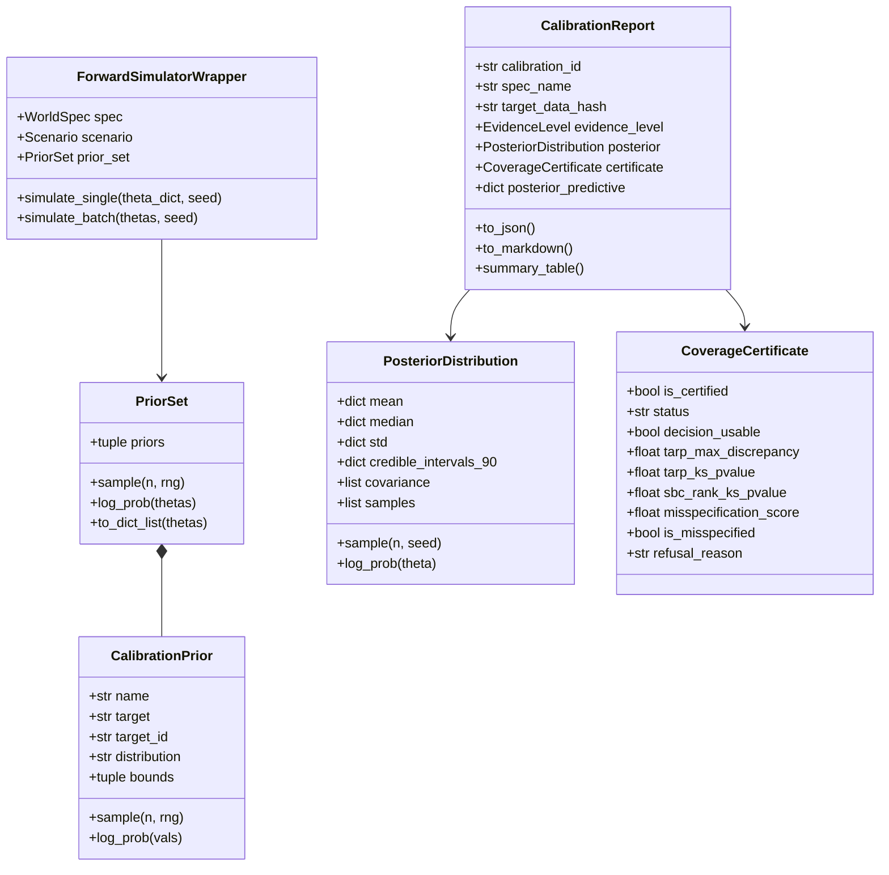

# FEAT-011: Amortized Calibration with Certified Coverage (`ewm calibrate`)

- **Status:** Approved / Implemented
- **Horizon:** v1.8.0 "Amortized Simulation-Based Calibration"
- **Authors:** Simulation Intelligence, Calibration Engineering & Causal Verification Teams
- **Governance:** [frontier-roadmap.md](../../architecture/frontier-roadmap.md) (Amortized Calibration), ADR-043
- **Dependencies:** Core engine (Zero mandatory dependencies: stdlib, NumPy, Pydantic); Optional extras: `[sbi]`/`[calibrate]` (scipy, scikit-learn, lazy torch)

---

## 1. Motivation & Context

The Enterprise World Model Engine simulates complex socio-technical systems using seeded Monte Carlo rollouts, but had no principled way to calibrate parameters against real empirical data or to certify the validity of that calibration.

Hand-tuning simulation parameters is neither reproducible nor scientifically honest. Simulation-Based Inference (SBI) solves this by treating the deterministic/seeded EWM engine as the forward generative model $\theta \to x$, learning an **amortized posterior distribution over parameters** $p(\theta \mid x_{obs})$. 

Critically, because EWM Engine's core identity is epistemic honesty, calibration ships with **mandatory coverage certification** (TARP, Posterior-SBC) and **misspecification detection**. The engine actively refuses to report or permit uncertified posteriors for downstream decision making (`ewm decide`), mirroring the causal "refuse when non-identifiable" doctrine.

---

## 2. Requirements & Acceptance Criteria

### Sub-track 1: Simulator-as-Forward-Model SBI
- **AC-070 (Forward Model Wrapper & Parameter Priors):**
  - Implement `CalibrationPrior` supporting `uniform`, `gaussian`, and `log_uniform` distributions with strict boundary enforcement.
  - Implement `PriorSet` multivariate prior container with joint sampling and log-density evaluation.
  - Implement `ForwardSimulatorWrapper` mapping $\theta \in \mathbb{R}^D \to x \in \mathbb{R}^P$ via seeded, deterministic simulation rollouts.
  - Support both `trajectory` (full series) and `moments` (mean, std, min, max, final) summary feature extraction modes.

- **AC-071 (Amortized Posterior Estimator & Non-Point Distributions):**
  - Implement `AmortizedPosteriorEstimator` learning $p(\theta \mid x)$ in pure NumPy (locally linear kernel-conditioned Bayesian estimator), with zero heavy dependencies and optional delegation to `sbi.inference.SNPE`.
  - Implement `PosteriorDistribution` representation.
  - **Non-Point Invariant:** The estimator must never return a bare point estimate. It must always emit posterior mean, median, standard deviations, full covariance matrix, and 90% equal-tailed credible intervals.

### Sub-track 2: Mandatory Coverage Certification & Refusal Gate
- **AC-072 (TARP Coverage Testing & Posterior-SBC):**
  - Implement `compute_tarp_coverage` (Lemos et al., ICML 2023, arXiv:2302.03026): test empirical coverage across nominal credibility levels $\alpha \in [0.1, 0.9]$ using Euclidean distances to reference points, with 1-sample Kolmogorov-Smirnov uniformity tests.
  - Implement `compute_posterior_sbc` (Posterior Simulation-Based Calibration, arXiv:2502.03279): conditional on observed telemetry $x_{obs}$, re-infer parameter ranks under posterior draw forward rollouts and evaluate rank uniformity.

- **AC-073 (Misspecification Diagnostic & Decision Refusal Gate):**
  - Implement `compute_misspecification_diagnostic` (Huang et al., NeurIPS 2023, arXiv:2305.15871): compute standardized feature distance of $x_{obs}$ from the simulator predictive manifold.
  - Severe Misspecification ($> 3.5\sigma$) or failed coverage ($>\text{threshold}$) flags `is_certified=False` and `decision_usable=False`.
  - Downstream decision engines (`ewm decide`) reject uncertified calibrations.

### Sub-track 3: SCM & Evidence Linkage
- **AC-074 (Epistemic Tier Honesty & Calibration Artifact):**
  - Certified calibration promotes simulation output to `EvidenceLevel.PREDICTIVE`.
  - **Calibrated $\neq$ Identified:** The engine explicitly disclaims causal identification; counterfactual validity still requires structural backdoor or instrumental identification (Structural Causal Model).
  - Emit reproducible calibration artifacts (`CalibrationReport`) containing data SHA-256 hash, prior specifications, posterior statistics, coverage certificate, posterior predictive overlay, and execution manifest.

### Sub-track 4: CLI & Worked Example
- **AC-075 (CLI Command & Reference Example):**
  - Expose `ewm calibrate <spec_file> --data <data_file> [options]` in `src/ewm_engine/cli/main.py`.
  - Provide complete worked example in `examples/calibrated_warehouse/` demonstrating end-to-end calibration, posterior predictive overlay, and refusal of impossible data.

---

## 3. Architecture & Data Structures

