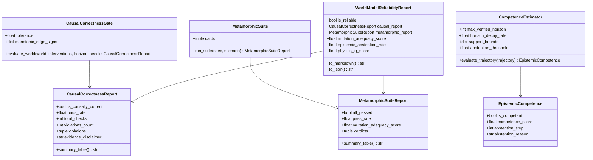

# FEAT-012: Causal-Correctness and Metamorphic Self-Knowledge Reliability Suite

- **Status:** Approved / Implemented
- **Horizon:** v1.9.0 "Model Reliability Beyond Rollout Error"
- **Authors:** Simulation Architecture, Evaluation & Verification Teams
- **Governance:** [frontier-roadmap.md](../../architecture/frontier-roadmap.md) (Causal Correctness), ADR-044
- **Dependencies:** Core engine (Zero mandatory heavy dependencies: stdlib, pure NumPy, Pydantic); integrates with SCM Kernel and Decision Engine (`ewm decide`)

---

## 1. Motivation & Context

Standard evaluation metrics (RMSE, CRPS, log scores, conformal intervals) measure predictive calibration under the observed training distribution. However, frontier research (Vafa et al. 2024, 2025; Motamed et al. 2025; Kang et al. 2025) demonstrates that predictive accuracy is uncorrelated with physical correctness and says nothing about whether a model responds correctly to interventions $do(X = x)$.

In an enterprise world model, point predictions are meaningless if intervening on inventory in Warehouse A causes spurious cross-talk in independent accounts, or if a model extrapolates with high confidence far outside its verified operational envelope.

FEAT-012 transforms world-model reliability into **first-class scored features**:
1. Causal intervention-selectivity and Twin-Rollout counterfactual gates.
2. Label-free metamorphic relations (MR-cards) with certified mutation adequacy.
3. Epistemic abstention signals wired into decision optimization.
4. The Physics-IQ doctrine: *plausibility is never a proxy for correctness*.

---

## 2. Requirements & Acceptance Criteria

### Sub-track 1: Causal-Correctness & Intervention Selectivity Gates
- **AC-076 (Descendant Selectivity):**
  - Given an SCM compiled from `WorldSpec`, for any intervention $do(X = x)$, assert that only descendants of $X$ diverge between factual and counterfactual rollouts under coupled exogenous noise.
  - All non-descendant variables $Y \notin \text{Descendants}(X) \cup \{X\}$ must strictly satisfy $|Y_{cf}(t) - Y_{factual}(t)| \le \text{tolerance}$ across all steps.
  - Violations must be recorded as `InterventionSelectivityViolation` with type `non_descendant_divergence`.
- **AC-077 (Monotonic Edge Sign Consistency):**
  - For descendants with declared monotonic edge signs ($X \to D$ positive or negative), assert that $\text{sign}(D_{cf} - D_{factual})$ matches the declared direction under intervention.
  - Inversions must be flagged as `monotonicity_sign_inversion`.
- **AC-078 (Anti-Overclaiming Gate):**
  - Passing causal gates certifies consistency with the assumed structural graph; it does not claim to have discovered unconditional physical truth, nor does it automatically upgrade `EvidenceLevel`.

### Sub-track 2: Metamorphic Relations & Mutation Adequacy
- **AC-079 (Standard MR-Cards):**
  - Implement executable MR-cards:
    - `MR_DETERMINISM`: Identical seed + config $\implies$ bit-identical state hashes.
    - `MR_CONSERVATION`: Total mass balance across steps matches recorded applied flows (zero unmetered leakage).
    - `MR_SCALING`: Proportional scaling of initial resource levels.
    - `MR_MONOTONICITY`: Boosting initial stock cannot decrease terminal availability.
    - `MR_ENTITY_PERMUTATION`: Isomorphic entity ID renaming preserves numerical trajectories.
    - `MR_CONSTRAINT_SLACK`: Adding a non-binding slack constraint leaves valid rollouts unchanged.
- **AC-080 (Mutation Adequacy Score):**
  - Implement `MutationAdequacyEvaluator` injecting non-equivalent synthetic structural defects:
    - `UnmeteredLeakageDynamics` (leakage mutant)
    - `UnseededJitterDynamics` (non-determinism mutant)
    - `PermutationBiasDynamics` (entity bias mutant)
  - Assert that the metamorphic suite kills synthetic mutants with a mutation adequacy score $\ge 80\%$.

### Sub-track 3: Epistemic Abstention & Decision Wiring
- **AC-081 (Competence Estimator & Epistemic Abstention):**
  - Implement `CompetenceEstimator` evaluating continuous competence score $C \in [0, 1]$ based on exponential horizon decay, historical support bounds, and non-negativity constraint proximity.
  - Emit `EpistemicCompetence` with explicit `abstention_step` and `abstention_reason`.
- **AC-082 (Decision Engine Wiring):**
  - Wire competence scoring into `DecisionEngine.decide` via `weight_by_competence=True` and `filter_abstained=True`.
  - Abstained or out-of-support rollouts are down-weighted or penalized during candidate scenario discovery and robustness evaluation.
- **AC-083 (Physics-IQ Guardrail):**
  - Implement `PhysicsIQGuardrail` auditing physical invariants (non-negativity of mass, conservation of closed resource groups).
  - Explicit doctrine: Output plausibility and perceptual realism are never used as correctness proxies.

### Sub-track 4: Unified Reliability Report & CI Verification
- **AC-084 (WorldModelReliabilityReport):**
  - Implement `WorldModelReliabilityReport` aggregating causal report, metamorphic report, mutation adequacy, competence/abstention rate, and Physics-IQ score.
  - Provide `summary_table()`, `to_markdown()`, and `to_json()`.
  - Deterministic gates run in CI; expensive probes can run nightly.

---

## 3. Architecture & Data Structures

